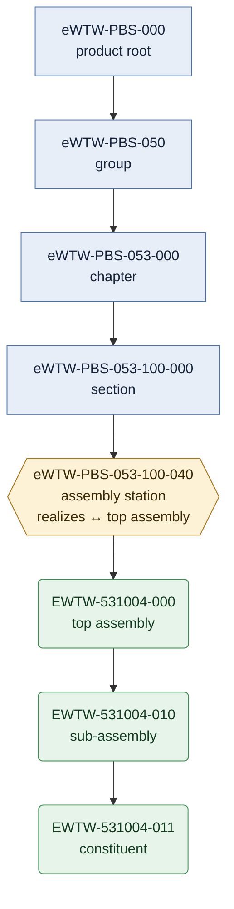

# eWTW — Product Breakdown Structure (PBS)

**Product:** AMPEL360 · eWTW — regional electric Wide Tube and Wing
**Location:** `01_OPTIONS_ARCHITECTURE/01-02_PROGRAMMES/01-02-01_AMPEL360/01-02-01-01_MODELS/01-02-01-01-01_eWTW/01-02-01-01-01-01_SBS_System-Breakdown-Structure/01-02-01-01-01-01-01_PBS_Product-Breakdown-Structure/`
**Governing convention:** [`AMPEL360-PBS-PN-CM-001`][CM-001] Issue 2 (this folder) · cross-view identity: [`AMPEL360-SBS-ID-CM-002`][CM-002]
**Version:** 0.2.1 · **Date:** 2026-10-15
**Snapshot:** every count and result on this page refers to `main` at `72039505cefdbb9aa6450d713c655f5058374550` (committed 2026-10-13), checked on 2026-10-15 — see [How to verify](#how-to-verify).

The PBS is the product view of the eWTW [SBS][SBS]. It is where identity passes from taxonomy-linked codes to part numbers: every subject node is an **assembly station** — above it a node is named by a PBS-local code, below it by a part number. The convention draws this boundary for physical assemblies; software and digital configuration items have no profile yet (N6). Model-level decisions, open KNOTs and the findings register live in the [model README][MODEL]. This page covers how the PBS is numbered, what it contains, where it departs from its convention, and where the convention itself is still open.

---

## Contents

1. [Numbering convention](#numbering-convention)
2. [Structure](#structure)
3. [Chapter 053 — Fuselage Wide-Tube](#chapter-053--fuselage-wide-tube)
4. [Node anatomy](#node-anatomy)
5. [Lifecycle and change control](#lifecycle-and-change-control)
6. [Deviations on record](#deviations-on-record)
7. [Open points in the convention](#open-points-in-the-convention)
8. [How to verify](#how-to-verify)
9. [Revision history](#revision-history)

---

## Numbering convention

PBS codes are **programme-local, conserved identifiers — never taxonomy addresses** (CM-001 §3.1). The link to the S-ATLAS taxonomy is carried only by mapping: `taxonomyRef` on every node and, at station grain, `realizes:` with its `realizesNote`. The prose formula is "realizes S-ATLAS `<address>`", never "is S-ATLAS `<code>`".

### Node levels

| Level | Identifier | Example |
|---|---|---|
| Product root | `eWTW-PBS-000` | `eWTW-PBS-000_Aircraft-Product` |
| Group | `eWTW-PBS-0X0` (bands `010` … `090`) | `eWTW-PBS-050_Airframe-Structure` |
| Chapter | `eWTW-PBS-<CCC>-000` | `eWTW-PBS-053-000_Fuselage-Wide-Tube` |
| Section | `eWTW-PBS-<CCC>-<S00>-000` (hundreds grid) | `eWTW-PBS-053-100-000_Nose-and-Forward-Fuselage-Structure` |
| Subject = assembly station | `eWTW-PBS-<CCC>-<S00>-<0U0>` (tens within the section) | `eWTW-PBS-053-100-040_Radome-and-Diverters-Attach-Structure` |

Machine references use the full identifier. The validator also accepts the short forms `eWTW-PBS-053` and `eWTW-PBS-053-100`, reading them as the chapter and section `-000` nodes, but only when no node carries the short code itself. That precedence is written in the validator, not in CM-002 (N5); without it, `eWTW-PBS-010`, `-030`, `-080` and `eWTW-PBS-053-000` would each name two nodes. Group `090` departs from the chapter pattern: its nodes are section-grain stubs (`090-100`, `090-300`, `090-500`). Group `080` holds a single reserved chapter, `080-000` *Reserved Future*.

### The identity boundary



Square boxes carry PBS-local codes, linked to the taxonomy by mapping. Rounded boxes carry product identity — part number, revision, effectivity (CM-001 §2). The station (hexagon) is where one becomes the other. The folder part number names an occurrence by its position, as designed; a part reused elsewhere keeps one catalog identity through `catalog_pn` (CM-001 §6). CM-001 defines no instance (serial) identity.

CM-001 requires each station to hold exactly one top assembly and one `station.yaml` recording the handshake `realizes ↔ top_assembly` (§2, §5); on disk the top assembly is identified by its folder alone (N3). A part-number change never implies a taxonomy change, and a taxonomic decomposition never implies a part-number decomposition (CM-001 §2).

### From station code to part number

| Element | Rule | Example |
|---|---|---|
| CSN (compact system number) | Chapter `CC` + section `SS` + subject `UU`, taken from the PBS-local code and immune to taxonomy evolution (CM-001 §3.2). The derivation holds for chapters `0CC`, sections `S00` and subjects `0U0`: at most nine stations per section (N7) | `053-100-040` → `53 10 04` → `531004` |
| Part number | `EWTW-<CSN>-<VAR>[-<VAR>…]`; `EWTW` is the model identity code (CM-001 §4) | `EWTW-531004-012` |
| `<VAR>` | `000` the assembly itself; `010`, `020` … find groups; `+1` … `+9` constituents or variants inside a group; nest deeper by appending another ×10 group | `-010` group, `-011` / `-012` its members |
| Roles | `role` in `part.yaml`; the vocabulary follows the record form (see [Node anatomy](#node-anatomy)). The role definitions are in CM-001 Clarification C1.1, which is not on `main` (F10) | `role: "constituent"` |
| Handedness | Odd/even encodes LH/RH **only for true mirrored pairs**; a same-side stack is UPPER/LOWER; renaming never changes the PN (CM-001 §4.1) | — |
| Quantities | A group with enumerated children is a set (`set of N`); unit quantities sit on the leaves; rollups count leaves only (CM-001 §4.2). Repeated occurrences and effectivity are not yet covered (N8) | — |
| Reuse | One physical part keeps one identity through `catalog_pn`; the folder P/N is positional (CM-001 §6). No part record carries `catalog_pn` yet (N9) | — |
| Interfaces | `ICD-EWTW-<CSN>-<counterpart>`: a 6-digit counterpart is a station (by CSN), a 3-digit one is a taxonomy chapter (CM-001 §7) | `ICD-EWTW-531002-538003` · `ICD-EWTW-533001-021` |
| Status | `PLANNED` or `realized`; `realized` only when every breakdown row exists on disk (CM-001 §8). It measures materialization of the breakdown and nothing else: schema conformance, lifecycle stage and baseline ratification are recorded separately | `status: PLANNED` |

---

## Structure

The product root and its group table are in [`eWTW-PBS-000_Aircraft-Product`][ROOT].

| Group | Title | Child nodes (PBS-local) | Content |
|---|---|---|---|
| `eWTW-PBS-010` | Ground and Servicing Interfaces | `010` · `011` · `012` | Scaffold |
| `eWTW-PBS-020` | Core Systems | `021` … `029` | Scaffold |
| `eWTW-PBS-030` | Protection and Mechanical Systems | `030` … `036` · `038`† | Scaffold; `036` is held as *Pneumatic Vacated* |
| `eWTW-PBS-040` | Avionics, Information and Auxiliary Power | `042` · `045` · `046` · `049` | Scaffold |
| `eWTW-PBS-050` | Airframe Structure | `051` … `057` | [`053`][PBS-053] planned in depth — 10 sections, 59 stations, 431 part nodes; the other chapters are scaffolds |
| `eWTW-PBS-070` | Electric Propulsion | `071`† · `073`† · `074`† · `076`† · `077`† · `078`† | Scaffold |
| `eWTW-PBS-080` | Alternative and Quantum Propulsion | `080-000`† (reserved) | Scaffold |
| `eWTW-PBS-090` | Software and Digital Configuration Items | `090-100`† · `090-300`† · `090-500`† | Scaffold |

† No taxonomy mapping recorded: 8 chapter nodes and 3 section-grain stubs (model finding F03). PBS-local titles need not match the S-ATLAS chapter of the same number: PBS `074` is *Propulsion Power Electronics*, S-ATLAS `074` is *Propulsion Energy Storage Systems*. No group exists for combustion propulsion (S-ATLAS `060`–`069`); one is opened only if the propulsion decision admits a thermal machine (`KNOT-EWTW-PRP-001`).

---

## Chapter 053 — Fuselage Wide-Tube

| Section | Title | Stations | Part nodes | Declared station form | Depth pass |
|---|---|:-:|:-:|---|---|
| `053-000` | General | 4 | 53 | Issue 2 | Applied |
| `053-100` | Nose and Forward Fuselage Structure | 6 | 70 | Issue 2 · 1 Amendment A1 (`-040`, migration-locked) | Applied |
| `053-200` | Center Fuselage Structure | 6 | 41 | Amendment A1 | Engine on `main`, not applied — plans 40 new nodes |
| `053-300` | Aft Fuselage Structure | 4 | 47 | Issue 2 | Applied |
| `053-400` | Tailcone and Auxiliary Power Module Structure | 5 | 21 | Amendment A1 | Pending |
| `053-500` | Fuselage Skin Panels and Doublers | 6 | 48 | Amendment A1 | Pending |
| `053-600` | Frames, Stringers and Longerons | 9 | 54 | Amendment A1 | Pending |
| `053-700` | Floor and Pressure Deck Structure | 6 | 31 | Amendment A1 | Pending |
| `053-800` | Pressure Bulkheads and Major Attach Fittings | 8 | 41 | Amendment A1 | Pending |
| `053-900` | Energy Carrier Structural Integration | 5 | 25 | Amendment A1 | Pending |
| **Total** | | **59** | **431** | 13 Issue 2 · 46 Amendment A1 | |

The form is the one each record declares in `convention:`. A declared form is not validated conformance: no record meets the Issue 2 station contract in full (N3). Every station is `PLANNED`. Two stations serve as references:

- **Rear fuselage zone** [`eWTW-PBS-053-300-010`][N-533001] (`EWTW-533001-000`) — the pilot station carried across the SBS views: concept geometry with its generator, STEP and GLB exchange files, a verification report, and the proposed integrated baseline `BL-053-300-010-A2`.
- **Radome attach structure** [`eWTW-PBS-053-100-040`][N-531004] (`EWTW-531004-000`) — the worked exemplar of CM-001 §4.3, held under a migration lock; its record on disk departs from that exemplar (N1).

---

## Node anatomy

**Folder identity is SSOT; YAML mirrors it** (CM-001 §5).

| Node | Carries |
|---|---|
| Group, chapter, section | `pbs-node.yaml` (`taxonomyRef`) and `README.md`; chapter `053` and each of its sections also carry the derived `pbs-item-register.yaml` |
| Station (subject) | `station.yaml` on the single station schema of CM-001 §5 (the records on disk depart from it: F04, N3); `pbs-item.yaml`, which carries the owner; `README.md` with a derived BOM block; the derived `part-register.yaml` |
| Part | Folder `EWTW-<CSN>-<VAR>_<NOMENCLATURE>/` with `part.yaml`. Its `role` follows the form of its station record: Issue 2 uses `assembly`, `set`, `leaf`, `constituent`, `installation`; Amendment A1 uses `top-assembly`, `assembly`, `item`, `constituent`, `variant` |
| Artefacts | Co-located with the node that produced them: `prompts/`, `CAD/source` · `CAD/exchange` · `CAD/preview`, `MEDIA/`, `evidence/`, `analysis/` (CM-001 Clarification C1.5, not on `main`: F10). The pilot node still uses the earlier spelling `Prompts/` and `CAD/Preview` |

Generated files carry one provenance line — date, generator file name verbatim, version — and no compliance self-claims (CM-001 §5).

### Authority by data item

| Data | Authority as written | On disk at the snapshot |
|---|---|---|
| Node code and place in the tree | The folder; YAML mirrors it (CM-001 §5) | All 59 station `id` values match their folders |
| Taxonomy mapping | `taxonomyRef` on nodes, `realizes:` on stations (CM-001 §3.1) | 11 nodes unmapped (F03); `053-600-090` has no `realizes` (N3) |
| Top assembly, root, MIC | `station.yaml` (CM-001 §5) | Not written; the folder alone names the top assembly (N3) |
| Owner | `station.yaml` (CM-001 §5) | Written in `pbs-item.yaml` instead (N3) |
| Catalog identity | `catalog_pn` (CM-001 §6) | Absent from all 431 part records (N9) |
| Revision and effectivity | No record designated (N9) | — |
| Row status, inventories, BOM blocks | Registers generated from the disk by the completion engines; README tables are views of them (CM-001 §8 calls the register SSOT) | Chapter `053` documents lag the disk (F02) |

---

## Lifecycle and change control

- **Stage.** Every PBS artefact is in `LC-A` Conceptual Design under the [Lifecycle Model][LCM] v0.7.1. No eWTW product baseline is ratified at the snapshot; `BL-053-300-010-A2` is proposed.
- **Approval is not ratification.** Approving a convention (CM-001, CM-002) and ratifying a product baseline are separate acts with separate objects. Neither convention header yet records its approval act (N10).
- **Ratification.** A release act ratifies a baseline only on evidence of the resulting configuration within its effectivity (`QPLUS-LC-RATIFY-001`). Development articles of a scoped maturation cycle initialize `LC-F` for their scope on the controlled path of `QPLUS-LC-ARTICLE-SCOPE-001`.
- **Memory.** Corrections supersede and never overwrite; retired identifiers and superseded records stay retrievable (`QPLUS-LC-MEMORY-001`).
- **Change control.** The PBS is a protected area. Changes here are author acts, applied directly or through the deterministic completion engines at the repository root (`complete_PBS-053-*.py`, `migrate_PBS-053-010.py`). Agent pull requests do not modify it, and [`tools/sbs_validate.py`][VAL] checks that they do not.

| Document | On `main` |
|---|---|
| [`AMPEL360-PBS-PN-CM-001`][CM-001] Issue 2 | Yes — header still *PROPOSED* (N10) |
| CM-001 Clarification C1 (C1.1–C1.7) | No — cited by clause; the EBS lists it as cited only (F10) |
| [`AMPEL360-SBS-ID-CM-002`][CM-002] Issue 1 | Yes — header still *PROPOSED* (N10) |
| [Lifecycle Model][LCM] v0.7.1 | Yes — draft |

---

## Deviations on record

Places where the PBS departs from its convention or from the model's open decisions. Items with an `F` number are in the [model findings register][FINDINGS], which holds their evidence and status; the closure criteria here follow its wording. `N` items are proposed on this page and are not yet in that register.

| Id | Deviation | Where | Closes when |
|---|---|---|---|
| F01 | The energy-carrier bay is called a battery bay, and the APM an electric auxiliary module, while the energy carrier and the electrical sources are open; PBS notes cite a publication illustration as their authority | Chapter `053` README; `PBS-053-BREAKDOWN.md`; READMEs of `053-900-010` and `053-400-020` | The content is declared, or the labels are neutralised |
| F02 | Derived documents lag the disk: `PBS-053-BREAKDOWN.md` lists 337 part numbers and `PBS-053-REALIZED-TREE.txt` 348 part files, against 431; the chapter `053` README links the deleted legacy `053-010-000` tree | Chapter `053` | Regenerated from disk, or marked superseded |
| F03 | 11 nodes record no taxonomy mapping — 8 chapter nodes and 3 section-grain stubs — and point to an Amendment A1 ratification table that Issue 2 absorbed; PBS notes cite `ATA` chapters instead of S-ATLAS addresses | Nodes marked † above | Mapping recorded per CM-001 §3.1 — mandatory before any station is realized under these nodes |
| F04 | 46 of 59 station records still declare the generator-reconstructed Amendment A1 form | `053-100-040`; `053-200`; `053-400` … `053-900` | Depth passes for `053-200` (once `KNOT-EWTW-MLG-001` is ruled or its note amended) and `053-400` … `053-900`, and the radome migration; each record then parses against the Issue 2 station contract (N3) — a pass having run is not the evidence |
| F08 | The pilot station's run-record is invalid YAML, caused by the generator's `_y()` | `053-300-010` | Serialization repaired in the generator; a new run-record from the repaired generator, naming its version and hash, parses; the invalid record superseded, not edited |
| F09 | The geometry of record fails its own interference check — a measured failure | `053-300-010` | A geometry revision re-verified with zero hard interferences, the re-run and its result recorded |
| F11 | Four of twelve NDT plug seats straddle the segment butt joints, recorded as INFO and flagged for design review | `053-300-010` | Dispositioned on its own, separate from F09 — redesign, justified acceptance, or an accepted deferral (`F-DEFER`) |
| F12 | CM-001 §9 gives `531004 → 53-10-01`; the 1:1 rule it states gives `53-10-04` | CM-001 | Correction recorded in CM-001 |
| N1 | The radome station departs from the CM-001 §4.3 exemplar. On disk, `-020` is an `assembly` whose children `-021` / `-022` are `-LH` / `-RH` with `role: "variant"`, the Amendment A1 vocabulary; the exemplar has a set of 2 with UPPER / LOWER members. Installed together or alternatives is a configuration fact, a mirrored pair or a same-side stack a design fact (§4.1): the conflict of texts settles neither. The station is `PLANNED` on disk and *realized* in the exemplar | `053-100-040` | Hinge disposition established by design evidence; disk and exemplar then reconciled — a governed pass under the lock, or the exemplar amended |
| N2 | The radome shell has no PBS identity or part number: station `053-100-040` covers the attach structure only. F06 states this but closes on the registry example; this item stays open | `053-100` | The shell placed in the breakdown — its station or parent, owner, and interfaces with `053-100-040` — not only numbered |
| N3 | No station record carries `top_assembly`, `root`, `mic` or `owner`, which the single station schema requires (CM-001 §5), although 13 records declare Issue 2. The top assembly is identified by its folder alone, so the handshake `realizes ↔ top_assembly` (CM-001 §2) is not written down; the owner sits in `pbs-item.yaml`. One Amendment A1 record has no `realizes` (`053-600-090`, see `KNOT-EWTW-KEL-001`) | All 59 station records | The author rules whether the fields are written or derived from the folder (CM-001 §5); every station then passes that contract with exactly one resolvable top assembly |
| N4 | Citations of Amendment A1 survive outside the historical record: the root README and the `070` group README cite it, and all 59 `realizesNote` clauses cite A1.1 (now CM-001 §3.1) | Root and `070` READMEs; station records | Active documents cite Issue 2 clauses; historical documents keep their citations |

Five stations record a pending ownership or taxonomy ruling in their notes. The model tracks each as a KNOT — `KNOT-EWTW-MLG-001` (`053-200-030`), `KNOT-EWTW-LUG-001` (`053-200-010`), `KNOT-EWTW-KEL-001` (`053-600-090`), `KNOT-EWTW-DFN-001` (`053-400-040`), `KNOT-EWTW-TSI-001` (`053-300-030`) — see the [model KNOTs][KNOTS].

---

## Open points in the convention

Gaps in CM-001 and CM-002 themselves, not departures from them. They are settled in the convention, as author acts, and only then reflected here. Like the `N` items above, they are proposed for the model findings register.

| Id | Open point | Closes when |
|---|---|---|
| N5 | **Short forms.** The validator reads `eWTW-PBS-053` and `eWTW-PBS-053-100` as the `-000` nodes and cites a ruling under CM-002 §3, which CM-002's text does not contain. Without its precedence — a node carrying the code itself wins — `eWTW-PBS-010`, `-030` and `-080` (group, or chapter `-000`) and `eWTW-PBS-053-000` (chapter, or section `053-000-000`) each name two nodes | CM-002 states where short forms apply and which reading wins; every reference resolves to exactly one node |
| N6 | **Non-physical items.** The station is defined for physical assemblies — below it, everything is physical (CM-001 §2) — while group `090` holds software, digital-twin and product-passport configuration items | CM-001 gives these items a profile of their own, or excludes them from the station rule, before any `090` node is realized |
| N7 | **CSN domain and capacity.** The derivation holds for chapters `0CC`, sections `S00` and subjects `0U0`; all 59 CSNs on disk follow it. That allows nine stations per section, and `053-600` uses all nine (`010`–`090`). CM-001 states neither the domain nor an extension rule | CM-001 states the domain, rejects codes outside it, and gives an extension rule that keeps every assigned CSN — before a section needs a tenth station |
| N8 | **Quantities.** CM-001 §4.2 counts leaves and forbids double counting, but does not say how quantities multiply along repeated occurrences, aggregate by catalog identity or follow effectivity, nor when a group with enumerated children is a set rather than a sub-assembly | CM-001 defines the quantity basis, with worked cases: a repeated sub-assembly, a reused catalog part, parts installed together, exclusive alternatives |
| N9 | **Authority.** CM-001 calls both the folder (§5) and the register (§8) SSOT without saying which governs what; it designates no record for revision and effectivity; and `catalog_pn` (§6) is carried by no part record | CM-001 states authority per field — identity, row status, revision, effectivity, catalog identity |
| N10 | **Approval records.** CM-001 Issue 2 and CM-002 Issue 1 are on `main`, yet both headers read *PROPOSED — merge constitutes ratification*. They entered the history in commits `8ed1bd59` (2026-08-22) and `546c84a4` (2026-09-06); no record names the approval act | Each header names its approval act — commit, date, authority — and the resulting status |

---

## How to verify

From the repository root, at the snapshot:

```bash
SBS="01_OPTIONS_ARCHITECTURE/01-02_PROGRAMMES/01-02-01_AMPEL360/01-02-01-01_MODELS/01-02-01-01-01_eWTW/01-02-01-01-01-01_SBS_System-Breakdown-Structure"
PBS="$SBS/01-02-01-01-01-01-01_PBS_Product-Breakdown-Structure"
TAX="01_OPTIONS_ARCHITECTURE/01-03_TECHNOLOGIES/01-03-01_Q+ATLANTIDE/000-099_S-ATLAS"

find "$PBS" -type f -name station.yaml | wc -l                   # 59
find "$PBS" -type f -name part.yaml | wc -l                      # 431
python3 - "$PBS" <<'EOF'
import pathlib, sys, yaml
docs = [yaml.safe_load(p.read_text()) for p in pathlib.Path(sys.argv[1]).rglob("station.yaml")]
st = [d["station"] for d in docs]
print(sum("Amendment A1" in s["convention"] for s in st))                      # 46 — F04
print({k: sum(k in d or k in d["station"] for d in docs) for k in ("top_assembly", "root", "mic", "owner")})  # all 0 — N3
print([s["id"] for s in st if "realizes" not in s])                            # ['eWTW-PBS-053-600-090'] — N3
print([s["id"] for s in st if str(s["csn"]) != s["localCode"][1:3] + s["localCode"][4:6] + s["localCode"][8:10]])  # [] — N7
EOF
python3 tools/sbs_validate.py --sbs "$SBS" --tax "$TAX"          # RESULT: FAIL (1 failing check(s)) — F08
```

The validator (`tools/sbs_validate.py` 0.1.2) runs ten checks: protected areas, stage directories, YAML parsing, placeholder and ghost ids, resolution of PBS ids, part numbers and taxonomy addresses, declared file references, and self-claims. It does not check the station contract (N3) or quantities (N8), so one failing check does not mean that every other rule holds. On a branch that changes anything in the PBS, the protected-area check fails as well: that is the guard against agent changes, not a defect.

This run: commit `72039505cefdbb9aa6450d713c655f5058374550`, clean tree, 2026-10-15; Python 3.13.16 with PyYAML 6.0.3; `sbs_validate.py` 0.1.2; diagram rendered with mermaid-cli 10.9.1. The convention's own executable checks are in [CM-001 §10][CM-001]; paste their output into any ratifying change.

---

## Revision history

| Version | Date | Change |
|---|---|---|
| 0.1.0 | 2026-07-19 | Header only (`2debb670`) |
| 0.2.0 | 2026-10-15 | Completed: numbering convention and identity boundary, structure, chapter `053`, node anatomy, lifecycle and change control, deviations on record (including N1–N3), verification commands |
| 0.2.1 | 2026-10-15 | Technical review of 0.2.0 applied: short forms and their precedence (N5); station contract stated as a requirement; authority table; status, declared form and approval separated from conformance and ratification; open points in the convention (N5–N10) and stale A1 citations (N4); F03, F04, F08, F09 and F11 aligned with the model register, F09 and F11 split; checks by YAML parsing; snapshot pinned to the full commit |

[CM-001]: AMPEL360-PBS-PN-CM-001_Assembly-Station-and-Part-Number-Breakdown.md
[CM-002]: ../AMPEL360-SBS-ID-CM-002_Cross-Structure-Identification.md
[SBS]: ../README.md
[MODEL]: ../../README.md
[FINDINGS]: ../../README.md#9-findings
[KNOTS]: ../../README.md#5-open-knots
[ROOT]: eWTW-PBS-000_Aircraft-Product/README.md
[PBS-053]: eWTW-PBS-000_Aircraft-Product/eWTW-PBS-050_Airframe-Structure/eWTW-PBS-053-000_Fuselage-Wide-Tube/
[N-533001]: eWTW-PBS-000_Aircraft-Product/eWTW-PBS-050_Airframe-Structure/eWTW-PBS-053-000_Fuselage-Wide-Tube/eWTW-PBS-053-300-000_Aft-Fuselage-Structure/eWTW-PBS-053-300-010_Rear-Fuselage-Zone-General/
[N-531004]: eWTW-PBS-000_Aircraft-Product/eWTW-PBS-050_Airframe-Structure/eWTW-PBS-053-000_Fuselage-Wide-Tube/eWTW-PBS-053-100-000_Nose-and-Forward-Fuselage-Structure/eWTW-PBS-053-100-040_Radome-and-Diverters-Attach-Structure/
[LCM]: ../../../../../../../02_LIFECYCLE_MODEL/README.md
[VAL]: ../../../../../../../tools/sbs_validate.py
