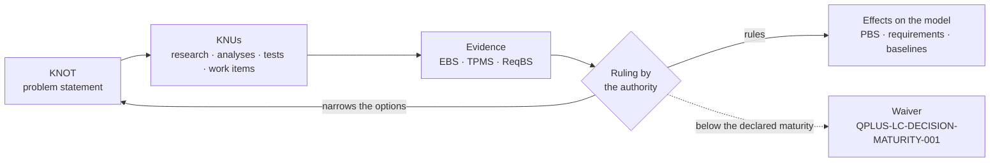

# eWTW — KNOT Register

**Model:** AMPEL360 · [eWTW][MODEL]
**Location:** `01_OPTIONS_ARCHITECTURE/01-02_PROGRAMMES/01-02-01_AMPEL360/01-02-01-01_MODELS/01-02-01-01-01_eWTW/01-02-01-01-01-02_KNOT_Knowledge-Node-Register/`
**Convention:** [`AMPEL360-KNOT-CM-004`][CM-004] Issue 1 — *PROPOSED*
**Version:** 0.2.0 · **Date:** 2026-11-12

This register holds what the eWTW must decide or satisfy — its **KNOTs** — and how each is to be resolved: its **Knowledge Units**, the **KNUs**. A KNOT states the problem. Its KNUs are the research, analyses, tests and other work that produce the knowledge to resolve it. A ruling records the decision with its rationale, and the options not retained stay in the record.

The records are YAML files, one per KNOT, each holding its KNUs. They are filed by scope, so that the register can grow without becoming one flat list: a KNOT that applies to a single S-ATLAS chapter sits in that chapter's folder, a KNOT whose home is still to be ruled sits in the folder of the chapter that raised it, and a KNOT that spans several chapters sits in `000_General/`, named after S-ATLAS chapter `000` *General* (rule 11 of [CM-004][CM-004]). The folder is a filing place, not part of the identity: a record moves when its scope is ruled, and its identifier does not change. This page is a view of the records. The [model README §5][MODEL-5] summarises the same KNOTs and shows how the decisions depend on one another.

---

## How a KNOT is resolved



No decision anchor has declared its criteria or its maturity thresholds yet: `criteria` and `maturity_required` are empty in every record, so no option can be scored (rule 5 of [CM-004][CM-004]). The verification script enforces that gate. Each anchor has a KNU that declares them first — a dedicated one for the configuration decisions (`KNU-EWTW-PRP-001-01` also serves `SRC`), the analysis KNU for the ownership rulings. A ruling may narrow the options without closing the KNOT, as ruling R1 of `KNOT-EWTW-NRG-001` did.

---

## Register

| KNOT | Title | Kind | Filed under | Resolution | KNUs | Proposed owner |
|---|---|---|---|---|:-:|---|
| `KNOT-EWTW-DFN-001` | Dorsal-fin root fairing | `decision-anchor` | `053` | OPEN | 1 | `STK_SE` |
| `KNOT-EWTW-KEL-001` | Keel-beam taxonomy home | `decision-anchor` | `053` | OPEN | 2 | `STK_CM` |
| `KNOT-EWTW-LUG-001` | Wing-attach lugs | `decision-anchor` | `053` | OPEN | 1 | `STK_SE` |
| `KNOT-EWTW-MLG-001` | MLG configuration | `decision-anchor` | `053` | OPEN | 2 | `STK_SE` |
| `KNOT-EWTW-TSI-001` | Tail-strike indicator | `decision-anchor` | `053` | OPEN | 1 | `STK_SE` |
| `KNOT-EWTW-ESS-001` | Essential power | `decision-anchor` | `000` | OPEN | 3 | `STK_SAF` |
| `KNOT-EWTW-LCM-001` | Lifecycle notation and registry pin | `lifecycle-constraint` | `000` | OPEN | 2 | `STK_CM` |
| `KNOT-EWTW-NRG-001` | Energy carrier | `decision-anchor` | `000` | OPEN | 7 | `STK_SE` |
| `KNOT-EWTW-PRP-001` | Propulsion chain | `decision-anchor` | `000` | OPEN | 5 | `STK_SE` |
| `KNOT-EWTW-SRC-001` | Electrical sources | `decision-anchor` | `000` | OPEN | 3 | `STK_SE` |
| `KNOT-EWTW-STO-001` | Role of energy storage | `decision-anchor` | `000` | OPEN | 4 | `STK_SE` |

### Rulings recorded

| KNOT | Ruling | Date | Statement | State |
|---|---|---|---|---|
| `KNOT-EWTW-NRG-001` | R1 | 2026-11-07 | Scope narrowed: all-electric, or hybrid-electric with conventional fuel; liquid hydrogen allocated to the [BWB-Q100][BWB]. Option D, cryogenic hydrogen, excluded; the KNOT stays open | `PROVISIONAL` — neither rationale nor evidence is recorded; `KNU-EWTW-NRG-001-07` |

The same ruling removes fuel cells from `KNOT-EWTW-SRC-001`. A provisional ruling directs the work, but it is not an auditable basis: both exclusions stand on the authority's statement alone until R1 is completed, and no KNOT can be ruled on it (rule 4).

---

## By S-ATLAS chapter

Each record lists, in its `taxonomy` field, the [S-ATLAS][S-ATLAS] chapters it applies to: for a configuration decision, the chapters of the model README §3 rows it unblocks — and `053` for the energy-carrier bay. The identifiers carry no classification ([CM-004][CM-004] §4). Generated from the records:

| Chapter | S-ATLAS title | KNOTs |
|---|---|---|
| `012` | Servicing | `ESS` · `SRC` |
| `021` | Air Conditioning Environmental Control | `NRG` · `PRP` · `STO` |
| `022` | Auto Flight | `ESS` · `PRP` |
| `023` | Communications | `ESS` |
| `024` | Electrical Power | `ESS` · `NRG` · `PRP` · `SRC` · `STO` |
| `026` | Fire Protection | `ESS` · `NRG` · `STO` |
| `027` | Flight Control | `PRP` |
| `028` | Energy Carrier Storage and Distribution | `NRG` |
| `031` | Indicating and Recording Systems | `ESS` |
| `034` | Navigation | `ESS` |
| `042` | Integrated Modular Avionics | `ESS` |
| `046` | Information Systems | `ESS` |
| `047` | Inerting and Protective Atmospheres | `ESS` · `NRG` · `STO` |
| `049` | Auxiliary Power Module | `ESS` · `SRC` |
| `053` | Fuselage | `NRG` |
| `061` | Powerplant Installation and Nacelle Integration | `PRP` |
| `062` | Combustion Machinery | `PRP` |
| `063` | Combustion Systems for Sustainable Carriers | `PRP` |
| `064` | Carrier Delivery Metering and Conditioning | `NRG` · `PRP` |
| `065` | Engine Air and Thermal Management | `PRP` |
| `066` | Control Monitoring and Indicating | `PRP` |
| `067` | Exhaust Emissions and Contrail Management | `PRP` |
| `068` | Turbogenerators and Power Offtakes | `NRG` · `PRP` · `SRC` · `STO` |
| `069` | Lubrication Ignition Starting and Accessories | `PRP` |
| `071` | Propulsion Architectures and Energy Management | `PRP` |
| `072` | Electric Machines for Propulsion | `PRP` |
| `073` | Power Electronics and Conversion | `PRP` |
| `074` | Propulsion Energy Storage Systems | `NRG` · `PRP` · `SRC` · `STO` |
| `076` | Propulsion Power Distribution and Protection | `ESS` · `PRP` · `SRC` |
| `077` | Electric Propulsors Installation and Distributed Integration | `PRP` |
| `078` | Thermal Management of Electric Propulsion | `NRG` · `PRP` · `STO` |
| `079` | High Voltage Safety and System Evidence | `ESS` · `NRG` · `PRP` · `SRC` · `STO` |

Home to be ruled, since each decides where its scope lives: `DFN` · `KEL` · `LUG` · `MLG` · `TSI`. Lifecycle, with no chapter: `LCM`.

---

## Research agenda

The KNUs neither done nor cancelled, generated from the records (rule 9). Every KNU is proposed; none has started.

| KNU | Title | Class | Also serves | Progress |
|---|---|---|---|---|
| `KNU-EWTW-DFN-001-01` | Fairing ownership | `ANALYSIS_PACKAGE` | — | NOT_STARTED |
| `KNU-EWTW-KEL-001-01` | Taxonomy home of the keel beam | `CONTROLLED_ARTEFACT` | — | NOT_STARTED |
| `KNU-EWTW-KEL-001-02` | Station binding | `WORK_ITEM` | — | NOT_STARTED |
| `KNU-EWTW-LUG-001-01` | Wing-attach interface split | `ANALYSIS_PACKAGE` | — | NOT_STARTED |
| `KNU-EWTW-MLG-001-01` | Trunnion location | `ANALYSIS_PACKAGE` | — | NOT_STARTED |
| `KNU-EWTW-MLG-001-02` | 053-200 engine note | `CONTROLLED_ARTEFACT` | — | NOT_STARTED |
| `KNU-EWTW-TSI-001-01` | Tail-strike provision and sensing | `ANALYSIS_PACKAGE` | — | NOT_STARTED |
| `KNU-EWTW-ESS-001-01` | Essential loads and duration | `ANALYSIS_PACKAGE` | — | NOT_STARTED |
| `KNU-EWTW-ESS-001-02` | Essential source options | `ANALYSIS_PACKAGE` | — | NOT_STARTED |
| `KNU-EWTW-ESS-001-03` | Decision criteria and maturity thresholds | `REQUIREMENT_SET` | — | NOT_STARTED |
| `KNU-EWTW-LCM-001-01` | Baseline notation | `WORK_ITEM` | — | NOT_STARTED |
| `KNU-EWTW-LCM-001-02` | Registry re-pin | `WORK_ITEM` | — | NOT_STARTED |
| `KNU-EWTW-NRG-001-01` | Decision criteria and maturity thresholds | `REQUIREMENT_SET` | — | NOT_STARTED |
| `KNU-EWTW-NRG-001-02` | Design mission and reserve policy | `REQUIREMENT_SET` | `PRP` · `SRC` · `STO` | NOT_STARTED |
| `KNU-EWTW-NRG-001-03` | Mission energy and power budget | `ANALYSIS_PACKAGE` | `PRP` · `SRC` · `STO` | NOT_STARTED |
| `KNU-EWTW-NRG-001-04` | Battery technology state | `EVIDENCE_RECORD` | `STO` | NOT_STARTED |
| `KNU-EWTW-NRG-001-05` | Thermal machine on conventional fuel | `ANALYSIS_PACKAGE` | `PRP` · `SRC` | NOT_STARTED |
| `KNU-EWTW-NRG-001-06` | Trade study of the energy carrier | `ANALYSIS_PACKAGE` | — | NOT_STARTED |
| `KNU-EWTW-NRG-001-07` | Rationale and evidence of ruling R1 | `EVIDENCE_RECORD` | — | NOT_STARTED |
| `KNU-EWTW-PRP-001-01` | Decision criteria and maturity thresholds | `REQUIREMENT_SET` | `SRC` | NOT_STARTED |
| `KNU-EWTW-PRP-001-02` | Propulsor architecture | `ANALYSIS_PACKAGE` | — | NOT_STARTED |
| `KNU-EWTW-PRP-001-03` | Efficiency and heat chain | `ANALYSIS_PACKAGE` | `SRC` | NOT_STARTED |
| `KNU-EWTW-PRP-001-04` | Propulsion failure cases | `ANALYSIS_PACKAGE` | — | NOT_STARTED |
| `KNU-EWTW-PRP-001-05` | PBS group for a thermal machine | `CONTROLLED_ARTEFACT` | — | NOT_STARTED |
| `KNU-EWTW-SRC-001-01` | Electrical load analysis | `ANALYSIS_PACKAGE` | `STO` · `ESS` | NOT_STARTED |
| `KNU-EWTW-SRC-001-02` | Source sizing | `ANALYSIS_PACKAGE` | — | NOT_STARTED |
| `KNU-EWTW-SRC-001-03` | Distribution architecture | `ANALYSIS_PACKAGE` | `ESS` | NOT_STARTED |
| `KNU-EWTW-STO-001-01` | Storage role and size | `ANALYSIS_PACKAGE` | — | NOT_STARTED |
| `KNU-EWTW-STO-001-02` | Battery installation safety | `REQUIREMENT_SET` | — | NOT_STARTED |
| `KNU-EWTW-STO-001-03` | Propagation test plan | `VERIFICATION_OBJECT` | — | NOT_STARTED |
| `KNU-EWTW-STO-001-04` | Decision criteria and maturity thresholds | `REQUIREMENT_SET` | — | NOT_STARTED |

Three KNUs touch protected areas and are author acts: `KNU-EWTW-PRP-001-05` and `KNU-EWTW-KEL-001-02` in the PBS, `KNU-EWTW-KEL-001-01` in the taxonomy. Two are conditional on their KNOT's ruling: `KNU-EWTW-PRP-001-05` and `KNU-EWTW-STO-001-03`.

---

## How to verify

From the repository root:

```bash
TAX="01_OPTIONS_ARCHITECTURE/01-03_TECHNOLOGIES/01-03-01_Q+ATLANTIDE/000-099_S-ATLAS"
REG="01_OPTIONS_ARCHITECTURE/01-02_PROGRAMMES/01-02-01_AMPEL360/01-02-01-01_MODELS/01-02-01-01-01_eWTW/01-02-01-01-01-02_KNOT_Knowledge-Node-Register"
python3 - "$REG" "$TAX" <<'EOF'
import pathlib, re, sys, yaml
F = {p.stem: p.parent.name.split("_")[0] for p in sorted(pathlib.Path(sys.argv[1]).rglob("KNOT-*.yaml"))}
K = {p.stem: yaml.safe_load(p.read_text(encoding="utf-8"))["knot"] for p in sorted(pathlib.Path(sys.argv[1]).rglob("KNOT-*.yaml"))}
TAX = {d.name.split("_")[0]: d.name.split("_", 1)[1].replace("-", " ") for d in pathlib.Path(sys.argv[2]).rglob("*_*") if d.is_dir()}
V = {"kind": "obligation control-intent decision-anchor lifecycle-constraint", "status": "DRAFT REVIEW APPROVED SUPERSEDED OBSOLETE",
     "resolution": "OPEN RULED DEFERRED", "knu_class": "WORK_ITEM CONTROLLED_ARTEFACT REQUIREMENT_SET ANALYSIS_PACKAGE "
     "VERIFICATION_OBJECT EVIDENCE_RECORD OTHER", "progress": "NOT_STARTED IN_PROGRESS PENDING_REVIEW DONE CANCELLED"}
REQ = ("knot_id title kind taxonomy raised_at question obligation_source lifecycle_phase due owner status resolution created_date "
       "depends_on closed_with unblocks affects options criteria assumptions couplings rulings reopen_if knus").split()
RUL = "id date authority statement effect rationale rationale_recorded evidence waiver state record".split()
bad, seen, by, prov = [], set(), {}, []
for kid, k in K.items():
    anchor = k.get("kind") == "decision-anchor"
    miss = [f for f in REQ + ["maturity_required"] * anchor if f not in k]
    if miss:
        bad.append(f"{kid} missing {miss}"); continue
    bad += [kid] * (kid != k["knot_id"] or not re.fullmatch(r"KNOT-EWTW-[A-Z]{3}-\d{3}", kid) or not k["obligation_source"])
    bad += [f"{kid} {f}" for f in ("kind", "status", "resolution") if k[f] not in V[f].split()]
    bad += [f"{kid} -> {r}" for f in ("depends_on", "closed_with", "unblocks") for r in k[f] if r not in K]
    bad += [f"{kid} taxonomy {a}" for a in k["taxonomy"] + [k["raised_at"]] * bool(k["raised_at"]) if a not in TAX]
    home = k["taxonomy"][0] if len(k["taxonomy"]) == 1 else k["raised_at"] or "000"          # rule 11
    bad += [f"{kid} filed under {F[kid]}, expected {home}"] * (F[kid] != home)
    for r in k["rulings"]:
        bad += [f"{kid} {r.get('id')} fields"] * any(f not in r for f in RUL)
        full = bool(r.get("rationale") and r.get("evidence"))
        bad += [f"{kid} {r.get('id')} state"] * (r.get("state") != ("COMPLETE" if full else "PROVISIONAL"))
        prov += [f"`{kid[10:13]}` {r.get('id')}"] * (not full)
    scored = k["resolution"] == "RULED" or any(o["state"] in ("retained", "rejected") for o in k["options"])
    if scored:                                                                                 # rules 4 and 5
        bad += [f"{kid} ruled on a provisional ruling"] * any(r.get("state") != "COMPLETE" for r in k["rulings"])
        waived = any(r.get("waiver") for r in k["rulings"])
        bad += [f"{kid} scored without criteria or maturity"] * (anchor and not (k["criteria"] and (k["maturity_required"] or waived)))
    for a in k["taxonomy"]:
        by.setdefault(a, []).append(kid[10:13])
    for u in k["knus"]:
        i = u["knu_id"]
        bad += [i] * (not re.fullmatch(f"KNU-{kid[5:]}-\\d\\d", i) or i in seen or not u["outputs"] or not u["exit"]
                      or u["knu_class"] not in V["knu_class"].split() or u["progress"] not in V["progress"].split()
                      or (u["progress"] == "IN_PROGRESS" and not (u["evidence_refs"] or u["end_date"])))
        bad += [f"{i} serves {r}" for r in u["serves"] if r not in K]
        seen.add(i)
if re.search(r"\b(compliant|conforms?)\b", str(K).lower()): bad.append("conformity claim")
print(f"{len(K)} KNOTs, {len(seen)} KNUs, {len(by)} S-ATLAS chapters; rule failures: {bad or 'none'}")
print(f"Provisional rulings: {' · '.join(prov) or 'none'}")
for kid, k in K.items():
    print(f"| `{kid}` | {k['title']} | `{k['kind']}` | `{F[kid]}` | {k['resolution']} | {len(k['knus'])} | `{k['owner']}` |")
for a in sorted(by):
    print(f"| `{a}` | {TAX[a]} | {' · '.join(f'`{t}`' for t in by[a])} |")
for label, kinds in (("Home to be ruled", ("decision-anchor",)), ("Lifecycle", ("lifecycle-constraint",))):
    ks = [kid[10:13] for kid, k in K.items() if not k["taxonomy"] and k["kind"] in kinds]
    print(f"{label}: {' · '.join(f'`{t}`' for t in ks)}")
for k in K.values():
    for u in k["knus"]:
        if u["progress"] not in ("DONE", "CANCELLED"):
            also = " · ".join(f"`{x[10:13]}`" for x in u["serves"]) or "—"
            print(f"| `{u['knu_id']}` | {u['title']} | `{u['knu_class']}` | {also} | {u['progress']} |")
EOF
```

The first line reads `11 KNOTs, 31 KNUs, 32 S-ATLAS chapters; rule failures: none` and the second `Provisional rulings: `NRG` R1`; the rest reproduces the three tables above and the two lines under the chapter table. The script fails a record that lacks a required field, is filed in the wrong folder, scores an option without criteria and maturity thresholds, is ruled on a provisional ruling, or misstates a ruling's state. It also checks identifiers, file names, vocabularies, references between KNOTs, that every S-ATLAS chapter resolves, outputs and exit criteria, and the absence of conformity claims.

---

## Revision history

| Version | Date | Change |
|---|---|---|
| 0.1.0 | 2026-11-08 | Register created: the 11 KNOTs of the model README 0.3.0 §5 as records, 29 KNUs proposed, ruling R1 of `KNOT-EWTW-NRG-001` recorded; S-ATLAS chapters per KNOT and the view by chapter |
| 0.2.0 | 2026-11-12 | Review of 0.1.0 applied. Records filed by scope: `053_Fuselage/` and `000_General/`. Scoring gate and required fields enforced by the script; `maturity_required` on every decision anchor; criteria KNUs added for `STO` and `ESS` (31 KNUs). R1 marked `PROVISIONAL`; `KNU-EWTW-NRG-001-07` now covers its evidence and writes the reopen condition to the KNOT |

[MODEL]: ../README.md
[MODEL-5]: ../README.md#5-open-knots
[CM-004]: AMPEL360-KNOT-CM-004_Knowledge-Nodes-and-Units.md
[BWB]: ../../01-02-01-01-02_BWB-Q100/README.md
[S-ATLAS]: ../../../../../01-03_TECHNOLOGIES/01-03-01_Q+ATLANTIDE/000-099_S-ATLAS/
