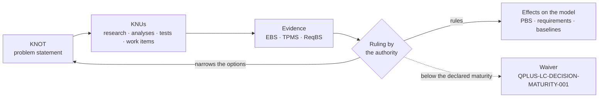

# eWTW — KNOT Register

**Model:** AMPEL360 · [eWTW][MODEL]
**Location:** `01_OPTIONS_ARCHITECTURE/01-02_PROGRAMMES/01-02-01_AMPEL360/01-02-01-01_MODELS/01-02-01-01-01_eWTW/01-02-01-01-01-02_KNOT_Knowledge-Node-Register/`
**Convention:** [`AMPEL360-KNOT-CM-004`][CM-004] Issue 1 — *PROPOSED*
**Version:** 0.1.0 · **Date:** 2026-11-08

This register holds what the eWTW must decide or satisfy — its **KNOTs** — and how each is to be resolved: its **Knowledge Units**, the **KNUs**. A KNOT states the problem. Its KNUs are the research, analyses, tests and other work that produce the knowledge to resolve it. A ruling records the decision with its rationale, and the options not retained stay in the record.

The records are the YAML files in this folder, one per KNOT, each holding its KNUs. This page is a view of them. The [model README §5][MODEL-5] summarises the same KNOTs and shows how the decisions depend on one another.

---

## How a KNOT is resolved



Each decision anchor declares first the criteria and the maturity it needs (rule 5 of [CM-004][CM-004]); its first KNU does that. A ruling may narrow the options without closing the KNOT, as ruling R1 of `KNOT-EWTW-NRG-001` did.

---

## Register

| KNOT | Title | Kind | Resolution | KNUs | Proposed owner |
|---|---|---|---|:-:|---|
| `KNOT-EWTW-DFN-001` | Dorsal-fin root fairing | `decision-anchor` | OPEN | 1 | `STK_SE` |
| `KNOT-EWTW-ESS-001` | Essential power | `decision-anchor` | OPEN | 2 | `STK_SAF` |
| `KNOT-EWTW-KEL-001` | Keel-beam taxonomy home | `decision-anchor` | OPEN | 2 | `STK_CM` |
| `KNOT-EWTW-LCM-001` | Lifecycle notation and registry pin | `lifecycle-constraint` | OPEN | 2 | `STK_CM` |
| `KNOT-EWTW-LUG-001` | Wing-attach lugs | `decision-anchor` | OPEN | 1 | `STK_SE` |
| `KNOT-EWTW-MLG-001` | MLG configuration | `decision-anchor` | OPEN | 2 | `STK_SE` |
| `KNOT-EWTW-NRG-001` | Energy carrier | `decision-anchor` | OPEN | 7 | `STK_SE` |
| `KNOT-EWTW-PRP-001` | Propulsion chain | `decision-anchor` | OPEN | 5 | `STK_SE` |
| `KNOT-EWTW-SRC-001` | Electrical sources | `decision-anchor` | OPEN | 3 | `STK_SE` |
| `KNOT-EWTW-STO-001` | Role of energy storage | `decision-anchor` | OPEN | 3 | `STK_SE` |
| `KNOT-EWTW-TSI-001` | Tail-strike indicator | `decision-anchor` | OPEN | 1 | `STK_SE` |

### Rulings recorded

| KNOT | Ruling | Date | Statement | Rationale |
|---|---|---|---|---|
| `KNOT-EWTW-NRG-001` | R1 | 2026-11-07 | Scope narrowed: all-electric, or hybrid-electric with conventional fuel; liquid hydrogen allocated to the [BWB-Q100][BWB]. Option D, cryogenic hydrogen, excluded; the KNOT stays open | Not yet recorded — `KNU-EWTW-NRG-001-07` |

The same ruling removes fuel cells from `KNOT-EWTW-SRC-001`.

---

## Research agenda

The KNUs neither done nor cancelled, generated from the records (rule 9). Every KNU is proposed; none has started.

| KNU | Title | Class | Also serves | Progress |
|---|---|---|---|---|
| `KNU-EWTW-DFN-001-01` | Fairing ownership | `ANALYSIS_PACKAGE` | — | NOT_STARTED |
| `KNU-EWTW-ESS-001-01` | Essential loads and duration | `ANALYSIS_PACKAGE` | — | NOT_STARTED |
| `KNU-EWTW-ESS-001-02` | Essential source options | `ANALYSIS_PACKAGE` | — | NOT_STARTED |
| `KNU-EWTW-KEL-001-01` | Taxonomy home of the keel beam | `CONTROLLED_ARTEFACT` | — | NOT_STARTED |
| `KNU-EWTW-KEL-001-02` | Station binding | `WORK_ITEM` | — | NOT_STARTED |
| `KNU-EWTW-LCM-001-01` | Baseline notation | `WORK_ITEM` | — | NOT_STARTED |
| `KNU-EWTW-LCM-001-02` | Registry re-pin | `WORK_ITEM` | — | NOT_STARTED |
| `KNU-EWTW-LUG-001-01` | Wing-attach interface split | `ANALYSIS_PACKAGE` | — | NOT_STARTED |
| `KNU-EWTW-MLG-001-01` | Trunnion location | `ANALYSIS_PACKAGE` | — | NOT_STARTED |
| `KNU-EWTW-MLG-001-02` | 053-200 engine note | `CONTROLLED_ARTEFACT` | — | NOT_STARTED |
| `KNU-EWTW-NRG-001-01` | Decision criteria and maturity thresholds | `REQUIREMENT_SET` | — | NOT_STARTED |
| `KNU-EWTW-NRG-001-02` | Design mission and reserve policy | `REQUIREMENT_SET` | `PRP` · `SRC` · `STO` | NOT_STARTED |
| `KNU-EWTW-NRG-001-03` | Mission energy and power budget | `ANALYSIS_PACKAGE` | `PRP` · `SRC` · `STO` | NOT_STARTED |
| `KNU-EWTW-NRG-001-04` | Battery technology state | `EVIDENCE_RECORD` | `STO` | NOT_STARTED |
| `KNU-EWTW-NRG-001-05` | Thermal machine on conventional fuel | `ANALYSIS_PACKAGE` | `PRP` · `SRC` | NOT_STARTED |
| `KNU-EWTW-NRG-001-06` | Trade study of the energy carrier | `ANALYSIS_PACKAGE` | — | NOT_STARTED |
| `KNU-EWTW-NRG-001-07` | Rationale of ruling R1 | `EVIDENCE_RECORD` | — | NOT_STARTED |
| `KNU-EWTW-PRP-001-01` | Decision criteria and maturity thresholds | `REQUIREMENT_SET` | `SRC` | NOT_STARTED |
| `KNU-EWTW-PRP-001-02` | Propulsor architecture | `ANALYSIS_PACKAGE` | — | NOT_STARTED |
| `KNU-EWTW-PRP-001-03` | Efficiency and heat chain | `ANALYSIS_PACKAGE` | `SRC` | NOT_STARTED |
| `KNU-EWTW-PRP-001-04` | Propulsion failure cases | `ANALYSIS_PACKAGE` | — | NOT_STARTED |
| `KNU-EWTW-PRP-001-05` | PBS group for a thermal machine | `CONTROLLED_ARTEFACT` | — | NOT_STARTED |
| `KNU-EWTW-SRC-001-01` | Electrical load analysis | `ANALYSIS_PACKAGE` | `STO` · `ESS` | NOT_STARTED |
| `KNU-EWTW-SRC-001-02` | Source sizing | `ANALYSIS_PACKAGE` | — | NOT_STARTED |
| `KNU-EWTW-SRC-001-03` | Distribution architecture | `ANALYSIS_PACKAGE` | `ESS` | NOT_STARTED |
| `KNU-EWTW-STO-001-01` | Storage role and size | `ANALYSIS_PACKAGE` | — | NOT_STARTED |
| `KNU-EWTW-STO-001-02` | Battery installation safety | `REQUIREMENT_SET` | — | NOT_STARTED |
| `KNU-EWTW-STO-001-03` | Propagation test plan | `VERIFICATION_OBJECT` | — | NOT_STARTED |
| `KNU-EWTW-TSI-001-01` | Tail-strike provision and sensing | `ANALYSIS_PACKAGE` | — | NOT_STARTED |

Three KNUs touch protected areas and are author acts: `KNU-EWTW-PRP-001-05` and `KNU-EWTW-KEL-001-02` in the PBS, `KNU-EWTW-KEL-001-01` in the taxonomy. Two are conditional on their KNOT's ruling: `KNU-EWTW-PRP-001-05` and `KNU-EWTW-STO-001-03`.

---

## How to verify

From the repository root:

```bash
REG="01_OPTIONS_ARCHITECTURE/01-02_PROGRAMMES/01-02-01_AMPEL360/01-02-01-01_MODELS/01-02-01-01-01_eWTW/01-02-01-01-01-02_KNOT_Knowledge-Node-Register"
python3 - "$REG" <<'EOF'
import pathlib, re, sys, yaml
K = {p.stem: yaml.safe_load(p.read_text(encoding="utf-8"))["knot"] for p in sorted(pathlib.Path(sys.argv[1]).glob("KNOT-*.yaml"))}
V = {"kind": "obligation control-intent decision-anchor lifecycle-constraint", "status": "DRAFT REVIEW APPROVED SUPERSEDED OBSOLETE",
     "resolution": "OPEN RULED DEFERRED", "knu_class": "WORK_ITEM CONTROLLED_ARTEFACT REQUIREMENT_SET ANALYSIS_PACKAGE "
     "VERIFICATION_OBJECT EVIDENCE_RECORD OTHER", "progress": "NOT_STARTED IN_PROGRESS PENDING_REVIEW DONE CANCELLED"}
bad, seen = [], set()
for kid, k in K.items():
    bad += [kid] * (kid != k["knot_id"] or not re.fullmatch(r"KNOT-EWTW-[A-Z]{3}-\d{3}", kid) or not k["obligation_source"])
    bad += [f"{kid} {f}" for f in ("kind", "status", "resolution") if k[f] not in V[f].split()]
    bad += [f"{kid} -> {r}" for f in ("depends_on", "closed_with", "unblocks") for r in k[f] if r not in K]
    for u in k["knus"]:
        i = u["knu_id"]
        bad += [i] * (not re.fullmatch(f"KNU-{kid[5:]}-\\d\\d", i) or i in seen or not u["outputs"] or not u["exit"]
                      or u["knu_class"] not in V["knu_class"].split() or u["progress"] not in V["progress"].split()
                      or (u["progress"] == "IN_PROGRESS" and not (u["evidence_refs"] or u["end_date"])))
        bad += [f"{i} serves {r}" for r in u["serves"] if r not in K]
        seen.add(i)
if re.search(r"\b(compliant|conforms?)\b", str(K).lower()): bad.append("conformity claim")
print(f"{len(K)} KNOTs, {len(seen)} KNUs; rule failures: {bad or 'none'}")
for kid, k in K.items():
    print(f"| `{kid}` | {k['title']} | `{k['kind']}` | {k['resolution']} | {len(k['knus'])} | `{k['owner']}` |")
for k in K.values():
    for u in k["knus"]:
        if u["progress"] not in ("DONE", "CANCELLED"):
            also = " · ".join(f"`{x[10:13]}`" for x in u["serves"]) or "—"
            print(f"| `{u['knu_id']}` | {u['title']} | `{u['knu_class']}` | {also} | {u['progress']} |")
EOF
```

The first line reads `11 KNOTs, 29 KNUs; rule failures: none`; the rest reproduces the two tables above. The script checks identifiers, file names, vocabularies, references between KNOTs, outputs and exit criteria, and the absence of conformity claims.

---

## Revision history

| Version | Date | Change |
|---|---|---|
| 0.1.0 | 2026-11-08 | Register created: the 11 KNOTs of the model README 0.3.0 §5 as records, 29 KNUs proposed, ruling R1 of `KNOT-EWTW-NRG-001` recorded |

[MODEL]: ../README.md
[MODEL-5]: ../README.md#5-open-knots
[CM-004]: AMPEL360-KNOT-CM-004_Knowledge-Nodes-and-Units.md
[BWB]: ../../01-02-01-01-02_BWB-Q100/README.md
