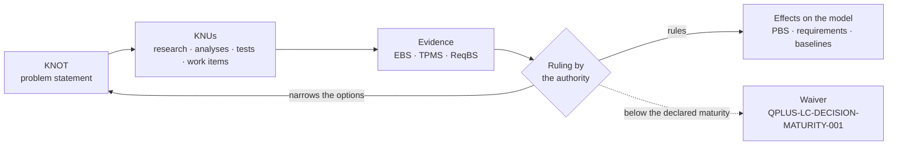

# eWTW — KNOT Register

**Model:** AMPEL360 · [eWTW][MODEL]
**Location:** `01_OPTIONS_ARCHITECTURE/01-02_PROGRAMMES/01-02-01_AMPEL360/01-02-01-01_MODELS/01-02-01-01-01_eWTW/01-02-01-01-01-02_KNOT_Knowledge-Node-Register/`
**Convention:** [`AMPEL360-KNOT-CM-004`][CM-004] Issue 1 — *PROPOSED*
**Version:** 0.11.27 · **Date:** 2026-11-26

This register holds what the eWTW must decide or satisfy — its **KNOTs**, the knowledge threads — and how each is to be resolved: its **Knowledge Units**, the **KNUs**. A KNOT states the problem. Its KNUs are the research, analyses, tests and other work that produce the knowledge to resolve it. A ruling records the decision with its rationale, and the options not retained stay in the record.

The records are YAML files, one per KNOT, each holding its KNUs. They are filed by scope, so that the register can grow without becoming one flat list: a KNOT that applies to a single S-ATLAS chapter sits in that chapter's folder, a KNOT whose home is still to be ruled sits in the folder of the chapter that raised it, and a KNOT that spans several chapters sits in `000_General/`, named after S-ATLAS chapter `000` *General* (rule 11 of [CM-004][CM-004]). The folder is a filing place, not part of the identity: a record moves when its scope is ruled, and its identifier does not change. This page is a view of the records. The [model README §5][MODEL-5] summarises the same KNOTs and shows how the decisions depend on one another.

The [architecture relations][REL] node reads these records. It projects taxonomy and programme relations onto the KNOTs — the candidates for a decision — and checks the registered options, the `taxonomy` field and `depends_on` against them. It changes no record here.

---

## How a KNOT is resolved



One decision anchor has approved criteria: `KNOT-EWTW-CRZ-001`, since its ruling R2 of 2026-11-24, with maturity records approved since its ruling R1. Three other records hold proposed criteria; of those, `KNOT-EWTW-NRG-001` has approved maturity records since its ruling R2. `maturity_required` is empty in the others. So the options of the cruise point can be scored and no others (rule 5 of [CM-004][CM-004]); none is scored yet. The verification script enforces that gate. Each anchor has a KNU that declares them first — a dedicated one for the configuration decisions (`KNU-EWTW-PRP-001-01` also serves `SRC`), the analysis KNU for the ownership rulings. A ruling may narrow the options without closing the KNOT, as ruling R1 of `KNOT-EWTW-NRG-001` did. It may also defer the choice that remains to another KNOT that holds the same choice (rule 6): since 2026-11-14 `KNOT-EWTW-NRG-001` and `KNOT-EWTW-SRC-001` are `DEFERRED` to `KNOT-EWTW-STO-001`, and are ruled by the act that rules it.

---

## Register

| KNOT | Title | Kind | Filed under | Resolution | KNUs | Proposed owner |
|---|---|---|---|---|:-:|---|
| `KNOT-EWTW-ACT-001` | Actuation and utility power | `decision-anchor` | `000` | OPEN | 3 | `STK_SE` |
| `KNOT-EWTW-AER-001` | Drag polar of the configuration | `obligation` | `000` | OPEN | 3 | `STK_SE` |
| `KNOT-EWTW-AUX-001` | Auxiliary power and supply at the stand | `decision-anchor` | `000` | OPEN | 3 | `STK_SE` |
| `KNOT-EWTW-CAD-001` | 3D model of record | `control-intent` | `000` | OPEN | 3 | `STK_CM` |
| `KNOT-EWTW-CRT-001` | Certification basis | `obligation` | `000` | OPEN | 3 | `STK_SAF` |
| `KNOT-EWTW-CRZ-001` | Cruise point | `decision-anchor` | `000` | OPEN | 5 | `STK_SE` |
| `KNOT-EWTW-ECS-001` | Cooling cycle of the packs | `decision-anchor` | `000` | OPEN | 3 | `STK_SE` |
| `KNOT-EWTW-ESS-001` | Essential power | `decision-anchor` | `000` | OPEN | 3 | `STK_SAF` |
| `KNOT-EWTW-FUL-001` | Fuel location and energy-carrier bay | `decision-anchor` | `000` | OPEN | 3 | `STK_SE` |
| `KNOT-EWTW-GEN-001` | Generation architecture | `decision-anchor` | `000` | OPEN | 3 | `STK_SE` |
| `KNOT-EWTW-ICE-001` | Ice protection without bleed air | `decision-anchor` | `000` | OPEN | 3 | `STK_SE` |
| `KNOT-EWTW-LCM-001` | Lifecycle notation and registry pin | `lifecycle-constraint` | `000` | OPEN | 2 | `STK_CM` |
| `KNOT-EWTW-MAS-001` | Empty mass of the configuration | `obligation` | `000` | OPEN | 3 | `STK_SE` |
| `KNOT-EWTW-NRG-001` | Energy carrier | `decision-anchor` | `000` | DEFERRED | 7 | `STK_SE` |
| `KNOT-EWTW-PRP-001` | Propulsion chain | `decision-anchor` | `000` | OPEN | 5 | `STK_SE` |
| `KNOT-EWTW-SRC-001` | Electrical sources | `decision-anchor` | `000` | DEFERRED | 3 | `STK_SE` |
| `KNOT-EWTW-STO-001` | Role of energy storage | `decision-anchor` | `000` | OPEN | 4 | `STK_SE` |
| `KNOT-EWTW-DAT-001` | Fuselage datum and master geometry | `decision-anchor` | `053` | OPEN | 3 | `STK_SE` |
| `KNOT-EWTW-DFN-001` | Dorsal-fin root fairing | `decision-anchor` | `053` | OPEN | 1 | `STK_SE` |
| `KNOT-EWTW-FUS-001` | Fuselage section, length and cabin | `decision-anchor` | `053` | OPEN | 3 | `STK_SE` |
| `KNOT-EWTW-KEL-001` | Keel-beam taxonomy home | `decision-anchor` | `053` | OPEN | 2 | `STK_CM` |
| `KNOT-EWTW-LUG-001` | Wing-attach lugs | `decision-anchor` | `053` | OPEN | 1 | `STK_SE` |
| `KNOT-EWTW-MLG-001` | MLG configuration | `decision-anchor` | `053` | OPEN | 2 | `STK_SE` |
| `KNOT-EWTW-ROD-001` | Rear adjustable rods | `decision-anchor` | `053` | OPEN | 4 | `STK_SE` |
| `KNOT-EWTW-TSI-001` | Tail-strike indicator | `decision-anchor` | `053` | OPEN | 1 | `STK_SE` |
| `KNOT-EWTW-WNG-001` | Wing planform: span, aspect ratio and area | `decision-anchor` | `057` | OPEN | 3 | `STK_SE` |

### Rulings recorded

| KNOT | Ruling | Date | Statement | State |
|---|---|---|---|---|
| `KNOT-EWTW-NRG-001` | R1 | 2026-11-07 | Scope narrowed: all-electric, or hybrid-electric with conventional fuel; liquid hydrogen allocated to the [BWB-Q100][BWB]. Option D, cryogenic hydrogen, excluded; the KNOT stays open | `COMPLETE` since 2026-11-14: rationale and evidence recorded once ([record](000_General/evidence/KNOT-EWTW-NRG-001_ruling-R1-completion_2026-11-14.md)) |
| `KNOT-EWTW-NRG-001` | R2 | 2026-11-14 | Missions approved with their roles — a requirement mission of 2,000 km, a scoring mission of about 1,100 km, a sensitivity mission of 500 km; 100 seats kept; 30 minutes taken as the final reserve; level 6 required of each critical element at the preliminary-design baseline. Option A, batteries alone, excluded until a demonstrated pack closes the requirement mission; the KNOT stays open | `COMPLETE` |
| `KNOT-EWTW-NRG-001` | R3 | 2026-11-14 | Conventional fuel for a thermal machine carries the mission energy in every option that stands, and the fuel storage is authorised for definition. The choice between options B and C, with or without a propulsion battery, is deferred to `KNOT-EWTW-STO-001` | `COMPLETE` |
| `KNOT-EWTW-SRC-001` | R1 | 2026-11-14 | A turbogenerator is a main source in every option that stands, and its installation is authorised for definition. The choice between options B and C is deferred to `KNOT-EWTW-STO-001`; the KNUs continue | `COMPLETE` |
| `KNOT-EWTW-CRZ-001` | R1 | 2026-11-16 | The maturity required of the cruise point is approved: level 6 at the release of the preliminary-design baseline for the turbogenerator, the propeller and the ducted fan driven by a motor of megawatt class. The minimum objective on carbon dioxide applies at that release. No option is scored, and the criteria stay proposed | `COMPLETE` |
| `KNOT-EWTW-CRZ-001` | R2 | 2026-11-24 | The ten criteria of the cruise point approved, `M2` and `M5` with a modification: `M5` is taken against the new-type level of 2017, and at the release of the preliminary-design baseline the justified upper limit of the margin is at or below −26 %. A working reference taken as an assumption: 360 kt at 31,000 ft, five abreast, about 40 m of span in flight. No option is scored or excluded | `COMPLETE` |

R1 also removes fuel cells from `KNOT-EWTW-SRC-001`. It was provisional until 2026-11-14, when its rationale and evidence were recorded, once (rule 7). The rationale says what the exclusion is: a decision of allocation within the family of models, not the result of a trade on this airframe. It was drafted by the reviewer from statements already in the repository, and it is the authority's by the merge that carries it.

R2 is complete: it carries its rationale and its evidence, and its [decision record](000_General/evidence/KNOT-EWTW-NRG-001_ruling-R2_2026-11-14.md) says what was checked before it was recorded. It excludes option A from the scope without scoring it. With it leave option A of `KNOT-EWTW-SRC-001`, batteries alone, and option A of `KNOT-EWTW-PRP-001`, all-electric, which rest on the option it excludes.

R3 and ruling R1 of the electrical sources record what the two KNOTs have fixed and put the choice that remains in one place ([decision record](000_General/evidence/KNOT-EWTW-NRG-001_ruling-R3_2026-11-14.md)). Fuel with or without a propulsion battery, turbogenerators alone or combined, and the role of storage were one choice held three times: option C of `KNOT-EWTW-STO-001` is option B of the other two, and its options A and B are their option C. Neither KNOT is `RULED`, because no criterion is approved (rule 5). They score nothing.

Ruling R1 of the cruise point approves its three maturity records and fixes the moment of criterion `M5` ([decision record](000_General/evidence/KNOT-EWTW-CRZ-001_ruling-R1_2026-11-16.md)). The authority approved *the maturity criteria* unless the reviewer saw problems. The record reads that as the three maturity records and leaves the ten criteria proposed; it finds nothing against the thresholds, and notes that no element has a level on record yet.

Ruling R2 of the cruise point approves its ten criteria, takes a working reference and confirms the objective ([decision record](000_General/evidence/KNOT-EWTW-CRZ-001_ruling-R2_2026-11-24.md)). The authority chose for each criterion on a page prepared by the reviewer: eight as proposed, and `M2` and `M5` with a modification. `M2` now follows the certification requested, as CS 25.841(a) has it. `M5` is taken against the new-type level of 2017 at the same take-off mass: the gap is recorded at the concept baseline, and at the release of the preliminary-design baseline the justified upper limit of the margin is at or below −26 %. The working reference is 360 kt at 31,000 ft, the section of five abreast and a wing of about 40 m of span in flight, each as an assumption: no option is scored. A [review record](000_General/evidence/KNOT-EWTW-CRZ-001_reference-and-interval_2026-11-24.md) holds the proposal of a second reader reproduced, the checks of the reviewer and a method proposed for the upper limit, which is not ratified. `KNU-EWTW-CRZ-001-03` is done.

### KNOTs opened on 2026-11-14

Three KNOTs come from the research records of the same day. Each holds a question that two or more of the open decisions were waiting for.

| KNOT | Question | What waits for it |
|---|---|---|
| `KNOT-EWTW-CRZ-001` | Cruise point: which Mach number and which altitude? | Propeller against ducted fan (`PRP`); the voltage of the propulsion network (`SRC`); the cabin air compressors |
| `KNOT-EWTW-CRT-001` | Certification basis: which specification, which special conditions, and which requirements have no text yet? | The criteria of `PRP`, `STO`, `ESS` and `GEN`. It is an obligation, not a choice |
| `KNOT-EWTW-FUL-001` | Where is the fuel carried, and what does the energy-carrier bay then hold? | The fuel storage (`028`) and the bay `053-900`, which was defined for batteries |
| `KNOT-EWTW-GEN-001` | Generation architecture: how many turbogenerators, of what rating, and where? | The turbogenerator installation (`068`); option C of essential power. It is decided with `PRP` |

`KNOT-EWTW-GEN-001` was opened on 2026-11-15 to correct the deferral of the day before. The gate on the turbogenerator chapter, number, rating and position, had been put on `KNOT-EWTW-SRC-001`, which is deferred to the role of storage. That choice decides whether a battery is carried, not how many turbogenerators there are, so the gate would have opened on a decision that does not concern it. The question now has its own KNOT, and `KNU-EWTW-SRC-001-02` serves it.

### KNOTs opened on 2026-11-16: the dimensions of the airframe

The open decisions depend on the altitude, the speed, the propulsors and the place of the fuel. None of them defines a section, an aspect ratio, a wetted area or a cabin area, and without these the north star and the minimum objective cannot be applied with figures of the eWTW. Three KNOTs hold them, each in the chapter of its scope. They record dimensions and a polar with their assumptions. They do not choose between a tube-and-wing, a lifting body and a blended body: if an architecture between them improves the lift-to-drag ratio or the cabin area, the improvement has to appear in the screening, and is not assumed.

| KNOT | Question | What waits for it |
|---|---|---|
| `KNOT-EWTW-FUS-001`, chapter `053` | Which cross-section and which length does the fuselage have, and what cabin area do they give for 100 passengers? | The wetted area of the polar; the cabin area of the carbon dioxide metric; the volume of the bay `053-900` (`FUL`) |
| `KNOT-EWTW-WNG-001`, chapter `057` | Which span, which aspect ratio and which area does the wing have? | The induced drag of the polar; the fuel the wing box holds (`FUL`). It is sized with the cruise point (`CRZ`) |
| `KNOT-EWTW-AER-001`, chapters `006`, `053`, `055`, `057` | Which wetted area, which parasite drag and which lift-to-drag ratio does the eWTW have at each candidate cruise point? | The fuel of the north star and the metric of the minimum objective (`CRZ`). It is an obligation, not a choice |

The polar and the wetted area are one KNOT, because the second is an input of the first. The wing and the cruise point are coupled and not ordered: each sets the other. `KNOT-EWTW-CRZ-001` now depends on the polar, and `KNOT-EWTW-FUL-001` on the wing and on the fuselage. Three KNUs carry research briefs: sections and cabins with the concepts that have a lifting fuselage, wings with span limits and propellers on the wing, and drag data with the forecasts of ICAO.

On the same day the authority said what the wide tube is for: more comfort, and the ground for an architecture better suited to tanks of liquid hydrogen, on an aircraft that stays far from a blended wing body and carries no hydrogen in this model. Neither purpose has an approved measure or value; two are proposed in the [review record of 2026-11-24](000_General/evidence/KNOT-EWTW-CRZ-001_reference-and-interval_2026-11-24.md). Both ask for section, and the north star is fuel; so they are candidates for mandatory criteria of `KNOT-EWTW-FUS-001`, as the floor of 360 kt is for the cruise point, and not for traded ones. The three KNOTs and the cruise point are the decisions on the [path to the concept baseline][MODEL-PATH] proposed in the model README.

**What the research of 2026-11-17 found.** Three reports were reviewed, one for each brief: [sections and cabins](000_General/evidence/KNOT-EWTW-FUS-001_sections-and-cabins_2026-11-17.md), [wings and span limits](000_General/evidence/KNOT-EWTW-WNG-001_wings-and-span-limits_2026-11-17.md) and [drag data and forecasts](000_General/evidence/KNOT-EWTW-AER-001_drag-data-and-forecasts_2026-11-17.md). The reports name few sources, so sixteen statements were read by the reviewer, thirteen are as reported and eleven say that a search found nothing.

- At 98 seats a blended body burns 4 % more fuel than a tube-and-wing of the same technologies, in a study of NASA that sizes both. Its lift-to-drag ratio is higher and its empty mass higher still. A screening of sections has to carry mass with drag.
- The class sits four abreast in a cabin of 2.74 m or less. The stands it uses stop short of a span of 36 m, and its wings span 27 to 29 m: the limit leaves room for an aspect ratio of 14 to 21 before folding tips or a brace are needed.
- The same study computes a lift-to-drag ratio of 19.8 for an advanced tube-and-wing of 98 seats, with laminar flow control. The screening uses 15 and needs about 18.4 for the minimum objective. It is a forecast, not evidence.
- No manufacturer publishes a lift-to-drag ratio with its conditions, so the polar is to be checked through the fuel of a published mission. EASA publishes the certified values of the carbon dioxide metric; the file was not opened.
- Not answered: which section the tanks of liquid hydrogen ask for, which study supports a flattened section that carries lift, and what the forecasts of ICAO say.

**What the research of 2026-11-18 found.** At the request of the authority the reviewer did the research directly, and filed four records: [wide sections and hydrogen tanks](000_General/evidence/KNOT-EWTW-FUS-001_wide-sections-and-hydrogen-tanks_2026-11-18.md), [wings in service and propellers](000_General/evidence/KNOT-EWTW-WNG-001_wings-in-service-and-propellers_2026-11-18.md), [drag method and forecasts](000_General/evidence/KNOT-EWTW-AER-001_drag-method-and-forecasts_2026-11-18.md) and [structural mass and additive manufacturing](000_General/evidence/KNOT-EWTW-MAS-001_structural-mass-and-additive_2026-11-18.md). Thirty-eight statements were read at the source and fourteen say that a search or a file gave nothing. The same hand researched and reviewed, and each record says so: no second reader has checked them.

- The wide tube has values to choose from: 2.74 m for four abreast, 3.28 m for five, 3.63 m for six. Two aisles do not pay at this size. A wider tube gives less width for each seat than the reference cabin, unless seats are left out of the row.
- A wide fuselage that carries a fifth of the lift saves 10.6 % of fuel by calculation, at 180 seats (the D8 of MIT). Nothing is read near 100 seats.
- On hydrogen the two sources disagree: one design widens a regional fuselage for the tanks, one parametric study finds two points more energy for it. The energy of the requirement mission is 2.4 to 2.8 t of hydrogen.
- The jets now in production span 33.7 to 35.1 m, at an aspect ratio of 11 to 12: the room inside code letter C is used. This corrects the record of 2026-11-17.
- Propellers at the wingtip cut the drag of a wing by 5 to 15 % in a small wind tunnel; the flight campaign on record reports no aerodynamic gain.
- The polar has a public method. The database of EASA still does not open from here; the forecasts of ICAO were read the same day in its Environmental Reports (below).
- A structure largely optimised in topology would gain 1.4 to 4.7 % of the empty mass, 1 to 3.5 % of the fuel, on two assumptions of the reviewer. Composite structure gains about 8 %. The regulator's policy on additive parts stops at low criticality.

**`KNOT-EWTW-MAS-001`, opened on 2026-11-18.** The screening kept the empty mass of the reference type for every option, and two of the studies read show a comparison by drag alone to mislead. The KNOT is an obligation in chapters `008`, `053`, `057` and `058`: the empty mass by option, and the factor each structural technology is allowed with its maturity. `KNOT-EWTW-CRZ-001` now depends on it as it does on the polar.

**The technology goals of ICAO.** The review of the independent experts is sold; the authority pointed to its summaries in the Environmental Reports of ICAO, which are free, and they open ([record](000_General/evidence/KNOT-EWTW-AER-001_icao-technology-goals_2026-11-18.md)). The experts put their regional-jet reference of 2017, the E190-E2, 11 % below the new-type level of the carbon dioxide standard, and set goals of 16 % below for 2027 and 26 % below for 2037. So the minimum objective of criterion `M5` is where the regional jet already stood in 2017. At nominal values the eWTW of the screening is 9.5 % above the level, because its nominal values reproduce the fuel of the Embraer 190 of the generation before. It reaches the goal of 2037 only with every favourable value at once. Whether that goal becomes the target of the eWTW, beside the floor of `M5`, is a decision of the authority.

**The objective of 26 %, and the first screening of the configurations.** On 2026-11-18 the authority decided: the objective is 26 % below the new-type level and beyond, and everything is to be done to better it. Criterion `M5` is restated, with the minimum objective of 2026-11-16 as its floor, and a [record](000_General/evidence/KNOT-EWTW-CRZ-001_objective-and-premises_2026-11-18.md) holds the decision, what it corrects in the earlier screenings, and eight statements read for it. The [screening of the configurations](000_General/evidence/CFG-EWTW-AER-001/README.md) is steps 2 and 3 of the [path][MODEL-PATH]: four sections, three wings and four cruise points at three sets of technology, each aircraft sized on the requirement mission with its own polar and its own empty mass. It is of first order, and no second reader has checked it.

- At nominal values no aircraft is below the new-type level: the margins are +5 % to +19 %. With the baskets of the ICAO experts for 2037 the best is 18.8 % below, and none meets the objective. With every favourable value and a composite airframe, two of 36 meet it.
- The electrical chain costs about ten points of margin against a mechanical drive on the same airframe. What propulsors along the span give back is not credited, because no figure on record can be used; it is for `KNOT-EWTW-PRP-001` to show.
- The metric is taken where the applicant chooses, at the best lift-to-drag ratio, and does not see the cruise speed. The fuel does: the floor of 360 kt costs 9 to 10 % of it at 25,000 ft, and 6,000 ft more of altitude give 7 % back.
- The propeller points carry the drag of a turboprop in service, 26 % more zero-lift drag than a jet, and the figure is a statistic. With it the jet point burns what the propeller points burn. It is the largest unknown of the screening.
- The section moves the fuel by about 2 %, inside the error of the method; a wider cabin for the same seats costs 4 %. Aspect ratio saves 2.4 to 5.9 %. The smaller wings of options B and C have little or no room for the fuel of the requirement mission.
- A braced wing of aspect ratio 20 at a lower loading, flown higher at the floor of speed, stands 28.0 % below with the baskets of 2037. Its span is beyond code letter C.

**The certified metrics of EASA.** The authority attached issue 12 of the database of EASA, which three records had asked for and could not open; a [record](000_General/evidence/KNOT-EWTW-AER-001_easa-co2-database_2026-11-18.md) holds seven statements read in it and four findings of absence. It has 113 records, all certified against the in-production limit, with no reference geometric factor, no Embraer E2 and no Dash 8-400. The screening of the configurations, in its second issue, carries two of its types as checks.

- One turboprop is in it: the ATR 72-212A with PW127XT-M engines stands 20.3 % below the new-type level. The Airbus A220-100 stands 11.4 % below, the margin the ICAO experts give to their regional-jet reference, and the A220-300 4.7 % below.
- The limit formula of the screenings gives the limits the regulator prints, on the four types below 60 t.
- In the terms of the screening the turboprop has a product of efficiency and lift-to-drag of 4.14 and the jet 6.03. The turboprop stands better on the metric because it is light: 422 kg of take-off mass for each square metre of floor, against 732.
- The nominal chain of the eWTW turns 0.268 of the energy of its fuel into thrust work, and the certified turboprop 0.263, if its best lift-to-drag ratio is that of the statistic. With the same drag level the nominal eWTW differs from that turboprop by its mass, 629 to 724 kg for each square metre.
- The objective asks a product of 5.4 to 5.5 of the best aircraft of the screening: between the turboprop and the jet of today. The statistic the propeller points are set on is bounded by the file and not replaced: the consumption of the engine of the type in cruise is still missing.

### KNOTs opened on 2026-11-24: four systems that no KNOT held

The decomposition of the model lists these four as open, and the records around them said so one by one: two open inputs of the concept of operations were left to the authority, the essential-loads analysis carried the power of the flight controls as an assumption *whatever the technology*, and the review of the publications of chapter `021` found that the taxonomy gives the cooling two forms and the model none. Each is now a decision anchor with three KNUs: what is on record outside, the figures for this aircraft, and the criteria. No option is scored. Since 2026-11-26 `KNOT-EWTW-AUX-001` has seven mandatory criteria, proposed; the other three have none.

| KNOT | Question | What waits for it |
|---|---|---|
| `KNOT-EWTW-AUX-001` | What supplies the aircraft at the stand and starts its turbogenerators: the ground alone, a turbogenerator, or an auxiliary power module? | The auxiliary power module (`049`) and the servicing points (`012`); the stand cases of the concept of operations. It is decided after `ESS`, which owns the module as an element, and after `GEN` |
| `KNOT-EWTW-ICE-001` | How are the wing, the tail, the propellers and the inlets protected from ice: by heat, by expulsion, by boots, or by a combination? | Ice and rain protection (`030`); a load of the climb and of the descent that no analysis carries. It follows the wing and the propulsors (`WNG`, `PRP`) |
| `KNOT-EWTW-ECS-001` | Which cycle cools the cabin air: an air cycle fed by the electric compressors, a vapour cycle, or both? | The packs (`021`) and the power they draw by phase, which the load analysis lacks. It follows the cruise point (`CRZ`) |
| `KNOT-EWTW-ACT-001` | What powers the flight controls, the landing gear and the brakes: central hydraulics with electric pumps, local electro-hydraulic units, or electromechanical actuators? | Actuation and utility power (`029`); load L10 of the essential-loads analysis, its largest and least certain figure |

- **They do not gate the concept baseline.** They are due at the preliminary-design baseline, as the other system decisions. They are opened now because the research that sizes them is the same that turns the electrical load from an assumption into a figure.
- **One element has two KNOTs on it.** The auxiliary power module is created by option D of `KNOT-EWTW-ESS-001` and used by option C of `KNOT-EWTW-AUX-001` (rule 18). Essential power is decided first: a module carried for it also serves the stand.
- **The concept of operations follows.** In its issue 0.1.4 the three inputs name these KNOTs, and none is left to the authority.

### North star

On 2026-11-16 the authority decided that this work builds a more ecological alternative, and that the more ecological option prevails over time and cost among the options that meet what is never traded: safety, the certification basis, the requirement mission and the required maturity. It is rule 19 of [CM-004][CM-004], for every decision anchor. The tradable criterion that measures the environmental effect is marked `north_star` and comes first; the others follow in order, each deciding only where the earlier ones do not separate the options by more than a margin. Where the measure improves without limit as the service gets worse, a floor of service is a mandatory criterion. No decision anchor is scored without a north-star criterion, and the verification script checks it. `KNOT-EWTW-CRZ-001` is the first to use the rule. The other anchors with proposed criteria, `KNOT-EWTW-ESS-001`, `KNOT-EWTW-NRG-001` and `KNOT-EWTW-AUX-001`, have no north-star criterion yet.

### Environmental measure and floor of service: research

The [research record](000_General/evidence/KNOT-EWTW-CRZ-001_environmental-measure-and-floor_2026-11-16.md) of 2026-11-16 answers the two KNUs opened with the north star. A published measure of the kind of the north-star criterion exists: the carbon dioxide metric of ICAO Annex 16, Volume III, fuel for each kilometre in cruise against the size of the cabin. It applies to a new propeller-driven type, and a stricter limit adopted in March 2026 applies to new types from the end of 2031. The EU taxonomy sets a bar 11 % below the limit for an aircraft of this mass. The effects on climate other than carbon dioxide point the same way as fuel — a lower cruise reduces them in two assessments of the world fleet — and no figure sets them beside the fuel of a mission, so they are not scored. Sustainable fuel does not change the order. On the floor, both 275 kt and 360 kt are in service, on stages shorter than those of ruling R2: nothing anchors the floor at 360 kt and nothing refutes it. It is a requirement of the programme, and the record of the proposal now says on what ground. The metric of the eWTW cannot be computed before a cabin area and a drag polar are on record.

### Minimum objective: the carbon dioxide metric

On 2026-11-16, after that record, the authority kept the floor of 360 kt, stated in knots, and took the most stringent of the carbon dioxide requirements in law as the minimum objective of the aircraft. Of the limits read that is the margin of the EU taxonomy, 11 % below the new-type limit of ICAO. It is criterion `M5` of `KNOT-EWTW-CRZ-001`, proposed like the others. The [screening of the cruise points](000_General/evidence/CRP-EWTW-CRZ-001/README.md), in its third issue, computes the metric at first order with an assumed cabin area: 0.73 kg/km at the propeller points and 0.84 at the jet point, against an objective of 0.60. No point meets it at nominal values. The objective asks a product of efficiencies and lift-to-drag ratio of 4.92 where the nominal values hold 4.02 and the favourable ones 5.89. It is therefore a target of the design: by ruling R1 of `KNOT-EWTW-CRZ-001` it applies at the release of the preliminary-design baseline, and the gap is recorded meanwhile.

On 2026-11-18 the authority set the objective at 26 % below the new-type level, and beyond. The minimum of this section stays as the floor of criterion `M5` ([record](000_General/evidence/KNOT-EWTW-CRZ-001_objective-and-premises_2026-11-18.md)).

### Criteria proposed

Four KNOTs have criteria: the three described here and, since 2026-11-26, `KNOT-EWTW-AUX-001`, described below. `KNOT-EWTW-ESS-001` has seven mandatory criteria (`M1` to `M7`) and five tradable ones (`T1` to `T5`), drawn from the [research record of 2026-11-13](000_General/evidence/KNOT-EWTW-ESS-001_regulatory-basis_2026-11-13.md). A [second record, of 2026-11-14](000_General/evidence/KNOT-EWTW-ESS-001_sources-and-precedents_2026-11-14.md), covers the emergency sources of one regional type and the reading of EASA SC E-19. `KNOT-EWTW-NRG-001` has five mandatory criteria (`M1` to `M5`) and seven tradable ones (`T1` to `T7`), drawn from a [research record of 2026-11-14](000_General/evidence/KNOT-EWTW-NRG-001_energy-carrier_2026-11-14.md) on the energy carrier: the planning rule for fuel and energy, the published studies of hybrid regional aircraft, and the state of batteries and turbogenerators. `KNOT-EWTW-CRZ-001` has five mandatory criteria (`M1` to `M5`) and five tradable ones (`T1` to `T5`), the only ones in the register that are in order of precedence (rule 19 of [CM-004][CM-004]). They come from a [proposal of 2026-11-15](000_General/evidence/KNOT-EWTW-CRZ-001_criteria-proposal_2026-11-15.md), reissued on 2026-11-16: fuel on the scoring mission is the north star, installed power follows, then time; a floor of 360 kt on the cruise speed is the floor of service. The record states what supports the order, what it costs and what would open it again. Its three maturity records (`Q1` to `Q3`: the turbogenerator, the propeller and the ducted fan driven by a motor of megawatt class) are at the threshold of ruling R2 of `KNOT-EWTW-NRG-001`, level 6 at the release of the preliminary-design baseline, which the authority decided to keep on 2026-11-15 and approved by ruling R1 of 2026-11-16. The criteria of the three KNOTs are all `PROPOSED`. Approving them, with the weights and thresholds of the tradable ones, is an act of the authority. Until then no option is scored (rule 5).

On 2026-11-24 the authority approved the ten criteria of `KNOT-EWTW-CRZ-001`, two with a modification (ruling R2). They are the first approved criteria of the register.

On 2026-11-26 a fourth KNOT took criteria. `KNOT-EWTW-AUX-001` has seven mandatory criteria (`M1` to `M7`), all `PROPOSED`, and no tradable one. They come from the [research record of 2026-11-26](000_General/evidence/KNOT-EWTW-AUX-001_stand-supply-start-and-auxiliary-units_2026-11-26.md): what certification asks of a unit the aircraft needs to fly, of a restart in flight and of the limits of an alternate source, the conditions of a lithium battery that starts a machine, and what the rule on refuelling, the airports and the safety of persons ask at the stand. Two of the seven rest on a precedent and not on a rule, and each says in its `source` what it rests on. With no tradable criterion the KNOT has no north star, and none of its options can be scored (rules 5 and 19).

### Missions and maturity of the energy carrier

The [missions](000_General/evidence/MSN-EWTW-NRG-001/README.md) of the eWTW are three, for 100 passengers, with the roles that ruling R2 gave them: a requirement mission of 2,000 km, which must close; a scoring mission of about 1,100 km, the average stage; and a sensitivity mission of 500 km. A first-order test says which energy carrier flies each in an airframe of the class. After an [audit of 2026-11-14](000_General/evidence/KNOT-EWTW-NRG-001_audit-of-mission-closure_2026-11-14.md) the test is fitted to the published block fuel of one in-service type, the Embraer 190, within about 1 % on six sectors, and takes its empty mass and its take-off mass limit. Fuel for a turbogenerator flies the requirement mission at nominal values, at 44 t, and not at unfavourable ones. Batteries alone need about 3,500 Wh/kg at pack level there, and 1,560 at favourable values. Whether a battery beside the fuel saves fuel depends on how the empty mass grows; with the airframe of the reference it breaks even at about 480 Wh/kg on the short stage. The screening is written and checked by [`tools/mission_closure.py`](../../../../../../tools/mission_closure.py).

`KNOT-EWTW-NRG-001` declares the maturity it requires in six records, approved by ruling R2: two for the propulsion battery pack, and one each for the megawatt-class motor, the turbogenerator, the high-voltage distribution and the thermal management. Each asks for level 6 of the Q+ATLANTIDE-TRL scale — a model or prototype of the system or subsystem demonstrated in a relevant environment — at the release of the preliminary-design baseline. The evidence on record supports level 4 for a pack above 450 Wh/kg, and no level for the others: the motor rests on statements of its manufacturer. Under the lifecycle model a concept baseline may be released with elements below the threshold, with their level and their assumptions recorded; at the preliminary-design baseline an element below it needs an approved maturation cycle with a fallback, or a waiver.

### Options and loads of essential power

`KNOT-EWTW-ESS-001` registers five options, all `open`: a dedicated essential battery, a ram-air turbine, a segregated generator channel on the turbogenerator, an auxiliary power module, and a reserved partition of the propulsion battery. The [option set of 2026-11-14](000_General/evidence/KNOT-EWTW-ESS-001_option-set_2026-11-14.md) says with which electrical sources each can exist and what each shares with the propulsion chain. It does not rank them.

The [essential load analysis](000_General/evidence/ELA-EWTW-ESS-001/README.md) lists the loads kept after the loss of normal generation, built from the services of AMC 25.1351(d). At nominal values the essential network draws between 4 and 5 kW from its source. Every load figure in it is an assumption, to be replaced by sources or design values. Its budget is written and checked by [`tools/essential_loads.py`](../../../../../../tools/essential_loads.py).

### Cruise point: research and screening

The [research record](000_General/evidence/KNOT-EWTW-CRZ-001_cruise-point_2026-11-15.md) of 2026-11-15 gives the cruise points of the class in service, and the options of `KNOT-EWTW-CRZ-001` are restated on them: propellers at 275 to 360 kt up to 25,000 ft, jets at Mach 0.78 above 30,000 ft. The [screening](000_General/evidence/CRP-EWTW-CRZ-001/README.md) takes four points through the missions of option B without changing the mission screening. It finds that the jet point saves 36 minutes of cruise on the requirement mission against the fastest propeller point and loads 13 % more fuel; that the cruise asks about as much electrical power as the take-off, so that a battery for the take-off peak removes little from the rating of the turbogenerators; and that the compression of the cabin air and the insulation margin both worsen with altitude by amounts it gives. It is a first-order screening with one lift-to-drag ratio for every point, and a check on a published point shows that ratio is too high at a maximum cruise speed.

### Generation architecture: research, and the gas turbines in the screening

The [research record](000_General/evidence/KNOT-EWTW-GEN-001_generation-architecture_2026-11-15.md) of 2026-11-15 finds no turbogenerator of the megawatt class that has flown. What has run is a generator of 1 MW by itself, a turbogenerator of 600 kW on a bench, and a generator meant for 2.5 MW that had passed 1 MW with its turbine. The one mass on record, 127 kg for 1 MW, is that of a generator without its turbine. The research gives no fall of power with altitude, so the [screening of the cruise points](000_General/evidence/CRP-EWTW-CRZ-001/README.md), in its second issue, states a rule for the air a gas turbine takes in and declares it an assumption. At that rule the cruise power referred to sea level is between 9.6 and 26.1 MW by cruise point, against 8.8 to 9.0 MW at take-off. The cruise then sizes the gas turbines at every point, the nine units counted for the take-off do not cover the slowest cruise, and a battery for the take-off peak does not reduce them. The record also notes that a generating unit has two counts, turbines and generators, and that the texts read name engines and auxiliary power units but not a gas turbine that only drives generators for propulsion. That question is added to the brief of `KNU-EWTW-CRT-001-02`.

On 2026-11-26 the research on the gas turbine returned, as three reports and a second reading of one of them, and a [second record](000_General/evidence/KNOT-EWTW-GEN-001_turbogenerator-efficiency-and-altitude_2026-11-26.md) keeps what the review accepted. A NASA contractor report tabulates the maximum continuous power of two turboshaft engines of 5.6 MW against altitude and speed, to 30,000 ft and 350 kt. At that point the 5.6 MW of the working reference ask 12.7 to 12.8 MW of maximum rated power at sea level, or 10.0 MW of maximum continuous power at rest, against 13.7 MW by the rule of the screening. So the cruise still sizes the gas turbines there, the megawatts of the rule are 1 to 20 % above those of the two engines at 25,000 and 30,000 ft when the sea-level figure is the take-off rating, and a power referred to sea level has to name its rating. Nothing is tabulated at 31,000 or 35,000 ft. No engine of 2 to 6 MW in service has a measured cruise efficiency on record. What was read gives 0.25 to 0.36 on the shaft for engines and models of today, where the 0.350 of the screening, taken at the terminals of the generator, asks 0.361. In the one family of models read the value for 2037 rises with the size of the unit, so the two options on the count would not carry the same efficiency. No turbogenerator of 1 MW or more has a weighed mass, and none has run at altitude as a gas turbine that only drives generators. The [figures](000_General/evidence/TGF-EWTW-GEN-001/README.md) are kept as data and recomputed by `tools/turbogenerator_figures.py`. The classes of evidence are proposed and none is ratified; the reviewer is the producer of one of the reports; and nothing in the record moves a line of the first budget.

### Certification basis: research

The [research record](000_General/evidence/KNOT-EWTW-CRT-001_certification-basis_2026-11-15.md) of 2026-11-15 reads the texts at the Agency. CS-25 stands at Amendment 28, of 19 December 2023, and the five paragraphs the brief names are unchanged by it. The special condition for electric and hybrid propulsion is final. Of its means of compliance, the safety assessment is proposed, and the endurance demonstration is final for electric engines, with its section for turbo generators reserved. A certification memorandum of 13 November 2025 puts a turbogenerator used for propulsion under the definition of an engine. That answers the question added to the brief of `KNU-EWTW-CRT-001-02` the same day, which the report had left without an answer. Four gaps have no text: the climb with one engine inoperative for more than four engines, the emissions requirements, a propulsion battery on a large aeroplane, and the special conditions on the aircraft side. No text says which machines are the engines that the climb requirement counts, so the failure case that sizes the generation is a position to seek and, until then, an assumption to declare. The record lists what the declaration of the basis would cite. The declaration is `KNU-EWTW-CRT-001-03`, an act of the authority.

### Fuel location: research

The [research record](000_General/evidence/KNOT-EWTW-FUL-001_fuel-location_2026-11-15.md) of 2026-11-15 sets the fuel of the requirement mission, 6.8 t at nominal values and 7.7 t at the jet point, against the tanks of the class. The two turboprops hold 5.0 and 5.3 t, and the larger flies 1,596 km with full passengers, short of the requirement mission. The reference jet holds 13.0 t in its wing, so the fuel fits the wing of the reference with a margin; but no record gives the eWTW that wing, and a wing follows the cruise point. `KNOT-EWTW-FUL-001` now depends on `KNOT-EWTW-CRZ-001`. A tank within the fuselage contour pays for three things the rules name: twice the hydrostatic factor forward and sideways, an enclosure against the personnel compartments, and a flammability exposure held to that of a wing tank. None has a mass on record. The record also reads the product tree: station `053-900-050` records an auxiliary fuel tank deleted from the bay, with its footprint kept inert, and the bay has no volume on record, so options B and C cannot be screened yet. The place of the fuel and the position of the turbogenerators are coupled in the two records, through the planes of the rotors.

### Concept of operations of the environmental control system

The [concept of operations](000_General/evidence/CONOPS-EWTW-ECS-001/README.md) is the first part of the load analysis of `KNOT-EWTW-SRC-001`. It says in which phases the system works, what it does, what supplies it and what it does in seven failure and ground cases. It carries no figure of power, and its tool refuses one: the research found no load profile for the class, and this document fixes the phases and the cases for which the analysis has to give a number. Of its 26 statements, 7 are declared by the model or a ruling, 2 come from the essential load analysis, 13 are proposed in it and 4 are open. Its eight open inputs each name the KNOT that decides it; since its issue 0.1.4 of 2026-11-24 none is left to the authority.

### Supply at the stand, start and auxiliary units: research

The [research record](000_General/evidence/KNOT-EWTW-AUX-001_stand-supply-start-and-auxiliary-units_2026-11-26.md) of 2026-11-26 keeps what the review accepted from two reports on the brief of `KNOT-EWTW-AUX-001`, from an assessment of both and from a second reading of one of them. What was read: a regulation of the Union obliges the airports of the TEN-T networks to supply electricity to stationary aircraft at contact stands by the end of 2024 and at remote stands by the end of 2029, lets remote stands be exempted at airports under 10,000 commercial flight movements a year, and sets nothing for conditioned air. 60 kVA is printed for the one ground connection of a single-aisle type, and regional jets were metered at 2 to 7 kW at one airport. The one transport with electric packs has three receptacles of 90 kVA and ports for conditioned air, and normally starts its engines from its auxiliary unit. What its packs draw at the stand was not found, and nothing was found on the start of a gas turbine of 1 to 5 MW: the one start read is that of an auxiliary unit of 450 kVA on its battery, tested at 18 kW for 30 s, and that battery burned on the ground in 2013. Auxiliary power units weigh 91 to 190 kg dry at their makers, with no installed mass on record, and burn 101 kg in an hour at the stand under 100 seats by the one table read. On two types the unit, or its generator, is not required for dispatch, and the unit must run when an engine generator is out; one of the two master lists is a draft. Certification splits the units by whether the aircraft needs them to fly. No published concept of the band was found that carries an auxiliary unit and gives its reason. What the reviewer derives, and it ranks nothing: *the ground alone* is two supplies, of which the regulation assures one at the airports it covers; the sockets of the class are sized for aircraft whose packs are off; and the split of certification is the condition of option C through option D of `KNOT-EWTW-ESS-001`. Seven mandatory criteria are in the KNOT as proposed. Each says in its `source` what it rests on: four on a text of certification or of a rule, and no text read says whether it reaches a module that is not a gas turbine, or a turbogenerator; one on a text the register has as reported; two on a precedent and not on a rule. Three of the thirty-seven statements have two readers, and the reviewer is the producer of one of the reports. The record gives no load for the eWTW: that is the work of `KNU-EWTW-AUX-001-02`, with `KNOT-EWTW-ECS-001`.

---

## By S-ATLAS chapter

Each record lists, in its `taxonomy` field, the [S-ATLAS][S-ATLAS] chapters it applies to: for a configuration decision, the chapters of the model README §3 rows it unblocks — and `053` for the energy-carrier bay. The identifiers carry no classification ([CM-004][CM-004] §4). Generated from the records:

| Chapter | S-ATLAS title | KNOTs |
|---|---|---|
| `006` | Dimensions and Areas | `AER` |
| `008` | Levelling and Weighing | `MAS` |
| `012` | Servicing | `AUX` · `ESS` · `SRC` |
| `021` | Air Conditioning Environmental Control | `AUX` · `CRZ` · `ECS` · `NRG` · `PRP` · `STO` |
| `022` | Auto Flight | `ESS` · `PRP` |
| `023` | Communications | `ESS` |
| `024` | Electrical Power | `ACT` · `AUX` · `CRZ` · `ECS` · `ESS` · `ICE` · `NRG` · `PRP` · `SRC` · `STO` |
| `026` | Fire Protection | `ESS` · `NRG` · `STO` |
| `027` | Flight Control | `ACT` · `PRP` |
| `028` | Energy Carrier Storage and Distribution | `FUL` · `NRG` |
| `029` | Actuation and Utility Power | `ACT` |
| `030` | Ice and Rain Protection | `ICE` |
| `031` | Indicating and Recording Systems | `ESS` |
| `032` | Landing Gear | `ACT` |
| `034` | Navigation | `ESS` |
| `042` | Integrated Modular Avionics | `ESS` |
| `046` | Information Systems | `ESS` |
| `047` | Inerting and Protective Atmospheres | `ESS` · `NRG` · `STO` |
| `049` | Auxiliary Power Module | `AUX` · `ESS` · `SRC` |
| `053` | Fuselage | `AER` · `FUL` · `MAS` · `NRG` · `DAT` · `FUS` · `ROD` |
| `055` | Stabilizers | `AER` · `ICE` |
| `057` | Wings | `AER` · `FUL` · `ICE` · `MAS` · `WNG` |
| `058` | Advanced and Green Structural Systems | `MAS` |
| `061` | Powerplant Installation and Nacelle Integration | `GEN` · `PRP` |
| `062` | Combustion Machinery | `PRP` |
| `063` | Combustion Systems for Sustainable Carriers | `PRP` |
| `064` | Carrier Delivery Metering and Conditioning | `NRG` · `PRP` |
| `065` | Engine Air and Thermal Management | `PRP` |
| `066` | Control Monitoring and Indicating | `PRP` |
| `067` | Exhaust Emissions and Contrail Management | `PRP` |
| `068` | Turbogenerators and Power Offtakes | `AUX` · `GEN` · `ICE` · `NRG` · `PRP` · `SRC` · `STO` |
| `069` | Lubrication Ignition Starting and Accessories | `PRP` |
| `071` | Propulsion Architectures and Energy Management | `CRZ` · `PRP` |
| `072` | Electric Machines for Propulsion | `PRP` |
| `073` | Power Electronics and Conversion | `PRP` |
| `074` | Propulsion Energy Storage Systems | `NRG` · `PRP` · `SRC` · `STO` |
| `076` | Propulsion Power Distribution and Protection | `CRZ` · `ESS` · `PRP` · `SRC` |
| `077` | Electric Propulsors Installation and Distributed Integration | `CRZ` · `ICE` · `PRP` |
| `078` | Thermal Management of Electric Propulsion | `ECS` · `NRG` · `PRP` · `STO` |
| `079` | High Voltage Safety and System Evidence | `ESS` · `NRG` · `PRP` · `SRC` · `STO` |

Home to be ruled, since each decides where its scope lives: `DFN` · `KEL` · `LUG` · `MLG` · `TSI`. Lifecycle, with no chapter: `LCM`. Control of artefacts, with no chapter: `CAD`. Obligation, with no chapter: `CRT`.

---

## Research agenda

The KNUs neither done nor cancelled, generated from the records (rule 9). Nine KNUs are pending review: `KNU-EWTW-CAD-001-02`, whose check ran on 2026-11-13; `KNU-EWTW-ESS-001-01` and `-02`, with the essential load analysis and the option set of 2026-11-14; `KNU-EWTW-PRP-001-05`, the PBS group opened on 2026-11-14; `KNU-EWTW-NRG-001-07`, the completion of ruling R1; `KNU-EWTW-CRZ-001-02`, the screening of the cruise points; `KNU-EWTW-CRZ-001-05`, the floor of service, on which the research found no evidence for or against 360 kt; and `KNU-EWTW-AER-001-02` and `KNU-EWTW-WNG-001-02`, the polar and the wings of the screening of the configurations of 2026-11-18. `KNU-EWTW-NRG-001-02` is done: ruling R2 approved the mission set. `KNU-EWTW-CRZ-001-03` is done: ruling R2 of the cruise point approved its criteria. `KNU-EWTW-ESS-001-03` is in progress and waits for the authority. Four other KNUs of `KNOT-EWTW-NRG-001` are in progress on a research record of 2026-11-14, and four of `KNOT-EWTW-PRP-001` on [another of the same day](000_General/evidence/KNOT-EWTW-PRP-001_propulsion-chain_2026-11-14.md), on the propulsion chain. That record proposes no criteria: it says what was shown in flight and on the ground, what the rules require, and that each of the two open options, distributed and concentrated, has a precondition nothing read meets. Three KNUs of `KNOT-EWTW-SRC-001` and three of `KNOT-EWTW-STO-001` are in progress on a [third record](000_General/evidence/KNOT-EWTW-SRC-001_sources-and-storage_2026-11-14.md), on the electrical sources and the role of storage. It finds no load table and no weighed source for the class, and it notes that the two KNOTs and `KNOT-EWTW-NRG-001` now hold one open question: whether a propulsion battery is carried, and in which role. The three KNUs of `KNOT-EWTW-GEN-001` are in progress on a [record of 2026-11-15](000_General/evidence/KNOT-EWTW-GEN-001_generation-architecture_2026-11-15.md), on the generation architecture, and on the second issue of the screening of the cruise points. Since 2026-11-26 the three are also on a [second record](000_General/evidence/KNOT-EWTW-GEN-001_turbogenerator-efficiency-and-altitude_2026-11-26.md), on the efficiency of the gas turbine, its power against altitude and its mass. Two KNUs of `KNOT-EWTW-CRT-001` are in progress on a [record of the same day](000_General/evidence/KNOT-EWTW-CRT-001_certification-basis_2026-11-15.md), on the certification basis; the third, the declaration of the basis, is an act of the authority. Two KNUs of `KNOT-EWTW-FUL-001` are in progress on a [third record of that day](000_General/evidence/KNOT-EWTW-FUL-001_fuel-location_2026-11-15.md), on the place of the fuel; the disposition of the bay waits for it and for the author of the PBS. Two KNUs of `KNOT-EWTW-CRZ-001` are in progress on the research records of the cruise point and of the environmental measure. Six KNUs of the dimensions of the airframe are in progress on the research records of 2026-11-17 and 2026-11-18 and on the screening of the configurations: `KNU-EWTW-AER-001-01`, `KNU-EWTW-FUS-001-01` and `-02`, `KNU-EWTW-WNG-001-01`, and `KNU-EWTW-MAS-001-01` and `-02`. The three KNUs of `KNOT-EWTW-AUX-001` are in progress on a [record of 2026-11-26](000_General/evidence/KNOT-EWTW-AUX-001_stand-supply-start-and-auxiliary-units_2026-11-26.md), on the supply at the stand, the start and the auxiliary units: it answers the first, gives the second its inputs and no load for the eWTW, and gives the third seven mandatory criteria, which wait for the authority. The others are proposed and have not started; nine of them are the KNUs of the three other KNOTs opened on 2026-11-24.

| KNU | Title | Class | Also serves | Progress |
|---|---|---|---|---|
| `KNU-EWTW-ACT-001-01` | Actuation technologies in service, function by function | `ANALYSIS_PACKAGE` | — | NOT_STARTED |
| `KNU-EWTW-ACT-001-02` | Actuation loads by function and phase | `ANALYSIS_PACKAGE` | `ESS` · `SRC` | NOT_STARTED |
| `KNU-EWTW-ACT-001-03` | Decision criteria and maturity thresholds | `REQUIREMENT_SET` | — | NOT_STARTED |
| `KNU-EWTW-AER-001-01` | Published drag data and forecasts for the class | `ANALYSIS_PACKAGE` | `CRZ` · `GEN` | IN_PROGRESS |
| `KNU-EWTW-AER-001-02` | Polar of the eWTW in the screening | `ANALYSIS_PACKAGE` | `CRZ` · `GEN` · `PRP` | PENDING_REVIEW |
| `KNU-EWTW-AER-001-03` | Dimensions and areas of record | `CONTROLLED_ARTEFACT` | — | NOT_STARTED |
| `KNU-EWTW-AUX-001-01` | Ground supply, start and auxiliary units on record | `ANALYSIS_PACKAGE` | — | IN_PROGRESS |
| `KNU-EWTW-AUX-001-02` | Power at the stand and at the start | `ANALYSIS_PACKAGE` | `SRC` | IN_PROGRESS |
| `KNU-EWTW-AUX-001-03` | Decision criteria and maturity thresholds | `REQUIREMENT_SET` | — | IN_PROGRESS |
| `KNU-EWTW-CAD-001-01` | Source of record, script or FreeCAD document | `ANALYSIS_PACKAGE` | — | NOT_STARTED |
| `KNU-EWTW-CAD-001-02` | Round trip of EWTW-533001-000 through FreeCAD | `VERIFICATION_OBJECT` | — | PENDING_REVIEW |
| `KNU-EWTW-CAD-001-03` | CAD convention | `CONTROLLED_ARTEFACT` | `DAT` | NOT_STARTED |
| `KNU-EWTW-CRT-001-01` | Basis and special conditions in force | `EVIDENCE_RECORD` | `PRP` · `STO` · `ESS` | IN_PROGRESS |
| `KNU-EWTW-CRT-001-02` | Requirements with no text for this aircraft | `ANALYSIS_PACKAGE` | `PRP` · `STO` · `GEN` | IN_PROGRESS |
| `KNU-EWTW-CRT-001-03` | Declaration of the basis | `REQUIREMENT_SET` | — | NOT_STARTED |
| `KNU-EWTW-CRZ-001-01` | Cruise points of the class | `ANALYSIS_PACKAGE` | `PRP` · `SRC` | IN_PROGRESS |
| `KNU-EWTW-CRZ-001-02` | Mission screening by cruise point | `ANALYSIS_PACKAGE` | — | PENDING_REVIEW |
| `KNU-EWTW-CRZ-001-04` | Measure of environmental effect | `ANALYSIS_PACKAGE` | `PRP` · `GEN` | IN_PROGRESS |
| `KNU-EWTW-CRZ-001-05` | Floor of service | `ANALYSIS_PACKAGE` | — | PENDING_REVIEW |
| `KNU-EWTW-ECS-001-01` | Cooling cycles on record | `ANALYSIS_PACKAGE` | — | NOT_STARTED |
| `KNU-EWTW-ECS-001-02` | Pack power by phase for each cycle | `ANALYSIS_PACKAGE` | `SRC` · `CRZ` | NOT_STARTED |
| `KNU-EWTW-ECS-001-03` | Decision criteria and maturity thresholds | `REQUIREMENT_SET` | — | NOT_STARTED |
| `KNU-EWTW-ESS-001-01` | Essential loads and duration | `ANALYSIS_PACKAGE` | — | PENDING_REVIEW |
| `KNU-EWTW-ESS-001-02` | Essential source options | `ANALYSIS_PACKAGE` | — | PENDING_REVIEW |
| `KNU-EWTW-ESS-001-03` | Decision criteria and maturity thresholds | `REQUIREMENT_SET` | — | IN_PROGRESS |
| `KNU-EWTW-FUL-001-01` | Fuel volume and where it fits | `ANALYSIS_PACKAGE` | — | IN_PROGRESS |
| `KNU-EWTW-FUL-001-02` | Disposition of the energy-carrier bay | `ANALYSIS_PACKAGE` | — | NOT_STARTED |
| `KNU-EWTW-FUL-001-03` | Decision criteria and maturity thresholds | `REQUIREMENT_SET` | — | IN_PROGRESS |
| `KNU-EWTW-GEN-001-01` | Unit ratings, counts and installations on record | `ANALYSIS_PACKAGE` | — | IN_PROGRESS |
| `KNU-EWTW-GEN-001-02` | Generation sizing by failure case | `ANALYSIS_PACKAGE` | — | IN_PROGRESS |
| `KNU-EWTW-GEN-001-03` | Decision criteria and maturity thresholds | `REQUIREMENT_SET` | — | IN_PROGRESS |
| `KNU-EWTW-ICE-001-01` | Ice-protection technologies and aircraft on record | `ANALYSIS_PACKAGE` | — | NOT_STARTED |
| `KNU-EWTW-ICE-001-02` | Protected surfaces and load by phase | `ANALYSIS_PACKAGE` | `SRC` | NOT_STARTED |
| `KNU-EWTW-ICE-001-03` | Decision criteria and maturity thresholds | `REQUIREMENT_SET` | — | NOT_STARTED |
| `KNU-EWTW-LCM-001-01` | Baseline notation | `WORK_ITEM` | — | NOT_STARTED |
| `KNU-EWTW-LCM-001-02` | Registry re-pin | `WORK_ITEM` | — | NOT_STARTED |
| `KNU-EWTW-MAS-001-01` | Published mass data, methods and structural technologies | `ANALYSIS_PACKAGE` | `CRZ` | IN_PROGRESS |
| `KNU-EWTW-MAS-001-02` | Empty mass by option | `ANALYSIS_PACKAGE` | `CRZ` · `FUL` | IN_PROGRESS |
| `KNU-EWTW-MAS-001-03` | Structural technologies and the mass they are allowed | `ANALYSIS_PACKAGE` | `CRZ` | NOT_STARTED |
| `KNU-EWTW-NRG-001-01` | Decision criteria and maturity thresholds | `REQUIREMENT_SET` | — | IN_PROGRESS |
| `KNU-EWTW-NRG-001-03` | Mission energy and power budget | `ANALYSIS_PACKAGE` | `PRP` · `SRC` · `STO` | IN_PROGRESS |
| `KNU-EWTW-NRG-001-04` | Battery technology state | `EVIDENCE_RECORD` | `STO` | IN_PROGRESS |
| `KNU-EWTW-NRG-001-05` | Thermal machine on conventional fuel | `ANALYSIS_PACKAGE` | `PRP` · `SRC` | IN_PROGRESS |
| `KNU-EWTW-NRG-001-06` | Trade study of the energy carrier | `ANALYSIS_PACKAGE` | — | NOT_STARTED |
| `KNU-EWTW-NRG-001-07` | Rationale and evidence of ruling R1 | `EVIDENCE_RECORD` | — | PENDING_REVIEW |
| `KNU-EWTW-PRP-001-01` | Decision criteria and maturity thresholds | `REQUIREMENT_SET` | `SRC` | IN_PROGRESS |
| `KNU-EWTW-PRP-001-02` | Propulsor architecture | `ANALYSIS_PACKAGE` | — | IN_PROGRESS |
| `KNU-EWTW-PRP-001-03` | Efficiency and heat chain | `ANALYSIS_PACKAGE` | `SRC` | IN_PROGRESS |
| `KNU-EWTW-PRP-001-04` | Propulsion failure cases | `ANALYSIS_PACKAGE` | — | IN_PROGRESS |
| `KNU-EWTW-PRP-001-05` | PBS group for a thermal machine | `CONTROLLED_ARTEFACT` | — | PENDING_REVIEW |
| `KNU-EWTW-SRC-001-01` | Electrical load analysis | `ANALYSIS_PACKAGE` | `STO` · `ESS` | IN_PROGRESS |
| `KNU-EWTW-SRC-001-02` | Source sizing | `ANALYSIS_PACKAGE` | `GEN` | IN_PROGRESS |
| `KNU-EWTW-SRC-001-03` | Distribution architecture | `ANALYSIS_PACKAGE` | `ESS` | IN_PROGRESS |
| `KNU-EWTW-STO-001-01` | Storage role and size | `ANALYSIS_PACKAGE` | — | IN_PROGRESS |
| `KNU-EWTW-STO-001-02` | Battery installation safety | `REQUIREMENT_SET` | — | IN_PROGRESS |
| `KNU-EWTW-STO-001-03` | Propagation test plan | `VERIFICATION_OBJECT` | — | NOT_STARTED |
| `KNU-EWTW-STO-001-04` | Decision criteria and maturity thresholds | `REQUIREMENT_SET` | — | IN_PROGRESS |
| `KNU-EWTW-DAT-001-01` | Datum and master-geometry practice | `ANALYSIS_PACKAGE` | — | NOT_STARTED |
| `KNU-EWTW-DAT-001-02` | Envelope of record for the aft fuselage | `CONTROLLED_ARTEFACT` | — | NOT_STARTED |
| `KNU-EWTW-DAT-001-03` | Assembly check across stations | `VERIFICATION_OBJECT` | — | NOT_STARTED |
| `KNU-EWTW-DFN-001-01` | Fairing ownership | `ANALYSIS_PACKAGE` | — | NOT_STARTED |
| `KNU-EWTW-FUS-001-01` | Sections and cabins: the class, and concepts with a lifting fuselage | `ANALYSIS_PACKAGE` | `AER` | IN_PROGRESS |
| `KNU-EWTW-FUS-001-02` | Cabin and fuselage dimensions by option | `ANALYSIS_PACKAGE` | `AER` · `FUL` · `CRZ` | IN_PROGRESS |
| `KNU-EWTW-FUS-001-03` | Decision criteria and maturity thresholds | `REQUIREMENT_SET` | — | NOT_STARTED |
| `KNU-EWTW-KEL-001-01` | Taxonomy home of the keel beam | `CONTROLLED_ARTEFACT` | — | NOT_STARTED |
| `KNU-EWTW-KEL-001-02` | Station binding | `WORK_ITEM` | — | NOT_STARTED |
| `KNU-EWTW-LUG-001-01` | Wing-attach interface split | `ANALYSIS_PACKAGE` | — | NOT_STARTED |
| `KNU-EWTW-MLG-001-01` | Trunnion location | `ANALYSIS_PACKAGE` | — | NOT_STARTED |
| `KNU-EWTW-MLG-001-02` | 053-200 engine note | `CONTROLLED_ARTEFACT` | — | NOT_STARTED |
| `KNU-EWTW-ROD-001-01` | Function of adjustable rods in a rear fuselage | `ANALYSIS_PACKAGE` | — | NOT_STARTED |
| `KNU-EWTW-ROD-001-02` | Rod set requirements | `REQUIREMENT_SET` | — | NOT_STARTED |
| `KNU-EWTW-ROD-001-03` | Interfaces of station 053-300-020 | `CONTROLLED_ARTEFACT` | — | NOT_STARTED |
| `KNU-EWTW-ROD-001-04` | 3D model request EWTW-533002-000 | `CONTROLLED_ARTEFACT` | — | NOT_STARTED |
| `KNU-EWTW-TSI-001-01` | Tail-strike provision and sensing | `ANALYSIS_PACKAGE` | — | NOT_STARTED |
| `KNU-EWTW-WNG-001-01` | Wings of the class, span limits and high aspect ratio | `ANALYSIS_PACKAGE` | `AER` · `PRP` | IN_PROGRESS |
| `KNU-EWTW-WNG-001-02` | Wing area and span by cruise point | `ANALYSIS_PACKAGE` | `AER` · `FUL` · `CRZ` | PENDING_REVIEW |
| `KNU-EWTW-WNG-001-03` | Decision criteria and maturity thresholds | `REQUIREMENT_SET` | — | NOT_STARTED |

Seven KNUs touch protected areas and are author acts. Six are in the PBS: `KNU-EWTW-PRP-001-05`, `KNU-EWTW-KEL-001-02`, `KNU-EWTW-ROD-001-03`, `KNU-EWTW-ROD-001-04`, `KNU-EWTW-DAT-001-02` and `KNU-EWTW-CAD-001-03`. One is in the taxonomy: `KNU-EWTW-KEL-001-01`. Four are conditional on their KNOT's ruling: `KNU-EWTW-STO-001-03`, and `KNU-EWTW-ROD-001-02`, `-03` and `-04`, which run only if the ruling keeps the rod station. `KNU-EWTW-PRP-001-05` is conditional on a ruling that admits a thermal machine, and `KNOT-EWTW-PRP-001` has no ruling. The authority asked for the group on 2026-11-14 and it is opened ahead of that ruling, as PBS group `060` with chapter `068`: ruling R2 of `KNOT-EWTW-NRG-001` removes the all-electric chain, and the exclusion of hydrogen rests on R1, completed on the same day. The KNU is pending review, and the research record of the propulsion chain keeps the objection that the group gets ahead of the ruling.

---

## PBS nodes pending a ruling

This view is generated from the `gates` relations in the KNOT records. Each row identifies the existing PBS node, the decision's effectivity and the allocation awaiting that decision. The option's `pbs_footprint` describes the candidate structure; each element has one owning KNOT, the only one that creates it, and the other KNOTs update or populate it by its `key` (rule 18). A complete ruling records the requirements and authorised changes by view, and `embodied_in` references the first ratified baseline for the affected scope. [CM-004 §8][CM-004]

| PBS node | KNOT | Resolution | Effectivity | Pending allocation |
|---|---|---|---|---|
| `eWTW-PBS-012-000` | `KNOT-EWTW-AUX-001` | OPEN | eWTW / model scope / initial definition | External power and conditioned air at the stand |
| `eWTW-PBS-021-000` | `KNOT-EWTW-ECS-001` | OPEN | eWTW / model scope / initial definition | Cooling cycle of the packs, and how their heat is rejected |
| `eWTW-PBS-024-000` | `KNOT-EWTW-ESS-001` | OPEN | eWTW / model scope / initial definition | Essential feeds and segregation |
| `eWTW-PBS-024-000` | `KNOT-EWTW-SRC-001` | DEFERRED | eWTW / model scope / initial definition | Source-dependent conversion, protection and distribution |
| `eWTW-PBS-028-000` | `KNOT-EWTW-FUL-001` | OPEN | eWTW / model scope / initial definition | Location of the fuel storage installation |
| `eWTW-PBS-028-000` | `KNOT-EWTW-STO-001` | OPEN | eWTW / model scope / initial definition | Storage installation by allocated role |
| `eWTW-PBS-029-000` | `KNOT-EWTW-ACT-001` | OPEN | eWTW / model scope / initial definition | Technology of actuation and utility power, function by function |
| `eWTW-PBS-030-000` | `KNOT-EWTW-ICE-001` | OPEN | eWTW / model scope / initial definition | Technology of ice protection of the airframe, the propellers and the inlets |
| `eWTW-PBS-049-000` | `KNOT-EWTW-AUX-001` | OPEN | eWTW / model scope / initial definition | Whether an auxiliary power module is carried, and of which technology |
| `eWTW-PBS-053-200-010` | `KNOT-EWTW-LUG-001` | OPEN | eWTW / model scope / initial definition | Wing-attach lug ownership and interface split |
| `eWTW-PBS-053-200-030` | `KNOT-EWTW-MLG-001` | OPEN | eWTW / model scope / initial definition | Main landing gear trunnion mounting |
| `eWTW-PBS-053-300-020` | `KNOT-EWTW-ROD-001` | OPEN | eWTW / model scope / initial definition | Function, hosts and interfaces of the adjustable rods |
| `eWTW-PBS-053-300-030` | `KNOT-EWTW-TSI-001` | OPEN | eWTW / model scope / initial definition | Tail-strike provision and sensing ownership |
| `eWTW-PBS-053-400-040` | `KNOT-EWTW-DFN-001` | OPEN | eWTW / model scope / initial definition | Dorsal-fin root fairing ownership |
| `eWTW-PBS-053-600-090` | `KNOT-EWTW-KEL-001` | OPEN | eWTW / model scope / initial definition | Keel-beam taxonomy binding |
| `eWTW-PBS-053-900-000` | `KNOT-EWTW-FUL-001` | OPEN | eWTW / model scope / initial definition | What the bay holds once the fuel is located |
| `eWTW-PBS-053-900-000` | `KNOT-EWTW-NRG-001` | DEFERRED | eWTW / model scope / initial definition | Energy-carrier bay contents and installation |
| `eWTW-PBS-068-000` | `KNOT-EWTW-GEN-001` | OPEN | eWTW / model scope / initial definition | Number, rating and position of the turbogenerators |
| `eWTW-PBS-071-000` | `KNOT-EWTW-PRP-001` | OPEN | eWTW / model scope / initial definition | Propulsion module and installation allocation |

---

## Research briefs

Every KNOT carries a `context`, and every KNU that needs outside research a `research_brief` with its questions. Together with [`model-context.yaml`](model-context.yaml) — the aircraft, the research rules and the deliverable, written once — they form a prompt that can be handed as it is to a deep-research agent. From the repository root, with `REG` set as in *How to verify*, this command prints the brief of one KNU:

```sh
python3 - "$REG" KNU-EWTW-NRG-001-04 <<'EOF'
import pathlib, sys, yaml
reg, kid = pathlib.Path(sys.argv[1]), sys.argv[2]
p = next(reg.rglob("KNOT-" + kid[4:16] + ".yaml")); k = yaml.safe_load(p.read_text(encoding="utf-8"))["knot"]
u = next(x for x in k["knus"] if x["knu_id"] == kid)
if not u["research_brief"]: sys.exit(kid + " has no research brief: it is not a research task")
out = dict(yaml.safe_load((reg / "model-context.yaml").read_text(encoding="utf-8")))
out["decision"] = {f: k[f] for f in ("knot_id", "title", "question", "context", "effectivity", "options", "assumptions")}
out["task"] = {f: u[f] for f in ("knu_id", "title", "knu_class", "description", "research_brief", "exit")}
print(yaml.safe_dump(out, sort_keys=False, allow_unicode=True, width=110))
EOF
```

53 of the 79 KNUs have a brief. The other twenty-six are work items, author acts, checks on the models, work of the programme on its own analyses, the declaration of the certification basis and the authority's own rationale for R1, which no outside research can supply. The briefs state only what the model has declared; they are proposed text, to be sharpened before a research run.

---

## How to verify

From the repository root:

```bash
TAX="01_OPTIONS_ARCHITECTURE/01-03_TECHNOLOGIES/01-03-01_Q+ATLANTIDE/000-099_S-ATLAS"
REG="01_OPTIONS_ARCHITECTURE/01-02_PROGRAMMES/01-02-01_AMPEL360/01-02-01-01_MODELS/01-02-01-01-01_eWTW/01-02-01-01-01-02_KNOT_Knowledge-Node-Register"
python3 tools/knot_check.py "$REG" "$TAX"
python3 tools/knot_check_test.py
```

The first line reads `26 KNOTs, 79 KNUs, 40 S-ATLAS chapters; rule failures: none` and the second `Provisional rulings: none`; the remaining output reproduces the four tables and the four lines under the chapter table. [`tools/knot_check.py`](../../../../../../tools/knot_check.py) checks record fields, filing, scoring and ruling state, identifiers, vocabularies, references between KNOTs, S-ATLAS addresses, KNU outputs and exit criteria, and the absence of conformity claims. It also validates effectivity, option footprints and ruling fields, checks that each product element has a single owning KNOT (rule 18), and resolves each `gates` reference to a canonical PBS node. A KNOT recorded in more than one file is a failure. It exits with status 1 on a rule failure and then prints only the two first lines. [`tools/knot_check_test.py`](../../../../../../tools/knot_check_test.py) runs 18 tests: the register as it stands, and copies that each break one rule.

---

## Revision history

| Version | Date | Change |
|---|---|---|
| 0.1.0 | 2026-11-08 | Register created: the 11 KNOTs of the model README 0.3.0 §5 as records, 29 KNUs proposed, ruling R1 of `KNOT-EWTW-NRG-001` recorded; S-ATLAS chapters per KNOT and the view by chapter |
| 0.2.0 | 2026-11-12 | Review of 0.1.0 applied. Records filed by scope: `053_Fuselage/` and `000_General/`. Scoring gate and required fields enforced by the script; `maturity_required` on every decision anchor; criteria KNUs added for `STO` and `ESS` (31 KNUs). R1 marked `PROVISIONAL`; `KNU-EWTW-NRG-001-07` now covers its evidence and writes the reopen condition to the KNOT |
| 0.3.0 | 2026-11-12 | `context` on every KNOT and `research_brief` on 24 KNUs, with `model-context.yaml`: together they are a prompt for a deep-research agent; command to print one brief |
| 0.4.0 | 2026-11-12 | Added effectivity, candidate PBS footprints, ruling effects across SBS views, baseline embodiment and a generated view of pending PBS allocations. |
| 0.4.1 | 2026-11-12 | Review of 0.4.0 applied. Each footprint element has a `key` and one owning KNOT: the battery installation belongs to `NRG`, the turbogenerator to `SRC`, filed under S-ATLAS `068` by the authority's ruling of 2026-11-12. Footprints for `STO` options B and C. Verifier moved to `tools/knot_check.py` with 13 tests in `tools/knot_check_test.py` |
| 0.4.2 | 2026-11-13 | Pointer to the architecture relations node, which reads this register. The checker reports a KNOT recorded in more than one file. No record changed |
| 0.5.0 | 2026-11-13 | Three KNOTs that precede the next 3D model, with ten KNUs: `KNOT-EWTW-CAD-001` 3D model of record, `KNOT-EWTW-DAT-001` fuselage datum and master geometry, `KNOT-EWTW-ROD-001` rear adjustable rods. The checker lists control KNOTs that have no chapter. `KNU-EWTW-CAD-001-02` ran once with `tools/freecad_roundtrip.py` and is pending review |
| 0.6.0 | 2026-11-14 | `KNOT-EWTW-ESS-001`: twelve proposed criteria, two research records — the regulatory basis, then the sources of the class and the precedents — and narrower research briefs for its three KNUs. `KNOT-EWTW-CAD-001` restated for generator `v0.2.2-concept`. CM-004 defines the criterion record |
| 0.7.0 | 2026-11-14 | `KNOT-EWTW-ESS-001`: five options registered with their footprints, an option-set record and a first essential load analysis; `KNU-EWTW-ESS-001-01` and `-02` pending review. The essential battery footprint of `KNOT-EWTW-STO-001` is filed at `024-360`. `tools/essential_loads.py` with 24 tests. `KNOT-EWTW-CAD-001` restated: the STEP file of generator `v0.2.2-concept` is on `main` and passes the round trip |
| 0.8.0 | 2026-11-14 | `KNOT-EWTW-NRG-001`: twelve proposed criteria, a research record on the energy carrier, five KNUs in progress and narrower research briefs. `KNOT-EWTW-CAD-001` restated: the outputs of generator `v0.2.2-concept` on `main` come from one run and match its run record |
| 0.9.0 | 2026-11-14 | `KNOT-EWTW-NRG-001`: three candidate missions with a first-order closure test, and six proposed maturity records; `KNU-EWTW-NRG-001-02` pending review. CM-004 defines the maturity record, and `tools/knot_check.py` 0.1.4 checks it. `tools/mission_closure.py` with 21 tests |
| 0.9.1 | 2026-11-14 | Candidate missions reissued as 0.2.0 after an audit: fitted to the published block fuel of a reference type and anchored to its airframe. An audit record keeps what was accepted and what was not. Maturity record `Q1` restated with the published pack of a two-seat aeroplane. `tools/mission_closure.py` 0.2.0 with 29 tests |
| 0.10.0 | 2026-11-14 | Ruling R2 of `KNOT-EWTW-NRG-001`, complete: missions with their roles, 100 seats, the final reserve, and the required maturity, approved; option A excluded with a reopen condition. `KNU-EWTW-NRG-001-02` done. Maturity records approved, the motor without a level. Missions reissued as 0.3.0. CM-004 names the scale of the maturity record and the reopen condition. 32 tests for `tools/mission_closure.py` |
| 0.10.1 | 2026-11-14 | PBS group `060` opened for the thermal machine at the request of the authority: `KNU-EWTW-PRP-001-05` pending review, and chapter `068` gated by `KNOT-EWTW-SRC-001` |
| 0.10.2 | 2026-11-14 | Research record of the propulsion chain, reviewed: eleven statements read at the source, four as reported, seven findings of absence, ten items not accepted. `KNU-EWTW-PRP-001-01` to `-04` in progress. The basis of PBS group `060` restated: opened ahead of the ruling of `KNOT-EWTW-PRP-001`, on R2 |
| 0.10.3 | 2026-11-14 | Research record of the electrical sources and of the role of storage, reviewed: ten statements read at the source, seven as reported, ten findings of absence, six items not accepted. `KNU-EWTW-SRC-001-01` to `-03` and `KNU-EWTW-STO-001-01`, `-02` and `-04` in progress |
| 0.11.0 | 2026-11-14 | Ruling R1 completed with rationale and evidence. `KNOT-EWTW-NRG-001` (R3) and `KNOT-EWTW-SRC-001` (R1) deferred to `KNOT-EWTW-STO-001`, where the one remaining choice stays; fuel storage and turbogenerator installation authorised. CM-004 rule 6 defines the deferral and `tools/knot_check.py` 0.1.5 checks it. Three KNOTs opened: cruise point, certification basis, fuel location. 17 KNOTs, 50 KNUs; 23 tests |
| 0.11.1 | 2026-11-14 | Concept of operations of the environmental control system, first issue, for `KNU-EWTW-SRC-001-01`: phases, functions, supplies, cases and open inputs, with no figure. `tools/conops_check.py` with 16 tests |
| 0.11.2 | 2026-11-15 | `KNOT-EWTW-GEN-001` opened for the number, rating and position of the turbogenerators. It takes the gate on `eWTW-PBS-068-000` from `KNOT-EWTW-SRC-001`, which is deferred to a choice that does not decide it. 18 KNOTs, 53 KNUs; 24 tests |
| 0.11.3 | 2026-11-15 | Research record of the cruise point, reviewed: six statements read at the source, six as reported, five findings of absence. Options of `KNOT-EWTW-CRZ-001` restated on the points in service. Screening of four cruise points for `KNU-EWTW-CRZ-001-02`, with `tools/cruise_points.py` and 20 tests |
| 0.11.4 | 2026-11-15 | Research record of the generation architecture, reviewed: ten statements read at the source, three as reported, six findings of absence, eight items not accepted. The three KNUs of `KNOT-EWTW-GEN-001` in progress. Screening of the cruise points 0.2.0: a declared rule for the air a gas turbine takes in, and the cruise power referred to sea level; `tools/cruise_points.py` 0.2.0 with 23 tests. One question added to the brief of `KNU-EWTW-CRT-001-02`, which now also serves `KNOT-EWTW-GEN-001` |
| 0.11.5 | 2026-11-15 | Research record of the certification basis, reviewed: fifteen statements read at the source, one as reported, four findings of absence, seven items not accepted. CS-25 at Amendment 28; the five paragraphs of the brief, Subpart J, SC E-19, two of its means of compliance and a certification memorandum read at the Agency. `KNU-EWTW-CRT-001-01` and `-02` in progress. `KNOT-EWTW-CRT-001` now also unblocks `KNOT-EWTW-GEN-001` |
| 0.11.6 | 2026-11-15 | Research record of the fuel location, reviewed: nine statements read at the source, three as reported, five findings of absence, seven items not accepted. `KNU-EWTW-FUL-001-01` and `-03` in progress. `KNOT-EWTW-FUL-001` now depends on `KNOT-EWTW-CRZ-001` and is coupled with `KNOT-EWTW-GEN-001`. With it the pass over the KNOTs opened since ruling R2 has a research record for each |
| 0.11.7 | 2026-11-15 | Criteria proposed for `KNOT-EWTW-CRZ-001`: four mandatory, among them the two limits of CS 25.841 read at the Agency and a floor of 360 kt on the cruise speed, and five tradable with weights. A record gives the reasons, the argument against, and what the set implies on the points of the screening. All `PROPOSED`; the maturity the decision requires is not declared yet |
| 0.11.8 | 2026-11-15 | Maturity records `Q1` to `Q3` proposed for `KNOT-EWTW-CRZ-001`, at the threshold of ruling R2 of `KNOT-EWTW-NRG-001`, kept by decision of the authority; no level is set on the evidence on record. `KNU-EWTW-CRZ-001-03` pending review. The overview said two records held proposed criteria; it is three |
| 0.11.9 | 2026-11-16 | The north star, by decision of the authority: rule 19 of CM-004. The criteria of `KNOT-EWTW-CRZ-001` are in order of precedence in place of weights — fuel first, then installed power, then time — with a margin of 5 %, and its floor of 360 kt is the floor of service. Two research KNUs opened, `KNU-EWTW-CRZ-001-04` on the measure of environmental effect and `-05` on the floor of service (55 KNUs). `tools/knot_check.py` 0.1.6 checks the order and the north star, with 28 tests |
| 0.11.10 | 2026-11-16 | Research record of the measure of environmental effect and of the floor of service, reviewed: nine statements read at the source, five as reported, six findings of absence, six items not accepted. `KNU-EWTW-CRZ-001-04` in progress, `-05` pending review. The set of criteria is unchanged; the record of the proposal states the ground of the floor |
| 0.11.11 | 2026-11-16 | Two decisions of the authority: the floor of 360 kt stays, in knots; the most stringent of the carbon dioxide requirements in law is the minimum objective of the aircraft, criterion `M5` of `KNOT-EWTW-CRZ-001`. Screening of the cruise points 0.3.0 computes the metric of ICAO at first order: no point meets the objective at nominal values. `tools/cruise_points.py` 0.3.0 with 29 tests |
| 0.11.12 | 2026-11-16 | Rationale of ruling R1 of `KNOT-EWTW-NRG-001`: its last sentence restated by the authority before the merge that ratifies it. The eWTW is not said to keep a tube-and-wing fuselage: its architecture lies between a conventional tube-and-wing and a blended wing body, and its geometry is not yet on record |
| 0.11.13 | 2026-11-16 | Three KNOTs opened for the dimensions of the airframe, at the request of the authority: `KNOT-EWTW-FUS-001` (fuselage section, length and cabin, chapter `053`), `KNOT-EWTW-WNG-001` (wing planform, chapter `057`, a new folder) and `KNOT-EWTW-AER-001` (drag polar, an obligation under rule 19). `KNOT-EWTW-CRZ-001` depends on the polar; `KNOT-EWTW-FUL-001` on the wing and the fuselage; wing and cruise point are coupled. The research context names the architecture and the north star. 21 KNOTs, 64 KNUs |
| 0.11.14 | 2026-11-16 | Ruling R1 of `KNOT-EWTW-CRZ-001`: its three maturity records approved, and criterion `M5` applied at the release of the preliminary-design baseline; the ten criteria stay proposed. The authority states what the wide tube is for, comfort and the ground for tanks of liquid hydrogen: recorded in `KNOT-EWTW-FUS-001`, in the research context and in the rationale of ruling R1 of `KNOT-EWTW-NRG-001`, restated before ratification. KNOT stands for Knowledge Thread (CM-004, second revision of 2026-11-16). A path to the concept baseline is proposed in the model README |
| 0.11.15 | 2026-11-17 | Research on the dimensions of the airframe reviewed: three records, for `KNU-EWTW-FUS-001-01`, `KNU-EWTW-WNG-001-01` and `KNU-EWTW-AER-001-01`, now in progress. Sixteen statements read by the reviewer, thirteen as reported, eleven findings of absence. The context of `KNOT-EWTW-WNG-001` gains the span limit read at a source, and the polar of `KNOT-EWTW-AER-001` is to be checked through fuel and carried with mass |
| 0.11.16 | 2026-11-18 | Research done by the reviewer at the request of the authority: four records, thirty-eight statements read at the source and fourteen findings of absence, with no second reader. `KNOT-EWTW-MAS-001` opened, an obligation for the empty mass by option and for the factor each structural technology is allowed; `KNOT-EWTW-CRZ-001` depends on it. The record of the wings of 2026-11-17 is corrected by a dated note: the jets now in production are close to the span limit. 22 KNOTs, 67 KNUs |
| 0.11.17 | 2026-11-18 | The technology goals of ICAO read in its Environmental Reports of 2019 and 2022, by the route the authority indicated: eight statements read at the source, three findings of absence. The regional-jet reference of 2017 is 11 % below the new-type level, the margin of criterion `M5`; the goals are 16 % below for 2027 and 26 % below for 2037. The record of the same day that called the forecasts unread carries a note |
| 0.11.18 | 2026-11-18 | Decision of the authority: the objective is 26 % below the new-type level, and beyond. Criterion `M5` restated, with the legal minimum as its floor, in a record that also holds what the decision corrects and eight statements read for it. First screening of the configurations, `CFG-EWTW-AER-001`, written and checked by `tools/configuration_screen.py`: dimensions by section, a polar and an empty mass by option, 144 aircraft, and fourteen assumptions changed one at a time. `KNU-EWTW-WNG-001-02` and `KNU-EWTW-AER-001-02` wait for review; `KNU-EWTW-FUS-001-02` and `KNU-EWTW-MAS-001-02` are in progress |
| 0.11.19 | 2026-11-18 | The database of EASA of certified carbon dioxide metrics, issue 12, attached by the authority and read: seven statements, four findings of absence. The ATR 72-212A is certified 20.3 % below the new-type level and the A220-100 11.4 % below; the limit formula of the screenings is confirmed on four types. Screening of the configurations 0.2.0: the two types as checks, the product the objective asks, and two more assumptions changed. Notes on the four records that could not read the file |
| 0.11.20 | 2026-11-18 | Concept of operations of the environmental control system 0.1.2, corrected: the taxonomy does name the air supply without bleed, with its electric compressor, at `021-900-070`. The function `fresh-air` is bound to `021-900` and the open input on its taxonomy home is restated. Found while the publications of chapter `021` were reviewed and withdrawn from the TPuBS (model README 0.3.29, finding F24). No KNOT and no KNU changes |
| 0.11.21 | 2026-11-20 | Concept of operations of the environmental control system 0.1.3: its fresh-air function is bound to `021-100`, the section for air compression that the authority asked to add to the taxonomy, and the open input on its taxonomy home is closed: seven open inputs are left. No KNOT and no KNU changes |
| 0.11.22 | 2026-11-20 | Two views corrected, found while a brief was written from this page. The research agenda said that eight KNUs are pending review and that the others have not started: the records hold ten pending review, with the polar and the wings of the screening of the configurations, and eight more in progress, which it now names. The paragraph on the concept of operations said eight open inputs; it has seven since issue 0.1.3. No KNOT and no KNU changes |
| 0.11.23 | 2026-11-20 | A correction. The record of the objective called the floor of criterion `M5` the legal minimum and said that an aircraft cannot be certified above it. The 11 % is the margin of the EU taxonomy for the manufacturing of aircraft, taken by the authority as the minimum objective on 2026-11-16; the type certificate follows the carbon dioxide standard that applies to the type. The record, the source of the criterion, one sentence of the record of the technology goals and one of this page are corrected. A review of the brief of 2026-11-20, forwarded by the authority, pointed it out. No KNOT and no KNU changes |
| 0.11.24 | 2026-11-24 | Ruling R2 of `KNOT-EWTW-CRZ-001`: the ten criteria approved by the authority, `M2` and `M5` with a modification; a working reference taken as an assumption for the cruise point, the section and the wing; the ambition of at least 26 % confirmed. `KNU-EWTW-CRZ-001-03` done. A review record holds the proposal of a second reader reproduced, the checks of the reviewer and a method proposed for the upper limit of `M5`, not ratified. `KNOT-EWTW-FUS-001` and `KNOT-EWTW-WNG-001` carry the reference as an assumption. No option scored |
| 0.11.25 | 2026-11-26 | Research record of the gas turbine and the turbogenerator, reviewed from three reports and a second reading of one of them: thirty-six statements, thirty-one of them read by two readers; eight more as reported, ten findings of absence, fifteen items not accepted. Two published tables of power against altitude and speed, to 30,000 ft, set beside the rule of the screening; classes of evidence proposed, none ratified. The figures kept as data in `TGF-EWTW-GEN-001`, written and checked by `tools/turbogenerator_figures.py`, with 23 tests. Four assumptions added to `KNOT-EWTW-GEN-001`, and dated notes on the record of 2026-11-15, on the screening of the cruise points and on the review record of 2026-11-24. No KNOT and no KNU changes state |
| 0.11.26 | 2026-11-26 | Four KNOTs opened for systems that the model lists as open and no KNOT held: `KNOT-EWTW-AUX-001` auxiliary power and supply at the stand, `KNOT-EWTW-ICE-001` ice protection without bleed air, `KNOT-EWTW-ECS-001` cooling cycle of the packs, `KNOT-EWTW-ACT-001` actuation and utility power. Decision anchors with three KNUs each, not started; no criteria. Five PBS nodes gated. `KNOT-EWTW-ESS-001` keeps the auxiliary power module as its element and is coupled to `AUX`; five records name what they unblock. Concept of operations 0.1.4: eight open inputs, none left to the authority. 26 KNOTs, 79 KNUs. Written on 2026-11-24 as 0.11.25 and renumbered when the research record of the turbogenerator took that number |
| 0.11.27 | 2026-11-26 | Research record of the supply at the stand, the start of a gas turbine and auxiliary units, reviewed from two reports, an assessment of both and a second reading of one of them: thirty-seven statements, three of them read by two readers; twelve more as reported, twelve findings of absence, thirteen items not accepted. `KNOT-EWTW-AUX-001`: its three KNUs in progress, and seven mandatory criteria proposed, none tradable, so that it has no north star and is not scored. Dated notes on the option set of essential power, on the concept of operations and on the research record of the sources. In the chapter table, row `068` generated again: it names `AUX` since the taxonomy of that KNOT took the chapter. No KNOT changes state |

[MODEL]: ../README.md
[MODEL-PATH]: ../README.md#path-to-the-concept-baseline-of-the-aircraft
[REL]: ../01-02-01-01-01-03_REL_Architecture-Relations/README.md
[MODEL-5]: ../README.md#5-open-knots
[CM-004]: AMPEL360-KNOT-CM-004_Knowledge-Nodes-and-Units.md
[BWB]: ../../01-02-01-01-02_BWB-Q100/README.md
[S-ATLAS]: ../../../../../01-03_TECHNOLOGIES/01-03-01_Q+ATLANTIDE/000-099_S-ATLAS/
