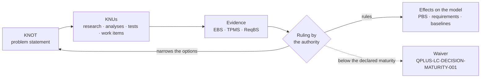

# eWTW — KNOT Register

**Model:** AMPEL360 · [eWTW][MODEL]
**Location:** `01_OPTIONS_ARCHITECTURE/01-02_PROGRAMMES/01-02-01_AMPEL360/01-02-01-01_MODELS/01-02-01-01-01_eWTW/01-02-01-01-01-02_KNOT_Knowledge-Node-Register/`
**Convention:** [`AMPEL360-KNOT-CM-004`][CM-004] Issue 1 — *PROPOSED*
**Version:** 0.5.0 · **Date:** 2026-11-13

This register holds what the eWTW must decide or satisfy — its **KNOTs** — and how each is to be resolved: its **Knowledge Units**, the **KNUs**. A KNOT states the problem. Its KNUs are the research, analyses, tests and other work that produce the knowledge to resolve it. A ruling records the decision with its rationale, and the options not retained stay in the record.

The records are YAML files, one per KNOT, each holding its KNUs. They are filed by scope, so that the register can grow without becoming one flat list: a KNOT that applies to a single S-ATLAS chapter sits in that chapter's folder, a KNOT whose home is still to be ruled sits in the folder of the chapter that raised it, and a KNOT that spans several chapters sits in `000_General/`, named after S-ATLAS chapter `000` *General* (rule 11 of [CM-004][CM-004]). The folder is a filing place, not part of the identity: a record moves when its scope is ruled, and its identifier does not change. This page is a view of the records. The [model README §5][MODEL-5] summarises the same KNOTs and shows how the decisions depend on one another.

The [architecture relations][REL] node reads these records. It projects taxonomy and programme relations onto the KNOTs — the candidates for a decision — and checks the registered options, the `taxonomy` field and `depends_on` against them. It changes no record here.

---

## How a KNOT is resolved



No decision anchor has declared its criteria or its maturity thresholds yet: `criteria` and `maturity_required` are empty in every record, so no option can be scored (rule 5 of [CM-004][CM-004]). The verification script enforces that gate. Each anchor has a KNU that declares them first — a dedicated one for the configuration decisions (`KNU-EWTW-PRP-001-01` also serves `SRC`), the analysis KNU for the ownership rulings. A ruling may narrow the options without closing the KNOT, as ruling R1 of `KNOT-EWTW-NRG-001` did.

---

## Register

| KNOT | Title | Kind | Filed under | Resolution | KNUs | Proposed owner |
|---|---|---|---|---|:-:|---|
| `KNOT-EWTW-CAD-001` | 3D model of record | `control-intent` | `000` | OPEN | 3 | `STK_CM` |
| `KNOT-EWTW-ESS-001` | Essential power | `decision-anchor` | `000` | OPEN | 3 | `STK_SAF` |
| `KNOT-EWTW-LCM-001` | Lifecycle notation and registry pin | `lifecycle-constraint` | `000` | OPEN | 2 | `STK_CM` |
| `KNOT-EWTW-NRG-001` | Energy carrier | `decision-anchor` | `000` | OPEN | 7 | `STK_SE` |
| `KNOT-EWTW-PRP-001` | Propulsion chain | `decision-anchor` | `000` | OPEN | 5 | `STK_SE` |
| `KNOT-EWTW-SRC-001` | Electrical sources | `decision-anchor` | `000` | OPEN | 3 | `STK_SE` |
| `KNOT-EWTW-STO-001` | Role of energy storage | `decision-anchor` | `000` | OPEN | 4 | `STK_SE` |
| `KNOT-EWTW-DAT-001` | Fuselage datum and master geometry | `decision-anchor` | `053` | OPEN | 3 | `STK_SE` |
| `KNOT-EWTW-DFN-001` | Dorsal-fin root fairing | `decision-anchor` | `053` | OPEN | 1 | `STK_SE` |
| `KNOT-EWTW-KEL-001` | Keel-beam taxonomy home | `decision-anchor` | `053` | OPEN | 2 | `STK_CM` |
| `KNOT-EWTW-LUG-001` | Wing-attach lugs | `decision-anchor` | `053` | OPEN | 1 | `STK_SE` |
| `KNOT-EWTW-MLG-001` | MLG configuration | `decision-anchor` | `053` | OPEN | 2 | `STK_SE` |
| `KNOT-EWTW-ROD-001` | Rear adjustable rods | `decision-anchor` | `053` | OPEN | 4 | `STK_SE` |
| `KNOT-EWTW-TSI-001` | Tail-strike indicator | `decision-anchor` | `053` | OPEN | 1 | `STK_SE` |

### Rulings recorded

| KNOT | Ruling | Date | Statement | State |
|---|---|---|---|---|
| `KNOT-EWTW-NRG-001` | R1 | 2026-11-07 | Scope narrowed: all-electric, or hybrid-electric with conventional fuel; liquid hydrogen allocated to the [BWB-Q100][BWB]. Option D, cryogenic hydrogen, excluded; the KNOT stays open | `PROVISIONAL` — neither rationale nor evidence is recorded; `KNU-EWTW-NRG-001-07` |

The same ruling removes fuel cells from `KNOT-EWTW-SRC-001`. A provisional ruling directs the work, but it is not an auditable basis: both exclusions stand on the authority's statement alone until R1 is completed, and no KNOT can be ruled on it (rule 4).

---

## By S-ATLAS chapter

Each record lists, in its `taxonomy` field, the [S-ATLAS][S-ATLAS] chapters it applies to: for a configuration decision, the chapters of the model README §3 rows it unblocks — and `053` for the energy-carrier bay. The identifiers carry no classification ([CM-004][CM-004] §4). Generated from the records:

| Chapter | S-ATLAS title | KNOTs |
|---|---|---|
| `012` | Servicing | `ESS` · `SRC` |
| `021` | Air Conditioning Environmental Control | `NRG` · `PRP` · `STO` |
| `022` | Auto Flight | `ESS` · `PRP` |
| `023` | Communications | `ESS` |
| `024` | Electrical Power | `ESS` · `NRG` · `PRP` · `SRC` · `STO` |
| `026` | Fire Protection | `ESS` · `NRG` · `STO` |
| `027` | Flight Control | `PRP` |
| `028` | Energy Carrier Storage and Distribution | `NRG` |
| `031` | Indicating and Recording Systems | `ESS` |
| `034` | Navigation | `ESS` |
| `042` | Integrated Modular Avionics | `ESS` |
| `046` | Information Systems | `ESS` |
| `047` | Inerting and Protective Atmospheres | `ESS` · `NRG` · `STO` |
| `049` | Auxiliary Power Module | `ESS` · `SRC` |
| `053` | Fuselage | `NRG` · `DAT` · `ROD` |
| `061` | Powerplant Installation and Nacelle Integration | `PRP` |
| `062` | Combustion Machinery | `PRP` |
| `063` | Combustion Systems for Sustainable Carriers | `PRP` |
| `064` | Carrier Delivery Metering and Conditioning | `NRG` · `PRP` |
| `065` | Engine Air and Thermal Management | `PRP` |
| `066` | Control Monitoring and Indicating | `PRP` |
| `067` | Exhaust Emissions and Contrail Management | `PRP` |
| `068` | Turbogenerators and Power Offtakes | `NRG` · `PRP` · `SRC` · `STO` |
| `069` | Lubrication Ignition Starting and Accessories | `PRP` |
| `071` | Propulsion Architectures and Energy Management | `PRP` |
| `072` | Electric Machines for Propulsion | `PRP` |
| `073` | Power Electronics and Conversion | `PRP` |
| `074` | Propulsion Energy Storage Systems | `NRG` · `PRP` · `SRC` · `STO` |
| `076` | Propulsion Power Distribution and Protection | `ESS` · `PRP` · `SRC` |
| `077` | Electric Propulsors Installation and Distributed Integration | `PRP` |
| `078` | Thermal Management of Electric Propulsion | `NRG` · `PRP` · `STO` |
| `079` | High Voltage Safety and System Evidence | `ESS` · `NRG` · `PRP` · `SRC` · `STO` |

Home to be ruled, since each decides where its scope lives: `DFN` · `KEL` · `LUG` · `MLG` · `TSI`. Lifecycle, with no chapter: `LCM`. Control of artefacts, with no chapter: `CAD`.

---

## Research agenda

The KNUs neither done nor cancelled, generated from the records (rule 9). One KNU is pending review: `KNU-EWTW-CAD-001-02`, whose check ran on 2026-11-13. The others are proposed and have not started.

| KNU | Title | Class | Also serves | Progress |
|---|---|---|---|---|
| `KNU-EWTW-CAD-001-01` | Source of record, script or FreeCAD document | `ANALYSIS_PACKAGE` | — | NOT_STARTED |
| `KNU-EWTW-CAD-001-02` | Round trip of EWTW-533001-000 through FreeCAD | `VERIFICATION_OBJECT` | — | PENDING_REVIEW |
| `KNU-EWTW-CAD-001-03` | CAD convention | `CONTROLLED_ARTEFACT` | `DAT` | NOT_STARTED |
| `KNU-EWTW-ESS-001-01` | Essential loads and duration | `ANALYSIS_PACKAGE` | — | NOT_STARTED |
| `KNU-EWTW-ESS-001-02` | Essential source options | `ANALYSIS_PACKAGE` | — | NOT_STARTED |
| `KNU-EWTW-ESS-001-03` | Decision criteria and maturity thresholds | `REQUIREMENT_SET` | — | NOT_STARTED |
| `KNU-EWTW-LCM-001-01` | Baseline notation | `WORK_ITEM` | — | NOT_STARTED |
| `KNU-EWTW-LCM-001-02` | Registry re-pin | `WORK_ITEM` | — | NOT_STARTED |
| `KNU-EWTW-NRG-001-01` | Decision criteria and maturity thresholds | `REQUIREMENT_SET` | — | NOT_STARTED |
| `KNU-EWTW-NRG-001-02` | Design mission and reserve policy | `REQUIREMENT_SET` | `PRP` · `SRC` · `STO` | NOT_STARTED |
| `KNU-EWTW-NRG-001-03` | Mission energy and power budget | `ANALYSIS_PACKAGE` | `PRP` · `SRC` · `STO` | NOT_STARTED |
| `KNU-EWTW-NRG-001-04` | Battery technology state | `EVIDENCE_RECORD` | `STO` | NOT_STARTED |
| `KNU-EWTW-NRG-001-05` | Thermal machine on conventional fuel | `ANALYSIS_PACKAGE` | `PRP` · `SRC` | NOT_STARTED |
| `KNU-EWTW-NRG-001-06` | Trade study of the energy carrier | `ANALYSIS_PACKAGE` | — | NOT_STARTED |
| `KNU-EWTW-NRG-001-07` | Rationale and evidence of ruling R1 | `EVIDENCE_RECORD` | — | NOT_STARTED |
| `KNU-EWTW-PRP-001-01` | Decision criteria and maturity thresholds | `REQUIREMENT_SET` | `SRC` | NOT_STARTED |
| `KNU-EWTW-PRP-001-02` | Propulsor architecture | `ANALYSIS_PACKAGE` | — | NOT_STARTED |
| `KNU-EWTW-PRP-001-03` | Efficiency and heat chain | `ANALYSIS_PACKAGE` | `SRC` | NOT_STARTED |
| `KNU-EWTW-PRP-001-04` | Propulsion failure cases | `ANALYSIS_PACKAGE` | — | NOT_STARTED |
| `KNU-EWTW-PRP-001-05` | PBS group for a thermal machine | `CONTROLLED_ARTEFACT` | — | NOT_STARTED |
| `KNU-EWTW-SRC-001-01` | Electrical load analysis | `ANALYSIS_PACKAGE` | `STO` · `ESS` | NOT_STARTED |
| `KNU-EWTW-SRC-001-02` | Source sizing | `ANALYSIS_PACKAGE` | — | NOT_STARTED |
| `KNU-EWTW-SRC-001-03` | Distribution architecture | `ANALYSIS_PACKAGE` | `ESS` | NOT_STARTED |
| `KNU-EWTW-STO-001-01` | Storage role and size | `ANALYSIS_PACKAGE` | — | NOT_STARTED |
| `KNU-EWTW-STO-001-02` | Battery installation safety | `REQUIREMENT_SET` | — | NOT_STARTED |
| `KNU-EWTW-STO-001-03` | Propagation test plan | `VERIFICATION_OBJECT` | — | NOT_STARTED |
| `KNU-EWTW-STO-001-04` | Decision criteria and maturity thresholds | `REQUIREMENT_SET` | — | NOT_STARTED |
| `KNU-EWTW-DAT-001-01` | Datum and master-geometry practice | `ANALYSIS_PACKAGE` | — | NOT_STARTED |
| `KNU-EWTW-DAT-001-02` | Envelope of record for the aft fuselage | `CONTROLLED_ARTEFACT` | — | NOT_STARTED |
| `KNU-EWTW-DAT-001-03` | Assembly check across stations | `VERIFICATION_OBJECT` | — | NOT_STARTED |
| `KNU-EWTW-DFN-001-01` | Fairing ownership | `ANALYSIS_PACKAGE` | — | NOT_STARTED |
| `KNU-EWTW-KEL-001-01` | Taxonomy home of the keel beam | `CONTROLLED_ARTEFACT` | — | NOT_STARTED |
| `KNU-EWTW-KEL-001-02` | Station binding | `WORK_ITEM` | — | NOT_STARTED |
| `KNU-EWTW-LUG-001-01` | Wing-attach interface split | `ANALYSIS_PACKAGE` | — | NOT_STARTED |
| `KNU-EWTW-MLG-001-01` | Trunnion location | `ANALYSIS_PACKAGE` | — | NOT_STARTED |
| `KNU-EWTW-MLG-001-02` | 053-200 engine note | `CONTROLLED_ARTEFACT` | — | NOT_STARTED |
| `KNU-EWTW-ROD-001-01` | Function of adjustable rods in a rear fuselage | `ANALYSIS_PACKAGE` | — | NOT_STARTED |
| `KNU-EWTW-ROD-001-02` | Rod set requirements | `REQUIREMENT_SET` | — | NOT_STARTED |
| `KNU-EWTW-ROD-001-03` | Interfaces of station 053-300-020 | `CONTROLLED_ARTEFACT` | — | NOT_STARTED |
| `KNU-EWTW-ROD-001-04` | 3D model request EWTW-533002-000 | `CONTROLLED_ARTEFACT` | — | NOT_STARTED |
| `KNU-EWTW-TSI-001-01` | Tail-strike provision and sensing | `ANALYSIS_PACKAGE` | — | NOT_STARTED |

Seven KNUs touch protected areas and are author acts. Six are in the PBS: `KNU-EWTW-PRP-001-05`, `KNU-EWTW-KEL-001-02`, `KNU-EWTW-ROD-001-03`, `KNU-EWTW-ROD-001-04`, `KNU-EWTW-DAT-001-02` and `KNU-EWTW-CAD-001-03`. One is in the taxonomy: `KNU-EWTW-KEL-001-01`. Five are conditional on their KNOT's ruling: `KNU-EWTW-PRP-001-05`, `KNU-EWTW-STO-001-03`, and `KNU-EWTW-ROD-001-02`, `-03` and `-04`, which run only if the ruling keeps the rod station.

---

## PBS nodes pending a ruling

This view is generated from the `gates` relations in the KNOT records. Each row identifies the existing PBS node, the decision's effectivity and the allocation awaiting that decision. The option's `pbs_footprint` describes the candidate structure; each element has one owning KNOT, the only one that creates it, and the other KNOTs update or populate it by its `key` (rule 18). A complete ruling records the requirements and authorised changes by view, and `embodied_in` references the first ratified baseline for the affected scope. [CM-004 §8][CM-004]

| PBS node | KNOT | Resolution | Effectivity | Pending allocation |
|---|---|---|---|---|
| `eWTW-PBS-024-000` | `KNOT-EWTW-ESS-001` | OPEN | eWTW / model scope / initial definition | Essential feeds and segregation |
| `eWTW-PBS-024-000` | `KNOT-EWTW-SRC-001` | OPEN | eWTW / model scope / initial definition | Source-dependent conversion, protection and distribution |
| `eWTW-PBS-028-000` | `KNOT-EWTW-STO-001` | OPEN | eWTW / model scope / initial definition | Storage installation by allocated role |
| `eWTW-PBS-053-200-010` | `KNOT-EWTW-LUG-001` | OPEN | eWTW / model scope / initial definition | Wing-attach lug ownership and interface split |
| `eWTW-PBS-053-200-030` | `KNOT-EWTW-MLG-001` | OPEN | eWTW / model scope / initial definition | Main landing gear trunnion mounting |
| `eWTW-PBS-053-300-020` | `KNOT-EWTW-ROD-001` | OPEN | eWTW / model scope / initial definition | Function, hosts and interfaces of the adjustable rods |
| `eWTW-PBS-053-300-030` | `KNOT-EWTW-TSI-001` | OPEN | eWTW / model scope / initial definition | Tail-strike provision and sensing ownership |
| `eWTW-PBS-053-400-040` | `KNOT-EWTW-DFN-001` | OPEN | eWTW / model scope / initial definition | Dorsal-fin root fairing ownership |
| `eWTW-PBS-053-600-090` | `KNOT-EWTW-KEL-001` | OPEN | eWTW / model scope / initial definition | Keel-beam taxonomy binding |
| `eWTW-PBS-053-900-000` | `KNOT-EWTW-NRG-001` | OPEN | eWTW / model scope / initial definition | Energy-carrier bay contents and installation |
| `eWTW-PBS-071-000` | `KNOT-EWTW-PRP-001` | OPEN | eWTW / model scope / initial definition | Propulsion module and installation allocation |

---

## Research briefs

Every KNOT carries a `context`, and every KNU that needs outside research a `research_brief` with its questions. Together with [`model-context.yaml`](model-context.yaml) — the aircraft, the research rules and the deliverable, written once — they form a prompt that can be handed as it is to a deep-research agent. From the repository root, with `REG` set as in *How to verify*, this command prints the brief of one KNU:

```sh
python3 - "$REG" KNU-EWTW-NRG-001-04 <<'EOF'
import pathlib, sys, yaml
reg, kid = pathlib.Path(sys.argv[1]), sys.argv[2]
p = next(reg.rglob("KNOT-" + kid[4:16] + ".yaml")); k = yaml.safe_load(p.read_text(encoding="utf-8"))["knot"]
u = next(x for x in k["knus"] if x["knu_id"] == kid)
if not u["research_brief"]: sys.exit(kid + " has no research brief: it is not a research task")
out = dict(yaml.safe_load((reg / "model-context.yaml").read_text(encoding="utf-8")))
out["decision"] = {f: k[f] for f in ("knot_id", "title", "question", "context", "effectivity", "options", "assumptions")}
out["task"] = {f: u[f] for f in ("knu_id", "title", "knu_class", "description", "research_brief", "exit")}
print(yaml.safe_dump(out, sort_keys=False, allow_unicode=True, width=110))
EOF
```

27 of the 41 KNUs have a brief. The other fourteen are work items, author acts, checks on the models and the authority's own rationale for R1, which no outside research can supply. The briefs state only what the model has declared; they are proposed text, to be sharpened before a research run.

---

## How to verify

From the repository root:

```bash
TAX="01_OPTIONS_ARCHITECTURE/01-03_TECHNOLOGIES/01-03-01_Q+ATLANTIDE/000-099_S-ATLAS"
REG="01_OPTIONS_ARCHITECTURE/01-02_PROGRAMMES/01-02-01_AMPEL360/01-02-01-01_MODELS/01-02-01-01-01_eWTW/01-02-01-01-01-02_KNOT_Knowledge-Node-Register"
python3 tools/knot_check.py "$REG" "$TAX"
python3 tools/knot_check_test.py
```

The first line reads `14 KNOTs, 41 KNUs, 32 S-ATLAS chapters; rule failures: none` and the second `Provisional rulings: `NRG` R1`; the remaining output reproduces the four tables and the three lines under the chapter table. [`tools/knot_check.py`](../../../../../../tools/knot_check.py) checks record fields, filing, scoring and ruling state, identifiers, vocabularies, references between KNOTs, S-ATLAS addresses, KNU outputs and exit criteria, and the absence of conformity claims. It also validates effectivity, option footprints and ruling fields, checks that each product element has a single owning KNOT (rule 18), and resolves each `gates` reference to a canonical PBS node. A KNOT recorded in more than one file is a failure. It exits with status 1 on a rule failure and then prints only the two first lines. [`tools/knot_check_test.py`](../../../../../../tools/knot_check_test.py) runs 14 tests: the register as it stands, and thirteen copies that each break one rule.

---

## Revision history

| Version | Date | Change |
|---|---|---|
| 0.1.0 | 2026-11-08 | Register created: the 11 KNOTs of the model README 0.3.0 §5 as records, 29 KNUs proposed, ruling R1 of `KNOT-EWTW-NRG-001` recorded; S-ATLAS chapters per KNOT and the view by chapter |
| 0.2.0 | 2026-11-12 | Review of 0.1.0 applied. Records filed by scope: `053_Fuselage/` and `000_General/`. Scoring gate and required fields enforced by the script; `maturity_required` on every decision anchor; criteria KNUs added for `STO` and `ESS` (31 KNUs). R1 marked `PROVISIONAL`; `KNU-EWTW-NRG-001-07` now covers its evidence and writes the reopen condition to the KNOT |
| 0.3.0 | 2026-11-12 | `context` on every KNOT and `research_brief` on 24 KNUs, with `model-context.yaml`: together they are a prompt for a deep-research agent; command to print one brief |
| 0.4.0 | 2026-11-12 | Added effectivity, candidate PBS footprints, ruling effects across SBS views, baseline embodiment and a generated view of pending PBS allocations. |
| 0.4.1 | 2026-11-12 | Review of 0.4.0 applied. Each footprint element has a `key` and one owning KNOT: the battery installation belongs to `NRG`, the turbogenerator to `SRC`, filed under S-ATLAS `068` by the authority's ruling of 2026-11-12. Footprints for `STO` options B and C. Verifier moved to `tools/knot_check.py` with 13 tests in `tools/knot_check_test.py` |
| 0.4.2 | 2026-11-13 | Pointer to the architecture relations node, which reads this register. The checker reports a KNOT recorded in more than one file. No record changed |
| 0.5.0 | 2026-11-13 | Three KNOTs that precede the next 3D model, with ten KNUs: `KNOT-EWTW-CAD-001` 3D model of record, `KNOT-EWTW-DAT-001` fuselage datum and master geometry, `KNOT-EWTW-ROD-001` rear adjustable rods. The checker lists control KNOTs that have no chapter. `KNU-EWTW-CAD-001-02` ran once with `tools/freecad_roundtrip.py` and is pending review |

[MODEL]: ../README.md
[REL]: ../01-02-01-01-01-03_REL_Architecture-Relations/README.md
[MODEL-5]: ../README.md#5-open-knots
[CM-004]: AMPEL360-KNOT-CM-004_Knowledge-Nodes-and-Units.md
[BWB]: ../../01-02-01-01-02_BWB-Q100/README.md
[S-ATLAS]: ../../../../../01-03_TECHNOLOGIES/01-03-01_Q+ATLANTIDE/000-099_S-ATLAS/
