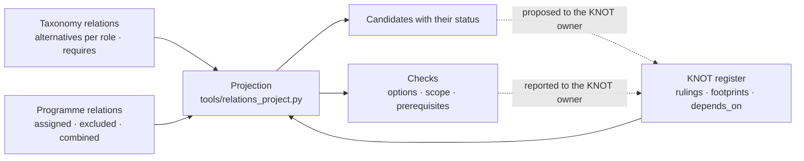

# eWTW — Architecture Relations

**Model:** AMPEL360 · [eWTW][MODEL]
**Location:** `01_OPTIONS_ARCHITECTURE/01-02_PROGRAMMES/01-02-01_AMPEL360/01-02-01-01_MODELS/01-02-01-01-01_eWTW/01-02-01-01-01-03_REL_Architecture-Relations/`
**Conventions:** [`AMPEL360-REL-CM-005`][CM-005] Issue 1 · [`QPLUS-REL-001`][REL-001] Issue 1 — both *PROPOSED*
**Version:** 0.2.0 · **Date:** 2026-11-14

This node records how the technologies open to the eWTW relate to one another, and what the AMPEL360 programme has assigned, excluded or admitted. A tool projects those relations onto the [KNOT register][KNOT-REG]. For a decision it lists the candidates, the product elements each candidate uses, what each candidate requires and the decisions that come first.

The projection proposes. An option enters a KNOT through its owner, and the authority decides by ruling ([CM-004][CM-004]).

---

## From relations to a decision



| File | Level | Content |
|---|---|---|
| [`taxonomy-relations.yaml`](taxonomy-relations.yaml) | Taxonomy | 2 alternatives sets and 5 relations between S-ATLAS nodes. A pilot set, held here until the taxonomy owner adopts [QPLUS-REL-001][REL-001] |
| [`programme-relations.yaml`](programme-relations.yaml) | Programme | 2 decision links (`decided-by`), 1 assignment, 1 exclusion, 1 combination |
| — | Model and product | Read from the [KNOT register][KNOT-REG], the PBS and the IBS. Not copied here ([CM-005][CM-005] §5 and §6) |

Every record is `PROPOSED`. The exclusion and the assignment take their state from ruling R1 of `KNOT-EWTW-NRG-001`, which is `PROVISIONAL`.

---

## Projections

This section is the output of [`tools/relations_project.py`][TOOL], written with `--write`. With `--check` the tool fails when the section differs from what the records give.

<!-- projections:begin -->
2 alternative sets, 7 taxonomy relations, 5 programme relations; rule failures: none

Sources not yet checked: auxiliary-power-module-as-essential-source-requires-bridging-storage · emergency-backup-power-references-cs-25-1351-d · essential-electrical-power-source · propulsion-storage-as-essential-source-requires-network-interface · propulsion-storage-interfaces-with-distribution · turbogenerator-as-essential-source-requires-bridging-storage · turbogenerator-requires-carrier-delivery

### electric power for propulsion — eWTW — `KNOT-EWTW-SRC-001`

| Candidate | Status | Product elements and owning KNOT | Requires |
|---|---|---|---|
| `068` Turbogenerators and Power Offtakes | open | `turbogenerator-installation` (`SRC`) | `064` |
| `068` Turbogenerators and Power Offtakes + `074` Propulsion Energy Storage Systems | open, combination | `propulsive-battery-installation` (`NRG`) · `turbogenerator-installation` (`SRC`) | `064` · `078` |
| `074` Propulsion Energy Storage Systems | open | `propulsive-battery-installation` (`NRG`) | `078` |
| `075` Fuel Cell Electric Powertrains | excluded by `KNOT-EWTW-NRG-001#R1` (PROVISIONAL) | none recorded | — |

Options: the open candidates match registered options A, B, C.
Scope: every open candidate lies in a chapter of the KNOT's `taxonomy` field.
Prerequisites: derived from element ownership `NRG`; declared in the register `NRG`; consistent.

### essential electrical power — eWTW — `KNOT-EWTW-ESS-001`

| Candidate | Status | Product elements and owning KNOT | Requires |
|---|---|---|---|
| `024-360` Aircraft Energy Storage | open | `essential-battery-installation` (`STO`) | — |
| `049` Auxiliary Power Module | open | `auxiliary-power-module` (`ESS`) | `024-360` |
| `068` Turbogenerators and Power Offtakes | open | `turbogenerator-installation` (`SRC`) | `024-360` · `064` |
| `074` Propulsion Energy Storage Systems | open | `propulsive-battery-installation` (`NRG`) | `076-700` · `078` |
| `075` Fuel Cell Electric Powertrains | excluded by `KNOT-EWTW-NRG-001#R1` (PROVISIONAL) | none recorded | — |

No S-ATLAS address: ram-air turbine — nearest `024-230` Emergency Backup Power.
Options: the open candidates match registered options A, C, D, E.
Option B stands on a candidate that has no S-ATLAS address: `024-230` + `024-360`.
Scope: open candidates lie in chapters outside the KNOT's `taxonomy` field: `068` · `074`.
Prerequisites: derived from element ownership `NRG` · `SRC` · `STO`; declared in the register `SRC` · `STO`; consistent.
<!-- projections:end -->

---

## What the pilot shows

1. **Electrical sources: the records regenerate the registered options.** One alternatives set and one programme combination give options A, B and C of `KNOT-EWTW-SRC-001`, and fuel cells appear as excluded with the state of R1. The inputs were written with those options in view. The result shows that the records are sufficient to regenerate them, not that they predicted them.
2. **Essential power: five options stand on the records.** `KNOT-EWTW-ESS-001` registers options A to E, all `open`. A, C, D and E match the four open candidates, each taken with what it brings for the role: the essential battery that bridges the start of `049` and the transfer of `068`, and the feed to the essential network for `074`. Option B, the ram-air turbine, stands on a candidate that has no S-ATLAS address. None is scored: the criteria of the KNOT are still proposed.
3. **The scope of `KNOT-EWTW-ESS-001` is narrower than its options.** Options C and E have footprints in chapters `068` and `074`, which the `taxonomy` field of the KNOT does not include. The owner adds them on accepting the option set, at the review of `KNU-EWTW-ESS-001-02`.
4. **The ram-air turbine has no S-ATLAS node.** Option B files its installation at the nearest node, `024-230` *Emergency Backup Power*, and says so in the footprint. Its taxonomy home is a ruling for the taxonomy owner, as for the keel beam in `KNOT-EWTW-KEL-001`.
5. **The prerequisites agree with the register.** They are derived from who owns the product elements, which is a record independent of `depends_on`. For essential power the derivation gives `NRG`, `SRC` and `STO`; the register declares `SRC` and `STO`, and `SRC` already waits for `NRG`.
6. **Four of the five options use the essential battery.** `essential-battery-installation` is created by option C of `KNOT-EWTW-STO-001` and updated by options A to D here: sized for the whole endurance in A, for a bridge in B, C and D. Its footprint is now filed at `024-360`, the address of the candidate. If storage is ruled without that option, the four options lose the element they update. An essential battery may be needed whatever role storage is given, so which KNOT owns the element is a point for the two owners.
7. **The two bridging requirements are derived.** That an auxiliary power module or a generator channel needs a store while it starts or transfers follows from the rule that services for immediate safety stay on without crew action. No source states it for these two kinds of source, and the records say so.
8. **Seven of the nine taxonomy records have no checked source, and three of them have no source.** A source counts as checked when the document was opened on that date and its stated scope supports the claim. Reading at clause level belongs to ratification. The essential-power set now cites the two research records kept in the KNOT register.

---

## How to verify

From the repository root:

```bash
TAX="01_OPTIONS_ARCHITECTURE/01-03_TECHNOLOGIES/01-03-01_Q+ATLANTIDE/000-099_S-ATLAS"
MODEL="01_OPTIONS_ARCHITECTURE/01-02_PROGRAMMES/01-02-01_AMPEL360/01-02-01-01_MODELS/01-02-01-01-01_eWTW"
python3 tools/relations_project.py "$MODEL/01-02-01-01-01-03_REL_Architecture-Relations" "$MODEL/01-02-01-01-01-02_KNOT_Knowledge-Node-Register" "$TAX" --check
python3 tools/relations_project_test.py
```

The output is the section [Projections](#projections). With `--check` the tool compares the two and fails when they differ, so the section cannot fall behind the records unnoticed. `--write` replaces the section. The tool exits with status 1 on a rule failure and then prints only its first line, which names the failures.

The tool reads the working tree. The run that counts is the one on a commit, in review or on a clean checkout.

[`tools/relations_project_test.py`][TEST] runs 50 tests on copies of the relations and of the register: the pilot as committed, and copies that each change one input. Among them are a combination removed, an exclusion removed, a combination with an excluded member, a withdrawn set and its replacement, a second deciding KNOT for one role, a model outside the effectivity of the KNOT, a malformed assignment, a date that is not a date, a file that cannot be read, a KNOT recorded twice, a rejected option, a role requirement removed or withdrawn, an option on a candidate without an address, a stale README and a record that carries control characters.

---

## Revision history

| Version | Date | Change |
|---|---|---|
| 0.1.0 | 2026-11-12 | Node created: `AMPEL360-REL-CM-005` Issue 1 and `QPLUS-REL-001` Issue 1, both proposed; pilot relations for the eWTW; projections for electric power for propulsion and for essential electrical power; `tools/relations_project.py` with 18 tests |
| 0.1.1 | 2026-11-13 | Review applied. Decision links have a key, an authority and a state, and a role has one deciding KNOT per model. Assignments, models and dates are validated. A withdrawn set leaves its role free. Rejected options no longer count as standing. Unreadable inputs and duplicate KNOT files are failures instead of crashes. The Projections section is written and checked by the tool. 42 tests |
| 0.2.0 | 2026-11-14 | `KNOT-EWTW-ESS-001` registers five options. Two `requires` relations for essential electrical power: bridging storage for `049` and for `068`. Step 5 of the projection takes a candidate with what it brings for the role, and names an option that stands on a candidate with no address. The essential battery footprint of `KNOT-EWTW-STO-001` is filed at `024-360`. 50 tests |

[MODEL]: ../README.md
[KNOT-REG]: ../01-02-01-01-01-02_KNOT_Knowledge-Node-Register/README.md
[CM-004]: ../01-02-01-01-01-02_KNOT_Knowledge-Node-Register/AMPEL360-KNOT-CM-004_Knowledge-Nodes-and-Units.md
[CM-005]: AMPEL360-REL-CM-005_Architecture-Relations.md
[REL-001]: QPLUS-REL-001_Taxonomy-Relations.md
[TOOL]: ../../../../../../tools/relations_project.py
[TEST]: ../../../../../../tools/relations_project_test.py
