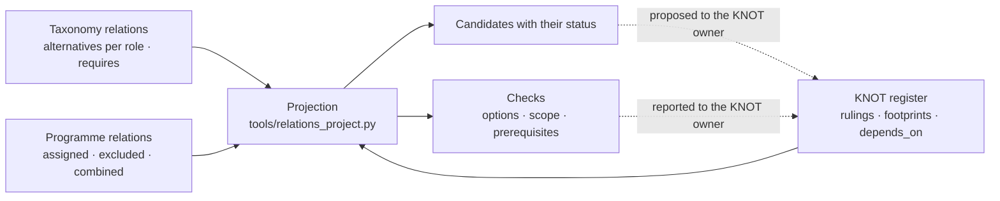

# eWTW — Architecture Relations

**Model:** AMPEL360 · [eWTW][MODEL]
**Location:** `01_OPTIONS_ARCHITECTURE/01-02_PROGRAMMES/01-02-01_AMPEL360/01-02-01-01_MODELS/01-02-01-01-01_eWTW/01-02-01-01-01-03_REL_Architecture-Relations/`
**Conventions:** [`AMPEL360-REL-CM-005`][CM-005] Issue 1 · [`QPLUS-REL-001`][REL-001] Issue 1 — both *PROPOSED*
**Version:** 0.1.1 · **Date:** 2026-11-13

This node records how the technologies open to the eWTW relate to one another, and what the AMPEL360 programme has assigned, excluded or admitted. A tool projects those relations onto the [KNOT register][KNOT-REG]. For a decision it lists the candidates, the product elements each candidate uses, what each candidate requires and the decisions that come first.

The projection proposes. An option enters a KNOT through its owner, and the authority decides by ruling ([CM-004][CM-004]).

---

## From relations to a decision



| File | Level | Content |
|---|---|---|
| [`taxonomy-relations.yaml`](taxonomy-relations.yaml) | Taxonomy | 2 alternatives sets and 5 relations between S-ATLAS nodes. A pilot set, held here until the taxonomy owner adopts [QPLUS-REL-001][REL-001] |
| [`programme-relations.yaml`](programme-relations.yaml) | Programme | 2 decision links (`decided-by`), 1 assignment, 1 exclusion, 1 combination |
| — | Model and product | Read from the [KNOT register][KNOT-REG], the PBS and the IBS. Not copied here ([CM-005][CM-005] §5 and §6) |

Every record is `PROPOSED`. The exclusion and the assignment take their state from ruling R1 of `KNOT-EWTW-NRG-001`, which is `PROVISIONAL`.

---

## Projections

This section is the output of [`tools/relations_project.py`][TOOL], written with `--write`. With `--check` the tool fails when the section differs from what the records give.

<!-- projections:begin -->
2 alternative sets, 5 taxonomy relations, 5 programme relations; rule failures: none

Sources not yet checked: emergency-backup-power-references-cs-25-1351-d · essential-electrical-power-source · propulsion-storage-as-essential-source-requires-network-interface · propulsion-storage-interfaces-with-distribution · turbogenerator-requires-carrier-delivery

### electric power for propulsion — eWTW — `KNOT-EWTW-SRC-001`

| Candidate | Status | Product elements and owning KNOT | Requires |
|---|---|---|---|
| `068` Turbogenerators and Power Offtakes | open | `turbogenerator-installation` (`SRC`) | `064` |
| `068` Turbogenerators and Power Offtakes + `074` Propulsion Energy Storage Systems | open, combination | `propulsive-battery-installation` (`NRG`) · `turbogenerator-installation` (`SRC`) | `064` · `078` |
| `074` Propulsion Energy Storage Systems | open | `propulsive-battery-installation` (`NRG`) | `078` |
| `075` Fuel Cell Electric Powertrains | excluded by `KNOT-EWTW-NRG-001#R1` (PROVISIONAL) | none recorded | — |

Options: the open candidates match registered options A, B, C.
Scope: every open candidate lies in a chapter of the KNOT's `taxonomy` field.
Prerequisites: derived from element ownership `NRG`; declared in the register `NRG`; consistent.

### essential electrical power — eWTW — `KNOT-EWTW-ESS-001`

| Candidate | Status | Product elements and owning KNOT | Requires |
|---|---|---|---|
| `024-360` Aircraft Energy Storage | open | `essential-battery-installation` (`STO`) | — |
| `049` Auxiliary Power Module | open | none recorded | — |
| `068` Turbogenerators and Power Offtakes | open | `turbogenerator-installation` (`SRC`) | `064` |
| `074` Propulsion Energy Storage Systems | open | `propulsive-battery-installation` (`NRG`) | `076-700` · `078` |
| `075` Fuel Cell Electric Powertrains | excluded by `KNOT-EWTW-NRG-001#R1` (PROVISIONAL) | none recorded | — |

No S-ATLAS address: ram-air turbine — nearest `024-230` Emergency Backup Power.
Options: none registered with a footprint; the 4 open candidates are proposals.
Scope: open candidates lie in chapters outside the KNOT's `taxonomy` field: `068` · `074`.
Prerequisites: derived from element ownership `NRG` · `SRC` · `STO`; declared in the register `SRC` · `STO`; consistent.
<!-- projections:end -->

---

## What the pilot shows

1. **Electrical sources: the records regenerate the registered options.** One alternatives set and one programme combination give options A, B and C of `KNOT-EWTW-SRC-001`, and fuel cells appear as excluded with the state of R1. The inputs were written with those options in view. The result shows that the records are sufficient to regenerate them, not that they predicted them.
2. **Essential power: four candidates, none yet an option.** `KNOT-EWTW-ESS-001` registers no option with a footprint. The four open candidates are an input to `KNU-EWTW-ESS-001-02` *Essential source options*.
3. **The scope of `KNOT-EWTW-ESS-001` may be too narrow.** Chapters `068` and `074` hold open candidates and are not in the `taxonomy` field of the KNOT. If `KNU-EWTW-ESS-001-02` retains either, the field gains the chapter.
4. **The ram-air turbine has no S-ATLAS node.** The nearest is `024-230` *Emergency Backup Power*. If the option study retains it, its taxonomy home is a ruling for the taxonomy owner, as for the keel beam in `KNOT-EWTW-KEL-001`.
5. **The prerequisites agree with the register.** They are derived from who owns the product elements, which is a record independent of `depends_on`. For essential power the derivation gives `NRG`, `SRC` and `STO`; the register declares `SRC` and `STO`, and `SRC` already waits for `NRG`.
6. **One footprint is coarser than its candidate.** `essential-battery-installation` is filed at chapter `024`, and the candidate is `024-360`. The join holds by containment. Filing the footprint at `024-360` in `KNOT-EWTW-STO-001` makes it exact.
7. **`049` *Auxiliary Power Module* has no product element in the register.** No option of any KNOT creates one.
8. **Five of the seven taxonomy records have no checked source, and three of them have no source.** A source counts as checked when the document was opened on that date and its stated scope supports the claim. Reading at clause level belongs to ratification. The report behind the essential-power set is not in the repository.

---

## How to verify

From the repository root:

```bash
TAX="01_OPTIONS_ARCHITECTURE/01-03_TECHNOLOGIES/01-03-01_Q+ATLANTIDE/000-099_S-ATLAS"
MODEL="01_OPTIONS_ARCHITECTURE/01-02_PROGRAMMES/01-02-01_AMPEL360/01-02-01-01_MODELS/01-02-01-01-01_eWTW"
python3 tools/relations_project.py "$MODEL/01-02-01-01-01-03_REL_Architecture-Relations" "$MODEL/01-02-01-01-01-02_KNOT_Knowledge-Node-Register" "$TAX" --check
python3 tools/relations_project_test.py
```

The output is the section [Projections](#projections). With `--check` the tool compares the two and fails when they differ, so the section cannot fall behind the records unnoticed. `--write` replaces the section. The tool exits with status 1 on a rule failure and then prints only its first line, which names the failures.

The tool reads the working tree. The run that counts is the one on a commit, in review or on a clean checkout.

[`tools/relations_project_test.py`][TEST] runs 42 tests on copies of the relations and of the register: the pilot as committed, and copies that each change one input. Among them are a combination removed, an exclusion removed, a combination with an excluded member, a withdrawn set and its replacement, a second deciding KNOT for one role, a model outside the effectivity of the KNOT, a malformed assignment, a date that is not a date, a file that cannot be read, a KNOT recorded twice, a rejected option, a stale README and a record that carries control characters.

---

## Revision history

| Version | Date | Change |
|---|---|---|
| 0.1.0 | 2026-11-12 | Node created: `AMPEL360-REL-CM-005` Issue 1 and `QPLUS-REL-001` Issue 1, both proposed; pilot relations for the eWTW; projections for electric power for propulsion and for essential electrical power; `tools/relations_project.py` with 18 tests |
| 0.1.1 | 2026-11-13 | Review applied. Decision links have a key, an authority and a state, and a role has one deciding KNOT per model. Assignments, models and dates are validated. A withdrawn set leaves its role free. Rejected options no longer count as standing. Unreadable inputs and duplicate KNOT files are failures instead of crashes. The Projections section is written and checked by the tool. 42 tests |

[MODEL]: ../README.md
[KNOT-REG]: ../01-02-01-01-01-02_KNOT_Knowledge-Node-Register/README.md
[CM-004]: ../01-02-01-01-01-02_KNOT_Knowledge-Node-Register/AMPEL360-KNOT-CM-004_Knowledge-Nodes-and-Units.md
[CM-005]: AMPEL360-REL-CM-005_Architecture-Relations.md
[REL-001]: QPLUS-REL-001_Taxonomy-Relations.md
[TOOL]: ../../../../../../tools/relations_project.py
[TEST]: ../../../../../../tools/relations_project_test.py
