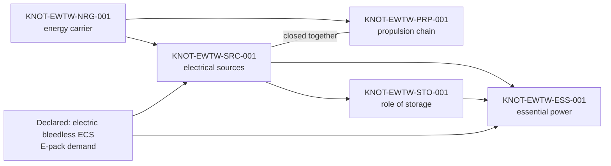

# AMPEL360 eWTW — Electric Wide Tube and Wing


> The AMPEL360 model of the advanced tube-and-wing class: an airliner of about 100 passengers on an electric / hybrid-electric candidate architecture, defined as one identity system seen through eleven breakdown views.

| Field | Value |
|---|---|
| Node | `01-02-01-01-01_eWTW` |
| Path | `01_OPTIONS_ARCHITECTURE/01-02_PROGRAMMES/01-02-01_AMPEL360/01-02-01-01_MODELS/01-02-01-01-01_eWTW/` |
| Programme | AMPEL360 |
| Class | Advanced tube-and-wing — S-ATLAS [`092`][S-092] |
| Size class | Approximately 100 passengers ([SBS README][SBS] §6) |
| Propulsion posture | All-electric, or hybrid-electric with conventional fuel; no hydrogen on board — liquid hydrogen is allocated to the [BWB-Q100][BWB] (architecture authority, 2026-11-07). The chain itself is open (`KNOT-EWTW-PRP-001`) |
| Status | **DRAFT** — concept definition; every identifier `PLANNED`; not a design baseline |
| Version | 0.3.2 |
| Date | 2026-11-12 |
| Owner | Amedeo Pelliccia — GQAOA |
| Lifecycle stage | `LC-A` Conceptual Design, per `02_LIFECYCLE_MODEL` v0.7.1 rev. I — see [§6](#6-lifecycle-baselines-and-the-path-to-first-release) |
| Conventions | [`AMPEL360-PBS-PN-CM-001`][CM-001] Issue 2 · [`AMPEL360-SBS-ID-CM-002`][CM-002] |

The eWTW's breakdown structures live under [`SBS`][SBS] — a federation of views over one identity system. Beside the SBS, the model holds its decisions and their inputs: the [KNOT register][KNOT-REG] and the [architecture relations][REL]. The fleet-level comparison between a conventional airliner and the AMPEL360 hydrogen-electric reference architecture is in the [root README][ROOT-DELTA]; this page states what of that reference the eWTW has **decided**, what it must **integrate** and what it leaves **open** — and where the model stands: what exists on disk, at which lifecycle stage, and which statements elsewhere in the repository still disagree with this page.

Nothing here is a design baseline. A planned part number establishes a controlled identity, not a manufactured component. Every figure in [§1](#1-status-at-a-glance) is derived from `main` at the commit stated and can be regenerated with the commands in [§10](#10-how-to-verify).

---

## Contents

1. [Status at a glance](#1-status-at-a-glance)
2. [Declared, integrated, open](#2-declared-integrated-open)
3. [System decomposition](#3-system-decomposition)
4. [SBS crosswalk — proposed allocations](#4-sbs-crosswalk--proposed-allocations)
5. [Open KNOTs](#5-open-knots)
6. [Lifecycle, baselines and the path to first release](#6-lifecycle-baselines-and-the-path-to-first-release)
7. [Exemplars](#7-exemplars)
8. [Governing documents and tools](#8-governing-documents-and-tools)
9. [Findings](#9-findings)
10. [How to verify](#10-how-to-verify)
11. [Revision history](#11-revision-history)

---

## 1. Status at a glance

Derived from `main` at `279bb700`, 2026-10-12, and unchanged at `e212e121`, 2026-11-07: no SBS record has changed in between, only READMEs.

| View | On `main` |
|---|---|
| PBS | 8 groups, 41 chapters. Chapter [`053`][PBS-053]: 10 sections, **59 assembly stations, 431 part nodes**, every station `PLANNED`; 13 station records declare the Issue 2 schema, none carrying it in full ([F15](#9-findings)), and 46 the Amendment A1 form ([F04](#9-findings)). The other 40 chapters are scaffolds |
| FBS | 13 top-level functions, 74 function nodes; an [allocation matrix][FAM] that allocates 17 stations of `053-000 … 053-300` to `eWTW-FBS-50` at station grain |
| WBS | 117 work nodes; a crosswalk for `EWTW-533001` |
| CBS · RBS · TPMS | For `EWTW-533001`: 16 cost-object rows, no figures · 6 risks `R-533001-01 … 06` · 3 measures — mass 80.3 kg (estimate), part count, interference (target not met) |
| IBS | 2 interface sets, 8 dossiers; an [ICD register][ICD-REG] of 8 rows — 4 identified, 4 awaiting a migration act |
| ReqBS | 5 [requirement candidates][REQ-533001] for `EWTW-533001`; no initial baseline |
| EBS | A derived [evidence index][EBS-IDX] of 11 rows — 4 on disk, 5 cited only (Clarification C1), 2 pending commit (LC-001) |
| LBS | README only |
| TPuBS | 50 information-architecture subject nodes; 19 publication modules |
| Validator | [`tools/sbs_validate.py`][VAL] 0.1.2 — **FAIL, 1 check**: the pilot station's run-record is invalid YAML ([F08](#9-findings)) |

---

## 2. Declared, integrated, open

**Declared so far:**

- the scope (architecture authority, 2026-11-07): **all-electric, or hybrid-electric with conventional fuel**. No hydrogen is carried; liquid hydrogen is allocated to the [BWB-Q100][BWB];
- the fuselage PBS `053` — ten sections `053-000 … 053-900`, identifiers `PLANNED`;
- the energy-carrier structural provisions `053-900` — bay structure (`053-900-010`), crash protection and containment interface (`053-900-020`), mount and attach fittings (`053-900-030`) and the electric-energy maintenance compartment (`053-900-040`), with load overlays in `053-200` (bay integration) and `053-700` (bay support and crash);
- no auxiliary fuel tank: its footprint is preserved inert (`053-900-050`);
- the pack-bay and belly-fairing architecture — an unpressurised pack bay in the wing-to-fuselage fairing (`053-200-020`, pack-mount rails `EWTW-532002-050`);
- an **electric, bleedless ECS based on E-packs** — taxonomy home S-ATLAS [`021-510`][S-021-510] *Environmental Cooling Unit — Electric*; the PBS holds chapter `036` as *Pneumatic — Vacated*;
- tailcone provisions for the Auxiliary Power Module — mounts (`053-400-020`), firewall and thermal provisions (`053-400-030`): a location and a fire boundary, not a technology.

**The one system-level change already identifiable** is the transfer of the ECS power source from the engine's pneumatic domain to the electrical domain. It couples E-pack sizing to generation, distribution, protection and heat rejection — before any propulsion decision is taken.

**Open decisions**, which together gate the preliminary-design baseline: the energy carrier · the propulsion chain · the electrical sources · the role of energy storage · the architecture of essential power — registered as KNOTs in [§5](#5-open-knots). The structure of the energy-carrier bay does not determine its content: batteries and conventional fuel tanks would each require a different realisation; cryogenic tanks are out of scope. Several pages on `main` still call it a battery bay ([F01](#9-findings)).

---

## 3. System decomposition

Status: **D** declared by the model · **I** integration need that follows from what is declared · **O** open decision.

The S-ATLAS column gives taxonomy homes. PBS codes are PBS-local (CM-001 §3.1) and need not coincide: PBS `074` is *Propulsion Power Electronics*, S-ATLAS `074` is *Propulsion Energy Storage Systems* ([F03](#9-findings)). The FBS column names the existing function nodes a system serves, as `eWTW-FBS-<n>`; allocations themselves are recorded in the FBS, not here.

| # | System | S-ATLAS | FBS | To be represented for eWTW | St. |
|---|---|---|---|---|:-:|
| 1 | Airframe | `051–059` | `50` · `10` | Fuselage, wings, empennage, propulsor attachments, doors, floors, compartments, fairings, equipment supports. Energy-carrier provisions, E-pack installation, penetrations, access and mass distribution | D·I |
| 2 | Energy-carrier storage and delivery | `028` · `064` | `30` | Carrier containment, supports, charging or refuelling interfaces, gauging, isolation, links to consumers. The bay that receives the carrier is declared (`053-900`); the carrier is not | O |
| 3 | Propulsion | `061–069` · `071–074` · `076–077` | `20` | Propulsive units, installation, power transmission, control and monitoring. If electric: inverters, motors, optional gearboxes, propellers or fans; if hybrid, the thermal machine on conventional fuel and its sub-systems too — the PBS skeleton has no group for one yet | O |
| 4 | Electrical generation and storage | `024` · `068` · `074` | `30` · `40` | Main sources, conversion, storage, start, energy management; fuel cells (`075`) left the option set with hydrogen. The E-pack creates a significant demand; **it does not determine the kind of generation or the role of batteries** | I·O |
| 5 | Electrical distribution | `024` · `076` · `079` | `40` | Buses, switchgear, converters, protection, harnesses, segregation, essential supplies. E-pack supplies and protection must be allocated now; a propulsion HV network only if the propulsion chain requires it | I·O |
| 6 | Thermal management | `021` · `078` | `70-40` · `20-40` · `30-30` | Equipment cooling, heat exchangers, ventilation, liquid loops, air inlets and outlets — integrated with the E-pack installation; propulsion-battery and thermal-machine loops conditional on their presence | I·O |
| 7 | Flight controls | `027` · `022` | `60` | Computers, sensors, primary and secondary surfaces, actuators. No model-specific change declared; differential thrust only if distributed propulsion is chosen | O |
| 8 | Actuation and utility power | `029` | `60-50` · `110-20` | Pumps, accumulators, actuators, hydraulic lines, possible EHA and EMA. The electric ECS does not decide the fate of hydraulics — technology allocated function by function | O |
| 9 | ECS, pressurisation, pneumatics | `021` · `036` | `70-10` · `70-20` | E-packs (`021-510`), electric compressors, air treatment, distribution, recirculation, thermal regulation, cabin pressure. **Bleedless ECS declared**; pack bay in the belly fairing; any other pneumatic consumer is treated separately | D |
| 10 | Ice and rain protection | `030` | `70-30` | Surfaces and inlets, probes and windshield heating, rain removal. Technology open: **a bleedless ECS is not an aircraft without bleed** | O |
| 11 | Landing gear, braking, steering | `032` | `110` · `50-40` | Legs, retraction, wheels, brakes, anti-skid, steering, doors, structural interfaces. Bay and fitting structure defines an integration scope, not the gear design: NLG bay `053-100-020` with NLG fittings `053-800-030`, MLG wheelwell `053-200-030`. The MLG configuration is open (`KNOT-EWTW-MLG-001`) | I·O |
| 12 | Avionics and flight management | `022` · `023` · `031` · `034` · `042` · `046` | `80` · `90` | Navigation, communication, surveillance, guidance, instruments, alerting, systems management; E-pack control and indication now, energy management once the sources are chosen | I·O |
| 13 | Cabin, cargo, equipment | `025` · `033` · `035` · `044` · `050` | `100` | Furnishings, seats, floors, lighting, oxygen, water and waste, holds, evacuation; interfaces with air distribution. Floor structure (`053-700-010 … -050`) and seat tracks (`053-700-060`) carry planned part trees; water and waste has no S-ATLAS chapter yet ([F03](#9-findings)) | I |
| 14 | Protection and emergency | `026` · `047` · `079` | `120` | Fire and smoke detection, source isolation, electrical protection, continuity of essential functions. **Thermal-propagation management if propulsion batteries are present; fire protection of the thermal machine and its fuel in the hybrid branch** | O |
| 15 | Auxiliary power and ground services | `049` · `012` | `40-50` · `110-40` | External power, auxiliary sources, start, emergency supplies, service interfaces — sized against E-pack demand and the energy configuration. Tailcone mounts and firewall are declared (`053-400-020`, `-030`); the name *Auxiliary Power Module* does not determine its technology | I·O |
| 16 | Diagnostics and maintenance support | `045` | `130` | Monitoring, built-in test, fault recording, access, test points, support equipment — extending to the E-packs and to whatever equipment is selected; TPuBS follows its configuration and effectivity | I |

---

## 4. SBS crosswalk — proposed allocations

The PBS nodes below exist. Stations of `053-000 … 053-300` are already allocated to `eWTW-FBS-50` at station grain; the functions in this table refine that allocation and are proposed, to be formalised in the FBS under CM-002. Interfaces marked **registered** have a row with an identifier in the [ICD register][ICD-REG]; the others are still to be registered in the IBS.

| Domain | FBS function to represent | PBS node | IBS interfaces |
|---|---|---|---|
| `053` forward structure | Support and restrain the radome on the airframe | `eWTW-PBS-053-100-040` (assembly `EWTW-531004-000`) | Dossiers exist in [`eWTW-IBS-531004`][IBS-531004] — lightning protection, weather radar, forward pressure bulkhead, removal envelope, tolerance stack; their register rows await a migration act |
| `053` NLG bay | Bound the bay and carry the loads assigned to its walls | `eWTW-PBS-053-100-020` | **Registered:** `ICD-EWTW-531002-538003` to the NLG fittings (`053-800-030`). To register: surrounding structure, gear envelope, doors, penetrations |
| `053` rear fuselage zone | Carry fuselage loads through the zone — recorded under `eWTW-FBS-50` | `eWTW-PBS-053-300-010` (assembly `EWTW-533001-000`) | **Registered:** `ICD-EWTW-533001-538002` rear pressure bulkhead · `ICD-EWTW-533001-534001` tailcone production join · `ICD-EWTW-533001-021` outflow-valve surround ([dossiers][IBS-533001]) |
| `053` floor | Support the passenger floor and carry its loads | `eWTW-PBS-053-700-020 … -040` (forward, centre, rear) · `-050` (panels) | Beams, panels, side structure, installations |
| `053` seat tracks | Provide seat attachment and load transfer | `eWTW-PBS-053-700-060` | Seats, fasteners, floor, supporting structure |
| `053` pressure bulkheads | Close the pressurised volume and carry pressure loads | `eWTW-PBS-053-800-010` (forward) · `-020` (rear) | **Registered:** rear joint `ICD-EWTW-533001-538002`; forward: radome dossier `eWTW-IBS-531004-538001`. To register: skin, frames, seals, penetrations |
| `053-900` energy-carrier bay | Integrate the energy module and carry its loads in the assigned scenarios | `eWTW-PBS-053-900-010` · crash and containment `-020` · mounts `-030` | Supports, envelopes, access, load paths, system connections — content-dependent until `KNOT-EWTW-NRG-001` closes |
| `021` ECS | Condition and distribute air at the required state | Chapter `eWTW-PBS-021-000` exists as a scaffold — **the E-pack station and its part numbers are still to be realized under it**, realizing S-ATLAS `021-510`; its mount rails already exist in the fairing (`EWTW-532002-050`) | Electrical supply, air, control, installation, exhaust, maintenance |

One distinction is deliberate: the TPuBS node `021-200-010` (*Distribution Ducting Architecture*) is a publication node. It describes the product; it can never identify an E-pack or give it a part number (CM-001 §9). The link runs from the product, with its configuration and effectivity, to the publication — never the other way round. The ECS zoning illustration [`ICN-EWTW-021000010-001-01`][ICN-021000010] is today the counter-example: it labels the energy-carrier bay a battery bay, and PBS notes cite it as their authority ([F01](#9-findings)).

---

## 5. Open KNOTs

Uncertainty is managed with the KNOT/KNU method, as in the sibling model [MRTT-Q300][MRTT]. Identifiers and owners are proposed; they take effect when recorded. Each KNOT has a record in the [KNOT register][KNOT-REG], under [`AMPEL360-KNOT-CM-004`][CM-004] (proposed): its options, criteria, rulings with their rationale, and the Knowledge Units (KNUs) — research, analyses and other work — that resolve it. The tables below are views of those records. The [architecture relations][REL] node projects taxonomy and programme relations onto these KNOTs: the candidates for a decision, and a check of what it waits for.

### Configuration decisions

These are LC-B deliverables — *major configuration decisions* in the [lifecycle model][LCM] §3. Each is taken, or explicitly deferred with its rationale, before `REV-B_RELEASED` of any scope it affects. LC-A work proceeds under recorded assumptions, and each assumption names the KNOT that would invalidate it.

**Scope narrowed on 2026-11-07** by the architecture authority: the eWTW is all-electric, or hybrid-electric with conventional fuel, and carries no hydrogen; liquid hydrogen is allocated to the [BWB-Q100][BWB]. `KNOT-EWTW-NRG-001` and `KNOT-EWTW-SRC-001` are narrowed to that scope and stay open within it.

| KNOT | Question | Unblocks (§3 rows) | Meanwhile | Proposed owner |
|---|---|---|---|---|
| `KNOT-EWTW-NRG-001` | Energy carrier: batteries, conventional fuel for a thermal machine — or both? Cryogenic hydrogen is out of scope | 2 · 4 · 6 · 14, and the content of `053-900` | Assumed: the carrier is not aft of the rear pressure bulkhead ([`BL-053-300-010-A2`][BL-A2]). `KNOT-MRTT-CMA-001` targets commonality with the eWTW family under an LH₂ baseline — a premise the eWTW no longer offers; to be revisited in the [MRTT-Q300][MRTT] model | `STK_SE` |
| `KNOT-EWTW-PRP-001` | Propulsion chain: all-electric, or hybrid-electric with a thermal machine on conventional fuel; distributed or not? | 3 · 5 · 6 · 7 | The PBS skeleton holds an electric group ([`070`][PBS-070]) only | `STK_SE` |
| `KNOT-EWTW-SRC-001` | Electrical sources: turbogenerators (`068`), batteries (`074`) — alone or combined? Fuel cells (`075`) left the option set with hydrogen | 4 · 5 · 15 | — | `STK_SE` |
| `KNOT-EWTW-STO-001` | Role of energy storage: propulsive energy, buffering for start, transients and peaks, or essential and emergency supply only? | 4 · 6 · 14 | — | `STK_SE` |
| `KNOT-EWTW-ESS-001` | Essential power: which sources, what segregation and what duration keep essential functions available? | 5 · 12 · 14 · 15 | — | `STK_SAF` |

The decisions constrain one another. The carrier is the root; sources and propulsion chain are best closed together:



### Ownership and taxonomy rulings

Recorded as pending in the PBS; each decides where a scope lives.

| KNOT | Question | Recorded at | Proposed owner |
|---|---|---|---|
| `KNOT-EWTW-MLG-001` | MLG configuration: trunnions on wing or on fuselage structure? The committed `053-200` completion engine states wing-mounted trunnions as fact — amend its note or rule before it is applied | `053-200-030` | `STK_SE` |
| `KNOT-EWTW-LUG-001` | Wing-attach lugs: fuselage side or `057`? | `053-200-010` | `STK_SE` |
| `KNOT-EWTW-KEL-001` | Keel-beam taxonomy home: extend S-ATLAS `053-600`, or bind to an existing node? The station has no `realizes:`, and the `053-200` engine declares `ICD-EWTW-532003-536009` toward it | `053-600-090` | `STK_CM` |
| `KNOT-EWTW-DFN-001` | Dorsal-fin root fairing: `053` or `055`? | `053-400-040` | `STK_SE` |
| `KNOT-EWTW-TSI-001` | Tail-strike indicator and sensing: which owner? | `053-300-030` | `STK_SE` |
| `KNOT-EWTW-LCM-001` | Lifecycle notation: `LC-A` or `LCS-A` in baseline records; stage-folder names; re-pin when the registry is released | [§6](#6-lifecycle-baselines-and-the-path-to-first-release) | `STK_CM` |

---

## 6. Lifecycle, baselines and the path to first release

| Item | Statement |
|---|---|
| Controlling model | The constitutional **LC-letter** lifecycle, `LC-A` to `LC-N` |
| Canonical registry | [`02_LIFECYCLE_MODEL/README.md`][LCM] — **v0.7.1, revision I, status draft** (verified 2026-11-07) |
| Stage of this model | `LC-A` Conceptual Design. Nothing is released: no `REV-A_RELEASED` exists for any eWTW scope |
| `LC01`–`LC14` tokens | Not used — the registry excludes that axis. The SBS README still carries `LC01` ([F05](#9-findings)) |
| Integrated baselines | One: [`BL-053-300-010-A2`][BL-A2] — `PROPOSED`, `releasable: false` |
| Stage folders | Pattern `CAD-REVDIR-001` (registry §7) is recommended; its application to SBS artefacts, and the notation of baselines, are proposed in `AMPEL360-SBS-LC-CM-003`, which is not on `main` (`KNOT-EWTW-LCM-001`). No stage directories exist yet |

### Baseline `BL-053-300-010-A2`

Scope `eWTW-PBS-053-300-010`, the rear fuselage zone; supersedes A1. Status `PROPOSED`, `releasable: false`; release decision: none recorded.

- **Gate criteria.** Six of seven are recorded as met, and all six are documentary or allocation criteria: identity bound and concept geometry present (PBS), functions allocated (FBS), interfaces declared (IBS), first estimates recorded (TPMS), risk register opened (RBS), evidence indexed (EBS). They record that artefacts exist and are allocated, not that they are adequate. The seventh, the ReqBS initial set, is missing.
- **Membership.** The record names its members by file path and evidence string; it does not pin them to exact revisions or content hashes. A baseline is a set of exact revisions together with its gate criteria — advancing an artefact makes a gate satisfiable; release is a decision that refers to that set (the principle proposed in CM-003). A2 cannot be released until that set is pinned.
- **Open items.** A measured interference: bracket `EWTW-533001-031` #11 overlaps doubler `EWTW-533001-041` by 34,856.8 mm³ ([`TPM-533001-INTERF`][TPM-533001], risk [`R-533001-06`][RISKS-533001]). The station run-record is invalid YAML. Separately, the verification report flags four NDT plug seats on segment butt joints as INFO for design review ([F11](#9-findings)).

### Path to the first release

1. Repair the run-record at its source: fix the generator's YAML serialization, regenerate the record with the repaired generator, and keep the invalid record as superseded evidence; the validator then passes ([F08](#9-findings)).
2. Author the ReqBS initial set for the station; its five [requirement candidates][REQ-533001] are the starting point.
3. Remove the interference with a geometry revision, re-verified with zero hard interferences ([F09](#9-findings)).
4. Disposition the plug seats against the applicable requirements: redesign, justified acceptance, or an explicitly accepted deferral ([F11](#9-findings)).
5. Pin the membership — every member artefact at an exact revision, commit and content hash — and record the resulting configuration with its closure evidence, so that the release act is a ratification and not only an authorisation (`QPLUS-LC-RATIFY-001`, registry v0.7.1).
6. Record the release decision — act, date, authority — in the baseline record: `REV-A_RELEASED` for the scope.

Committing the LC-001 analysis package ([F10](#9-findings)) is not a gate criterion of A2, but its findings feed `R-533001-05` and a ReqBS candidate, so it belongs before step 2.

---

## 7. Exemplars

| Exemplar | What it demonstrates | Where |
|---|---|---|
| Rear fuselage zone `EWTW-533001-000` | The first station carried across the views: concept geometry with its generator source, STEP and GLB exchange files, a verification report, an allocation over the other ten views (revision 3: eight emitted, LBS and TPuBS not yet), an integrated baseline | [node][N-533001] · [verification][VER-533001] · [allocation][ALLOC] · [baseline][BL-A2] |
| Radome attach structure `EWTW-531004-000` | The realized exemplar migrated out of the legacy tree and held under a migration lock; interface dossiers per counterpart, plus station-scoped `-INST` and `-TOL` dossiers | [`eWTW-IBS-531004`][IBS-531004] |
| `ICD-EWTW-531002-538003` | Zonal structure against product-class owner: the NLG bay and the NLG fittings meet at one joint — one interface, never two part numbers | [ICD register][ICD-REG] |
| `complete_PBS-053-*.py` | Fail-closed, growth-only depth passes: read-only preflight, plan identical to apply, identities on disk always win | Repository root |

---

## 8. Governing documents and tools

| Document or tool | Governs | On `main` |
|---|---|---|
| [`AMPEL360-PBS-PN-CM-001`][CM-001] Issue 2 | The assembly station and identity boundary, part-number grammar, handedness and quantity discipline, interface identifiers, executable verification | Yes — the header still reads *PROPOSED — merge constitutes ratification*, and no record names the approval act ([F22](#9-findings)); the §9 example needs correcting ([F12](#9-findings)) |
| CM-001 Clarification C1 (C1.1–C1.7) | Roles, installation references, migration locks, zonal versus product-class ownership, artefact co-location, analysis records, stage folders | **No** — cited by clause in 8 SBS files; the EBS lists it as cited only ([F10](#9-findings)) |
| [`AMPEL360-SBS-ID-CM-002`][CM-002] | Cross-structure identification: derived ids for 1:1 views, sovereign ids with typed references for n:m views, no id space for the EBS | Yes — Issue 1; the header still reads *PROPOSED* ([F22](#9-findings)) |
| `AMPEL360-SBS-LC-CM-003` | Artefact lifecycle in the SBS; integrated baselines `BL-<scope>-<stage><seq>` | **No** — proposed; notation ruling open (`KNOT-EWTW-LCM-001`) |
| [`AMPEL360-KNOT-CM-004`][CM-004] Issue 1 | KNOT and KNU records: kinds, identifiers, fields, rulings and waivers, the research agenda as a view | Yes — *PROPOSED*; its header records the approval act once given |
| [`AMPEL360-REL-CM-005`][CM-005] Issue 1 · [`QPLUS-REL-001`][REL-001] Issue 1 | Architecture relations at programme, model and product level, and between taxonomy nodes; their projection onto the KNOT register | Yes — both *PROPOSED*; the taxonomy relations are held in the model until the taxonomy owner adopts them |
| [Lifecycle model][LCM] · [C-GROWTH][CGR] | LC-letter stages, release gates, findings; intra-stage execution | Yes — draft v0.7.1 rev. I |
| [`tools/sbs_validate.py`][VAL] 0.1.2 | One exit code over the SBS: protected areas, YAML, placeholder and ghost codes, typed references, taxonomy addresses, self-claims | Yes |
| [`tools/knot_check.py`][KNOT-CHECK] · [`tools/relations_project.py`][REL-TOOL] | The KNOT register against CM-004; the relations against CM-005 and their projection onto the register | Yes — with 13 and 18 tests |
| `complete_PBS-053-000.py` · `-100` · `-200` · `-300` · `migrate_PBS-053-010.py` | Depth passes for chapter `053`; the radome migration | Yes, at the repository root — `-200` not yet applied ([F04](#9-findings)) |

---

## 9. Findings

Places where the repository says two things, or points at something superseded. Classes follow the registry's finding rule (`QPLUS-LC-FINDING-001`) and are proposed; an `F-DEFER` takes effect only when accepted. Editing this page closes none of them. F13–F22 were entered on 2026-11-07 from the PBS README 0.2.1, where they were proposed as N1–N10 in the same order.

| F | Class | Finding | Evidence on `main` | Closes when |
|---|---|---|---|---|
| F01 | `F-WARN` | The energy-carrier bay is called a **battery bay** and the APM an **electric auxiliary module**, while `KNOT-EWTW-NRG-001` and `KNOT-EWTW-SRC-001` are open. Since 2026-11-07 the carrier is batteries, conventional fuel or both: if every branch carries propulsion batteries, the bay label holds and only size and role stay open (`KNOT-EWTW-STO-001`); the APM label stays premature, since in the hybrid branch the module may be thermal. The PBS notes cite a publication illustration as their authority — the inverse of product → publication | [`ICN-EWTW-021000010-001-01`][ICN-021000010] ("BATT BAY (053-900)", note 3); the chapter `053` README (cross-references, green-native notes); `PBS-053-BREAKDOWN.md`; the READMEs of `053-900-010` and `053-400-020` | The authority declares the content — rows 2, 4, 6 and 14 change status — or rules that propulsion batteries are carried in every branch, which keeps the bay label; otherwise the labels are neutralised: ICN issue 02 and amended PBS notes |
| F02 | `F-WARN` | Derived and summary documents lag the disk | `PBS-053-BREAKDOWN.md` lists 337 part numbers and `PBS-053-REALIZED-TREE.txt` 348 part files — July generator output under the G-ATLAS name — against 431 on disk; the root README cites 55 stations and ~330 part numbers; the chapter `053` README links the legacy `053-010-000` tree deleted in `abf6318e` | Regenerated from disk, or marked superseded |
| F03 | `F-DEFER` | Eleven PBS nodes — eight chapters and three section-grain stubs — record no taxonomy mapping and point to an "Amendment A1 ratification table" that Issue 2 absorbed. The `070` group's PBS-local titles follow a powerplant-style order that S-ATLAS does not; water and waste (`038`) has no S-ATLAS chapter to map to; PBS notes cite `ATA` chapters instead of S-ATLAS addresses | `taxonomyRef` without `chapter` in `038`, `071`, `073`, `074`, `076`, `077`, `078`, `080`, `090-100`, `090-300`, `090-500` | Mapping recorded per CM-001 §3.1 — mandatory before any station is realized under these nodes |
| F04 | `F-WARN` | 46 of 59 station records are still the generator-reconstructed Amendment A1 form | Depth passes applied to `053-000`, `053-100` (except the locked radome station `-040`) and `053-300`; the `053-200` engine plans 40 new nodes (41 → 81) and is not applied | Depth passes for `053-200` (once `KNOT-EWTW-MLG-001` is ruled or its note amended) and `053-400 … 053-900`, and the radome migration; each record then carries the Issue 2 station contract ([F15](#9-findings)) — a pass having run is not the evidence |
| F05 | `F-WARN` | Three lifecycle notations | SBS README §6 and §9 say `LC01 Concept Definition`, and §9–§10 still describe an empty SBS; the baseline record says `LCS-A`; the registry names the first stage *Conceptual Design* in §3 and `LC-A_Concept-Design` in §7 | `KNOT-EWTW-LCM-001` ruled; SBS README §6, §9 and §10 rewritten |
| F06 | `F-WARN` | The registry's worked example names the radome by retired identifiers | Registry §18: `eWTW-PBS-10-10-10-10-10`, `PN-eWTW-5310-0001`. The example concerns the radome shell, which has no PBS identity yet; station `eWTW-PBS-053-100-040` (`EWTW-531004-000`) is the attach structure, not the shell. The validator scans the SBS only, so this escapes it | **Closed** at `72039505`, 2026-10-13: registry v0.7.1 rev. I merged, §18 qualified as a historical example with its retired identifiers recorded. The shell's missing identity continues as F14 |
| F07 | `F-WARN` | An FBS function names a solution where the decision is open, and the energy function is classified away from its homes | `eWTW-FBS-30-10` *Store-Electrical-Energy*; `eWTW-FBS-30` classified under `004-900` and `005-900` (airworthiness limitations, inspection intervals) rather than `028` or `074` (`075` left the option set with hydrogen) | Name made solution-neutral with its identifier conserved and classification corrected — or `KNOT-EWTW-NRG-001` closed |
| F08 | `F-BLOCK` | The pilot station's run-record is invalid YAML, and the cause is in its generator: `_y()` neutralises only double quotes — it swaps them for single quotes — and never escapes backslashes, so the backslashes of a Windows path reach a double-quoted YAML scalar raw (`\E` is an illegal escape). The recorded path is also a local one, not repository-relative | `Prompts/Run-record.yaml` in `EWTW-533001-000`, line 26 (blob `efada71f73bb` at `279bb700`) — the validator's only failing check; `_y()` in `CAD/source/EWTW-533001-000_concept.py`, `v0.2.1-concept` | Serialization repaired in the generator — escaped, or emitted by a YAML library, with repository-relative POSIX paths; a new run-record produced by the repaired generator, naming its version and hash; the invalid record superseded, not edited, and cited by blob hash; the C1.5 lowercase rename. Correcting the YAML by hand would leave the defect reproducible |
| F09 | `F-BLOCK` | The geometry of record fails its own interference check — a measured failure | Verification report §D: bracket `EWTW-533001-031` #11 overlaps doubler `EWTW-533001-041` by 34,856.8 mm³; `TPM-533001-INTERF` = 1 against a target of 0; `R-533001-06` | A geometry revision re-verified with zero hard interferences |
| F10 | `F-WARN` | Records produced but not committed | CM-001 Clarification C1; the LC-001 structural analysis package — *cited only* and *pending commit* in the [EBS index][EBS-IDX] | Committed into their homes; the EBS rows become *on disk* |
| F11 | `F-WARN` | Four of twelve NDT plug seats straddle the segment butt joints. The report models them as specified and records them as INFO, flagged for design review; they need a disposition of their own, separate from F09 | Verification report §C and note I-2: seats at 15° + 30°k fall on the butts at 45°, 135°, 225° and 315° | Dispositioned against the applicable requirements — redesign, justified acceptance, or an explicitly accepted deferral (`F-DEFER`) |
| F12 | `F-WARN` | CM-001 §9 illustrates its 1:1 SNS rule with `531004 → 53-10-01`; the rule itself, applied to the station derivation `053-100-040` → CSN `531004`, gives `53-10-04` | CM-001 Issue 2 §9; station `eWTW-PBS-053-100-040`, CSN `531004`. No data module on `main` carries either value yet. The taxonomy's `embraer_origin` fields use `53-10-0x` in another numbering — there `53-10-01` is the forward fuselage skin — so the wrong example also invites a false match | Correction recorded in the governing convention: §9 reads `531004 → 53-10-04`, entered in the CM-001 change record |
| F13 | `F-WARN` | The radome station departs from the CM-001 §4.3 exemplar. On disk `-020` is an `assembly` whose children `-021` / `-022` are `-LH` / `-RH` with `role: "variant"`, the Amendment A1 vocabulary; the exemplar has a set of 2 with UPPER / LOWER members. Installed together or alternatives is a configuration fact, a mirrored pair or a same-side stack a design fact (§4.1): the conflict of texts settles neither | Station `eWTW-PBS-053-100-040`: `PLANNED`, Amendment A1 record; CM-001 §4.3: *realized*; `MIGRATION_LOCKED = {"531004"}` in `complete_PBS-053-100.py` | Hinge disposition established by design evidence; disk and exemplar then reconciled — a governed pass under the lock, or the exemplar amended |
| F14 | `F-WARN` | The radome shell has no PBS identity or part number: station `053-100-040` is the attach structure only. F06 stated this; it stays open after F06's closure | No shell node under `053-100`; registry §18 (shell: no PN yet) | The shell placed in the breakdown — its station or parent, owner, and interfaces with `053-100-040` — not only numbered |
| F15 | `F-WARN` | No station record carries `top_assembly`, `root`, `mic` or `owner`, which the single station schema requires (CM-001 §5), although 13 declare Issue 2. The handshake `realizes ↔ top_assembly` (§2) is not written down: the top assembly is identified by its folder alone, and the owner sits in `pbs-item.yaml`. One Amendment A1 record has no `realizes` | All 59 `station.yaml`; `053-600-090` without `realizes` (`KNOT-EWTW-KEL-001`) | The authority rules whether the fields are written or derived from the folder (CM-001 §5); every station then passes that contract with exactly one resolvable top assembly |
| F16 | `F-WARN` | Citations of Amendment A1 survive outside the historical record | The root and `070` group READMEs cite it; 58 `realizesNote` clauses cite A1.1, now §3.1 — `053-600-090` has none and cites A1.1 in a comment. The PBS README 0.2.1 (N4) says 59 | Active documents cite Issue 2 clauses; historical documents keep theirs |
| F17 | `F-WARN` | Short forms: the validator reads `eWTW-PBS-053` and `eWTW-PBS-053-100` as the `-000` nodes and cites a ruling under CM-002 §3 that CM-002's text does not contain. Without its precedence — a node carrying the code itself wins — four codes name two nodes | `tools/sbs_validate.py` 0.1.2; `eWTW-PBS-010`, `-030` and `-080` (group, or chapter `-000`) and `eWTW-PBS-053-000` (chapter, or section `053-000-000`) | CM-002 states where short forms apply and which reading wins; every reference resolves to exactly one node |
| F18 | `F-DEFER` | The station is defined for physical assemblies — below it, everything is physical (CM-001 §2) — while group `090` holds software, digital-twin and product-passport configuration items | Stubs `090-100`, `090-300`, `090-500`, no stations | CM-001 gives these items a profile of their own, or excludes them from the station rule, before any `090` node is realized |
| F19 | `F-WARN` | CSN domain and capacity: the derivation holds for chapters `0CC`, sections `S00` and subjects `0U0`, which allows nine stations per section; CM-001 states neither the domain nor an extension rule | All 59 CSNs follow the derivation; `053-600` uses all nine subject codes `010`–`090` | CM-001 states the domain, rejects codes outside it, and gives an extension rule that keeps every assigned CSN — before a section needs a tenth station |
| F20 | `F-WARN` | Quantities: CM-001 counts leaves and forbids double counting, but does not say how quantities multiply along repeated occurrences, aggregate by catalog identity or follow effectivity, nor when a group with enumerated children is a set rather than a sub-assembly | CM-001 §4.2, §6 | CM-001 defines the quantity basis, with worked cases: a repeated sub-assembly, a reused catalog part, parts installed together, exclusive alternatives |
| F21 | `F-WARN` | Authority: CM-001 calls both the folder (§5) and the register (§8) SSOT without saying which governs what; it designates no record for revision and effectivity; and `catalog_pn` (§6) is carried by no part record | CM-001 §5, §6, §8; none of the 431 `part.yaml` carries `catalog_pn` | CM-001 states authority per field — identity, row status, revision, effectivity, catalog identity |
| F22 | `F-WARN` | Approval records: CM-001 Issue 2 and CM-002 Issue 1 are on `main`, yet both headers read *PROPOSED — merge constitutes ratification* and no record names the approval act. Approving a convention is a separate act from ratifying a product baseline | CM-001 Issue 2 entered in `8ed1bd59`, 2026-08-22; CM-002 Issue 1 in `546c84a4`, 2026-09-06 | Each header names its approval act — commit, date, authority — and the resulting status |

---

## 10. How to verify

From the repository root:

```bash
SBS="01_OPTIONS_ARCHITECTURE/01-02_PROGRAMMES/01-02-01_AMPEL360/01-02-01-01_MODELS/01-02-01-01-01_eWTW/01-02-01-01-01-01_SBS_System-Breakdown-Structure"
TAX="01_OPTIONS_ARCHITECTURE/01-03_TECHNOLOGIES/01-03-01_Q+ATLANTIDE/000-099_S-ATLAS"

python3 tools/sbs_validate.py --sbs "$SBS" --tax "$TAX"         # at e212e121: RESULT: FAIL (1 failing check(s)) — F08
find "$SBS" -type f -name station.yaml | wc -l                  # 59
find "$SBS" -type f -name part.yaml | wc -l                     # 431
grep -rl --include=station.yaml "Amendment A1" "$SBS" | wc -l   # 46 — F04
python3 complete_PBS-053-200.py --root .                        # plan only, no writes: nodes added=40
```

Every identifier, taxonomy address and link on this page was resolved against `main` at `e212e121` for revision 0.3.0.

The KNOT register and the architecture relations are verified with their own commands, given in the [register][KNOT-REG] and in the [relations node][REL]: `tools/knot_check.py` and `tools/relations_project.py`, each with its tests.

---

## 11. Revision history

| Version | Date | Change |
|---|---|---|
| 0.1.0 | 2026-09-30 | Declared, integrated, open; system decomposition; SBS crosswalk (`e6117aee`) |
| 0.2.0 | 2026-10-12 | Metadata and contents; status at a glance; declarations completed (five `053-900` stations, vacated auxiliary fuel tank, tailcone APM provisions, E-pack taxonomy home); FBS column; registered interfaces in the crosswalk; open KNOTs; lifecycle and the path to first release; exemplars; governing documents; findings F01–F10; verification commands |
| 0.2.1 | 2026-10-12 | Review refinements: A2 qualified — documentary and allocation criteria, `PROPOSED`, `releasable: false`, membership not pinned; geometry findings separated — F09 measured interference, F11 plug seats for disposition; F08 closed at the generator; F12 against CM-001 §9; path to first release extended to six steps |
| 0.2.2 | 2026-10-13 | Registry re-pinned to Lifecycle Model v0.7.0 (`KNOT-EWTW-LCM-001`); F06 corrected — §18 concerns the radome shell, which has no PBS identity, while `053-100-040` is the attach structure; first-release step 5 aligned with ratification on closure evidence (`QPLUS-LC-RATIFY-001`, registry v0.7.1 pending) |
| 0.3.0 | 2026-11-07 | Scope narrowed by the architecture authority: all-electric, or hybrid-electric with conventional fuel; liquid hydrogen allocated to the BWB-Q100. `KNOT-EWTW-NRG-001` and `-SRC-001` narrowed; the `KNOT-MRTT-CMA-001` premise flagged; §3 rows 3, 4, 6 and 14 and findings F01 and F07 restated. Findings F13–F22 entered from the PBS README 0.2.1 (N1–N10); F03 and F04 restated — eleven nodes, closure on outcome; F06 closed. Registry and conventions re-pinned: v0.7.1 rev. I, approval status of CM-001 and CM-002 |
| 0.3.1 | 2026-11-08 | KNOT register created beside the SBS, under `AMPEL360-KNOT-CM-004` (proposed): the 11 KNOTs of §5 as records, with 31 KNUs and ruling R1 of `KNOT-EWTW-NRG-001`; §5 and §8 point to it |
| 0.3.2 | 2026-11-12 | Architecture relations node created beside the KNOT register, under `AMPEL360-REL-CM-005` and `QPLUS-REL-001` (both proposed): pilot relations and their projection onto `KNOT-EWTW-SRC-001` and `KNOT-EWTW-ESS-001`; the introduction, §5, §8 and §10 point to it; §8 lists the two verification tools |

[SBS]: 01-02-01-01-01-01_SBS_System-Breakdown-Structure/
[CM-001]: 01-02-01-01-01-01_SBS_System-Breakdown-Structure/01-02-01-01-01-01-01_PBS_Product-Breakdown-Structure/AMPEL360-PBS-PN-CM-001_Assembly-Station-and-Part-Number-Breakdown.md
[CM-002]: 01-02-01-01-01-01_SBS_System-Breakdown-Structure/AMPEL360-SBS-ID-CM-002_Cross-Structure-Identification.md
[PBS-053]: 01-02-01-01-01-01_SBS_System-Breakdown-Structure/01-02-01-01-01-01-01_PBS_Product-Breakdown-Structure/eWTW-PBS-000_Aircraft-Product/eWTW-PBS-050_Airframe-Structure/eWTW-PBS-053-000_Fuselage-Wide-Tube/
[PBS-070]: 01-02-01-01-01-01_SBS_System-Breakdown-Structure/01-02-01-01-01-01-01_PBS_Product-Breakdown-Structure/eWTW-PBS-000_Aircraft-Product/eWTW-PBS-070_Electric-Propulsion/
[N-533001]: 01-02-01-01-01-01_SBS_System-Breakdown-Structure/01-02-01-01-01-01-01_PBS_Product-Breakdown-Structure/eWTW-PBS-000_Aircraft-Product/eWTW-PBS-050_Airframe-Structure/eWTW-PBS-053-000_Fuselage-Wide-Tube/eWTW-PBS-053-300-000_Aft-Fuselage-Structure/eWTW-PBS-053-300-010_Rear-Fuselage-Zone-General/EWTW-533001-000_STRUCTURE-REAR-FUSELAGE-ZONE/
[VER-533001]: 01-02-01-01-01-01_SBS_System-Breakdown-Structure/01-02-01-01-01-01-01_PBS_Product-Breakdown-Structure/eWTW-PBS-000_Aircraft-Product/eWTW-PBS-050_Airframe-Structure/eWTW-PBS-053-000_Fuselage-Wide-Tube/eWTW-PBS-053-300-000_Aft-Fuselage-Structure/eWTW-PBS-053-300-010_Rear-Fuselage-Zone-General/EWTW-533001-000_STRUCTURE-REAR-FUSELAGE-ZONE/evidence/EWTW-533001-000_concept_verification.txt
[ALLOC]: 01-02-01-01-01-01_SBS_System-Breakdown-Structure/PILOT-ALLOCATION_EWTW-533001.yaml
[BL-A2]: 01-02-01-01-01-01_SBS_System-Breakdown-Structure/BASELINE-RECORD_BL-053-300-010-A2.yaml
[FAM]: 01-02-01-01-01-01_SBS_System-Breakdown-Structure/01-02-01-01-01-01-02_FBS_Functional-Breakdown-Structure/eWTW-FBS-00_Aircraft-Functions/ALLOCATION/functional-allocation-matrix.yaml
[ICD-REG]: 01-02-01-01-01-01_SBS_System-Breakdown-Structure/01-02-01-01-01-01-08_IBS_Interface-and-Installation-Breakdown-Structure/ICD-REGISTER.yaml
[IBS-531004]: 01-02-01-01-01-01_SBS_System-Breakdown-Structure/01-02-01-01-01-01-08_IBS_Interface-and-Installation-Breakdown-Structure/eWTW-IBS-531004_Radome-Interface-Set/
[IBS-533001]: 01-02-01-01-01-01_SBS_System-Breakdown-Structure/01-02-01-01-01-01-08_IBS_Interface-and-Installation-Breakdown-Structure/eWTW-IBS-533001_Rear-Fuselage-Zone-Interface-Set/
[REQ-533001]: 01-02-01-01-01-01_SBS_System-Breakdown-Structure/01-02-01-01-01-01-09_ReqBS_Requirements-Breakdown-Structure/REQUIREMENT-CANDIDATES_EWTW-533001.yaml
[TPM-533001]: 01-02-01-01-01-01_SBS_System-Breakdown-Structure/01-02-01-01-01-01-10_TPMS_Technical-Performance-Measurement-Structure/TPM_EWTW-533001.yaml
[RISKS-533001]: 01-02-01-01-01-01_SBS_System-Breakdown-Structure/01-02-01-01-01-01-05_RBS_Risk-Breakdown-Structure/RISKS_EWTW-533001.yaml
[EBS-IDX]: 01-02-01-01-01-01_SBS_System-Breakdown-Structure/01-02-01-01-01-01-07_EBS_Evidence-Breakdown-Structure/EVIDENCE-INDEX.yaml
[ICN-021000010]: 01-02-01-01-01-01_SBS_System-Breakdown-Structure/01-02-01-01-01-01-11_TPuBS_Technical-Publications-Breakdown-Structure/01_INFORMATION-ARCHITECTURE/S-ATLAS_000-099/020-029_Core-Aircraft-Systems/021_Air-Conditioning-Environmental-Control/021-000_General/021-000-010_ECS-General-and-Zoning/ICN/ICN-EWTW-021000010-001-01.svg
[MRTT]: ../01-02-01-01-03_MRTT-Q300/README.md
[BWB]: ../01-02-01-01-02_BWB-Q100/README.md
[KNOT-REG]: 01-02-01-01-01-02_KNOT_Knowledge-Node-Register/README.md
[CM-004]: 01-02-01-01-01-02_KNOT_Knowledge-Node-Register/AMPEL360-KNOT-CM-004_Knowledge-Nodes-and-Units.md
[REL]: 01-02-01-01-01-03_REL_Architecture-Relations/README.md
[CM-005]: 01-02-01-01-01-03_REL_Architecture-Relations/AMPEL360-REL-CM-005_Architecture-Relations.md
[REL-001]: 01-02-01-01-01-03_REL_Architecture-Relations/QPLUS-REL-001_Taxonomy-Relations.md
[KNOT-CHECK]: ../../../../../tools/knot_check.py
[REL-TOOL]: ../../../../../tools/relations_project.py
[LCM]: ../../../../../02_LIFECYCLE_MODEL/README.md
[CGR]: ../../../../../02_LIFECYCLE_MODEL/C-GROWTH-METHOD-SPEC.md
[VAL]: ../../../../../tools/sbs_validate.py
[ROOT-DELTA]: ../../../../../README.md#architecture-delta--conventional-airliner-vs-ampel360-hydrogen-electric
[S-092]: ../../../../01-03_TECHNOLOGIES/01-03-01_Q+ATLANTIDE/000-099_S-ATLAS/090-099_Type-Specific-Architectures-and-Expansion/092_Advanced-Tube-and-Wing-Class/
[S-021-510]: ../../../../01-03_TECHNOLOGIES/01-03-01_Q+ATLANTIDE/000-099_S-ATLAS/020-029_Core-Aircraft-Systems/021_Air-Conditioning-Environmental-Control/021-510_Environmental-Cooling-Unit-Electric/
