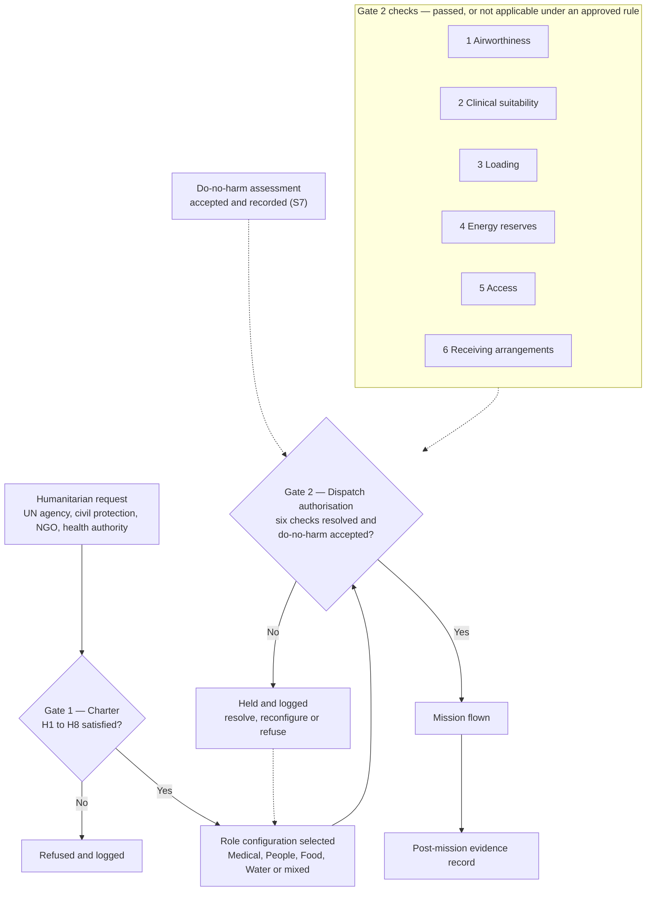

# AMPEL360 MRTT-Q300

> **Medical · Relief · Tanker · Transport**
> A humanitarian-only wide-body relief aircraft model in the AMPEL360 programme, committed to 100 % sustainability within its aircraft-and-airlift boundary.

| Field | Value |
|---|---|
| Node | `01-02-01-01-03_MRTT-Q300` |
| Path | `01_OPTIONS_ARCHITECTURE/01-02_PROGRAMMES/01-02-01_AMPEL360/01-02-01-01_MODELS/01-02-01-01-03_MRTT-Q300/` |
| Programme | AMPEL360 |
| Status | **DRAFT — concept proposal, proposed for adoption.** Not controlled documentation; not a design baseline. |
| Version | 0.3.0 |
| Date | 2026-10-12 |
| Owner | Amedeo Pelliccia — GQAOA |
| Lifecycle stage | `LC-A` Conceptual Design (proposed), per `02_LIFECYCLE_MODEL` v0.6.1 rev. G — see [§10](#10-lifecycle-evidence-and-open-knots) |
| Taxonomy terminology baseline | Root Q+A README — revision to be recorded |
| Predecessor | See [§11](#11-comparison-with-the-predecessor-concept); controlled reference not yet recorded |

Every performance, schedule and sustainability statement in this document is a **programme target or hypothesis** until it is closed by evidence at a lifecycle gate. Nothing here is a certified capability. Every governance statement is a **proposal** until the corresponding decision is recorded.

---

## Contents

1. [Purpose and order of priority](#1-purpose-and-order-of-priority)
2. [Humanitarian-Only Charter](#2-humanitarian-only-charter)
3. [Designation](#3-designation)
4. [Mission catalogue](#4-mission-catalogue)
5. [Mission flow and gates](#5-mission-flow-and-gates)
6. [100 % Sustainable — commitment, criteria and demonstration](#6-100--sustainable--commitment-criteria-and-demonstration)
7. [Platform concept](#7-platform-concept)
8. [Q+ATLANTIDE applicability](#8-qatlantide-applicability)
9. [Certification and operational approval](#9-certification-and-operational-approval)
10. [Lifecycle, evidence and open KNOTs](#10-lifecycle-evidence-and-open-knots)
11. [Comparison with the predecessor concept](#11-comparison-with-the-predecessor-concept)
12. [Reference framework](#12-reference-framework)
13. [Revision history](#13-revision-history)

---

## 1. Purpose and order of priority

The MRTT-Q300 exists to move **care, people, food and water** to and from places where normal transport has failed: war zones, disaster areas, epidemics, famine and drought regions.

It is the AMPEL360 model that expresses the spirit of Q+A most directly: advanced aerospace technology placed entirely at the service of human life, with no military function and no fossil energy in its design basis.

### Order of priority

| Rank | Principle | Rule |
|---:|---|---|
| 1 | **Safety First** | Airworthiness, the safety of patients, passengers, crew and people on the ground, and regulatory compliance are never traded against anything below. |
| 2 | **Humanitarian purpose** | The aircraft has no military role, no defence variant and no provisions for one. |
| 3 | **Sustainability** | The 100 % sustainable commitment of [§6](#6-100--sustainable--commitment-criteria-and-demonstration), within the aircraft-and-airlift boundary. |
| 4 | Payload, range, cost, market size | Yield to ranks 1 to 3 wherever they conflict. |

No humanitarian urgency and no sustainability measure justifies reducing a safety margin.

---

## 2. Humanitarian-Only Charter

**Status: proposed for adoption.** Once adopted, the charter is binding at model level and cannot be waived by the programme, a customer or an operator.

| ID | Rule | Operational meaning |
|---|---|---|
| **H1** | Purpose limitation | The aircraft is designed, certified, sold, leased and operated solely for humanitarian and civil-protection missions. |
| **H2** | Unarmed by design | No weapons, hardpoints, targeting, electronic-warfare or weapon-release functions, and **no structural, electrical or data provisions reserved for retrofitting them**. |
| **H3** | No military support | No fuel offload to other aircraft, no transport of troops or military materiel, no intelligence, surveillance or reconnaissance, no military command-and-control relay. |
| **H4** | Civil-only approval | Civil type certification and civil registration only. No military type certificate track, no defence overlay, no classified enclave. |
| **H5** | Humanitarian principles | Missions follow humanity, neutrality, impartiality and independence. Priority is set by need alone. |
| **H6** | Protection of persons | Dignity, non-discrimination, family unity, accessibility and data protection apply to every patient and passenger. |
| **H7** | Open mission evidence | Every mission traces to a humanitarian request and leaves an auditable evidence record. Personal and medical data remain protected. |
| **H8** | End-use binding | The charter travels with the aircraft through a contractual end-use covenant on sale, lease and transfer. |

The charter governs **what the aircraft may be used for**. It does not authorise any flight; that is the function of the dispatch gate in [§5](#5-mission-flow-and-gates).

### Excluded uses

| Excluded | Why it is excluded |
|---|---|
| Air-to-air refuelling | It sustains combat air operations (H3). No boom, pod-and-drogue or transferable-fuel manifold is part of this model definition. |
| Troop or military cargo transport | Incompatible with neutrality (H3, H5). |
| ISR, signals collection, tactical datalinks | Military function (H3). No military-band radios or tactical datalinks are part of this model definition. |
| Detention, deportation or forced-return flights | Incompatible with H5 and H6. |
| Any armed configuration | H2. |

A military or state operator requesting the aircraft for relief work does not change these rules. Whether such operators may use the model at all, and on what terms, is an open ruling (`KNOT-MRTT-OPR-001`).

---

## 3. Designation

| Element | Meaning | Status |
|---|---|---|
| **MRTT** | **M**edical · **R**elief · **T**anker · **T**ransport — the four mission pillars | Proposed for adoption as the controlled expansion |
| **Tanker** | Bulk **potable water** carried to people. It never means fuel transferred to another aircraft. | Proposed for adoption |
| **Q** | Q+ lineage: quantum- and AI-assisted engineering under Q+A governance | — |
| **300** | Model size class within the AMPEL360 family | Semantics open (`KNOT-MRTT-SIZ-001`) |

---

## 4. Mission catalogue

| ID | Mission | Typical role fit | Main design drivers |
|---|---|---|---|
| `HUM-01` | **Aeromedical evacuation** — critically ill and wounded patients, including isolation transport for infectious disease | Intensive-care modules, stretcher tiers, isolation units, medical crew stations | Medical oxygen volume, clean power, cabin altitude, vibration and noise limits, infection control |
| `HUM-02` | **Civilian evacuation** — people leaving regions at war or disaster areas | High-density seating, care zone, accessible lavatories, child and family area | Fast boarding without airport infrastructure, accessibility, passenger identification with data protection |
| `HUM-03` | **Food relief** — staple and therapeutic food | Palletised cargo, temperature-controlled zone | Payload-range, rapid offload, austere-airfield handling |
| `HUM-04` | **Water relief** — potable water and the means to produce it | Potable-water tank modules, treatment and desalination units, distribution kits | Water quality assurance, slosh and load control, hygiene of tank modules |
| `HUM-05` | **Medical logistics** — vaccines, medicines, blood products, field hospitals | Cold-chain modules, dangerous-goods-compliant stowage, field-hospital pallets | Unbroken temperature evidence, dangerous-goods compliance |
| `HUM-06` | **Disaster response deployment** — search-and-rescue teams, shelter, emergency telecommunications | Mixed passenger and cargo layout | Role-change time, mixed-load certification |

**Candidate roles under evaluation** (not in the catalogue): ground energy and water support to field hospitals using on-board fuel-cell power; aerial firefighting.

### Water relief: mission-specific comparison

`HUM-04` does not assume one delivery method. For each mission the planner compares the options below and records the comparison in the mission evidence.

| Factor | Bulk potable water | Treatment equipment | Local source restoration |
|---|---|---|---|
| What is flown | Water in tank modules | Treatment or desalination units, consumables, operators | Pumps, pipe, chemicals, repair teams |
| Depends on a usable local source | No | Yes — quantity and raw-water quality | Yes — an existing well, network or plant |
| Time to first safe litre | Shortest: on arrival | Set-up and water-quality verification | Assessment and repair time |
| Litres delivered per kilogram flown | Fixed by payload, once | Grows with the duration of operation | Grows with the duration of operation |
| Local needs | Storage and distribution | Energy, operators, consumables, security | Skilled labour, spares, security |
| Typical fit | First days; no usable source; isolated groups | Sustained need with a raw-water source | Damaged but recoverable infrastructure |

The options combine. The mix is selected on need, time, available sources and safety, and the selection is justified per mission.

---

## 5. Mission flow and gates

Two gates stand between a request and a flight. **Passing Gate 1 never authorises dispatch.**

### Gate 2 — dispatch authorisation: minimum content

| # | Check | Must be confirmed before dispatch |
|---:|---|---|
| 1 | **Airworthiness** | Aircraft released to service; the selected role configuration is an approved configuration; open defects within approved limits. |
| 2 | **Clinical suitability** | Each patient assessed as fit for the flight profile; medical crew, equipment, oxygen and medicines match the patient load. For evacuation flights: care provision for vulnerable passengers. |
| 3 | **Loading** | Mass and balance, restraint, role-module installation, dangerous-goods acceptance, potable-water module hygiene release, cold-chain start condition. |
| 4 | **Energy reserves** | Energy carrier on board covers the mission and the required reserves, including the return leg where no replenishment exists at destination ([§7.4](#74-austere-operations)). |
| 5 | **Access** | Overflight and landing clearances, airfield suitability, conflict-zone risk assessment, deconfliction and humanitarian notification where applicable. |
| 6 | **Receiving arrangements** | A confirmed receiving party: receiving hospital and ground transfer for patients; reception and protection arrangements for evacuees; consignee, storage and distribution for food, water and medical goods. |

### Gate 2 pass condition

Gate 2 passes only when **both** of the following are recorded:

1. Each of the six checks is **passed**, or recorded as **not applicable** under an approved applicability rule, with a written justification.
2. The mission's **do-no-harm assessment is accepted**. This acceptance is the per-mission evidence for sustainability criterion S7 ([§6.3](#63-criteria-metrics-and-acceptance-thresholds)).

A failed check, an unjustified "not applicable" or a missing do-no-harm acceptance holds the mission. Check 6 matters as much as the others: an arrival nobody is ready to receive does not help the people it was flown for.

### Applicability rules (proposed)

| Item | Applies | Rule for "not applicable" |
|---|---|---|
| Check 1 — Airworthiness | Always | Never not applicable |
| Check 2 — Clinical suitability | When patients or evacuees are on board | Not applicable only when no patients and no evacuees are carried, for example a cargo-only `HUM-03`, `HUM-04` or `HUM-05` flight. The load manifest is cited as the justification. |
| Check 3 — Loading | Always | Never not applicable; its content follows the load |
| Check 4 — Energy reserves | Always | Never not applicable |
| Check 5 — Access | Always | Never not applicable; conflict-zone content applies where the route or destination requires it |
| Check 6 — Receiving arrangements | Always | Never not applicable; its content follows the load |
| Do-no-harm acceptance | Always | Never not applicable |

"Not applicable" is a recorded outcome, never an omission. A case outside these rules is held until a rule is approved or the check is passed.

**Authority.** Gate 2 belongs to the **operator**, under its own approvals and accountable functions. The programme defines the minimum content above; it does not dispatch aircraft. Detailed content, approval of the applicability rules and the authority that accepts the do-no-harm assessment are open (`KNOT-MRTT-DSP-001`). The Gate 1 authority is proposed in [§10](#proposed-governance-decisions).

---

## 6. 100 % Sustainable — commitment, criteria and demonstration

### 6.1 Commitment and claim are different things

- **Commitment.** 100 % sustainable is a programme commitment. It applies from this draft onward and drives design decisions.
- **Demonstration.** The commitment is *fulfilled* only for a defined configuration and mission set, when every criterion in [§6.3](#63-criteria-metrics-and-acceptance-thresholds) meets its approved threshold and that result is independently verified.
- Until then the correct wording is "committed to 100 % sustainability", never "is 100 % sustainable".
- **Scope.** The commitment and any demonstration cover the **aircraft-and-airlift boundary** of [§6.2](#62-boundaries) only.

### 6.2 Boundaries

The **aircraft-and-airlift boundary** is everything in the "Inside" column below.

| Boundary | Inside | Outside |
|---|---|---|
| Product | Airframe, propulsion, systems, role modules: materials, manufacture, maintenance, end of life | — |
| Energy | Hydrogen production, liquefaction, transport, storage, boil-off, use in flight and on the ground | — |
| Operations | Flight, ground handling, role change and servicing for each mission | Ground transport by other parties after handover |
| Mission goods | Packaging and waste of relief and medical goods | The relief goods themselves (food, medicines, equipment) |
| Social | Programme supply chain and mission conduct | Supply-chain depth (tiers) to be fixed |

> [!IMPORTANT]
> **Scope of any claim.** A demonstration within this boundary shows that the aircraft and the airlift meet the criteria. The relief goods and onward ground transport are outside the boundary, so a demonstration **cannot establish the sustainability of the humanitarian intervention as a whole**. External communication must not suggest that it does.

The functional unit for lifecycle results (for example per mission, per tonne-kilometre, per patient-kilometre) is fixed in the assessment plan (`KNOT-MRTT-SUS-002`).

### 6.3 Criteria, metrics and acceptance thresholds

Threshold status: **Fixed** = follows directly from the commitment. **Floor** = a regulatory minimum, necessary but not sufficient. **Open** = no approved value yet.

| ID | Criterion | Metric | Acceptance threshold | Status |
|---|---|---|---|---|
| **S1.1** | Fossil-free energy carriers | Fossil-origin share of energy uplifted, per mission and per year (% of MJ) | 0 % | Fixed |
| **S1.2** | Renewable qualification | Share of hydrogen uplifted (% of MJ) demonstrated to qualify as a renewable fuel of non-biological origin (RFNBO): renewable-electricity criteria of Delegated Regulation (EU) 2023/1184 met, including additionality and temporal and geographical correlation where applicable, and certified under a recognised certification scheme | 100 % | Fixed |
| **S1.3** | Regulatory greenhouse-gas savings | Savings against the 94 gCO₂e/MJ fossil fuel comparator, calculated with the methodology and within the calculation boundary of Delegated Regulation (EU) 2023/1185 (%) | **Minimum savings: 70 %.** Equivalent **emissions ceiling: 28.2 gCO₂e/MJ** = 94 × (1 − 0.70) | Floor |
| **S1.4** | Programme production-to-tank intensity | Greenhouse-gas intensity per MJ of LH₂ delivered into the aircraft tank: production, liquefaction, storage, transport, boil-off and airport handling, as fixed in the assessment plan (gCO₂e/MJ) | Programme emissions ceiling: to be set | Open |
| **S2.1** | Flight CO₂ | CO₂ emitted in flight from the energy carrier (g) | 0 | Fixed |
| **S2.2** | Non-CO₂ flight effects | NOₓ per mission where hydrogen is burned; contrail and water-vapour climate effect per mission | To be set. No regulatory threshold for contrail effect is known to the programme; one must be defined and justified. | Open |
| **S3** | Ground operations | Fossil-origin share of ground energy (%) | 0 % at programme-controlled bases. Forward locations: to be set. | Fixed + Open |
| **S4** | Materials and circularity | Recoverable mass fraction at end of life (%); recycled content (%); substances of very high concern without a justified exemption (count) | Recoverable and recycled fractions: to be set. Substances without justified exemption: 0. | Open + Fixed |
| **S5** | Mission waste and consumables | Medical waste returned or handed to approved treatment (% by mass); relief packaging recovered (%) | Medical waste: 100 %. Packaging: to be set. | Fixed + Open |
| **S6** | Lifecycle greenhouse gases | Cradle-to-grave emissions per functional unit | To be set, together with the rule for residual emissions ([§6.6](#66-honest-boundary)). | Open |
| **S7** | Social sustainability | Supply-chain due-diligence coverage (%); share of missions with a do-no-harm assessment accepted and recorded at Gate 2 ([§5](#5-mission-flow-and-gates)) (%) | Coverage: to be set. Do-no-harm: 100 % of missions. | Open + Fixed |
| **S8** | Evidence completeness | Criteria S1.1 to S7 with result evidence and independent verification (%) | 100 % | Fixed |

**The three hydrogen criteria are independent.**

- S1.3 and S1.4 use different calculation boundaries and are reported separately. The assessment plan records where the boundaries differ. Meeting S1.3 does not demonstrate S1.4.
- Neither demonstrates S1.2. Zero fossil origin and low greenhouse-gas intensity do not, by themselves, establish that hydrogen is renewable; only demonstrated RFNBO qualification does.
- Application of S1.2 to hydrogen uplifted outside the EU, and treatment of regulatory transitional provisions, are open (`KNOT-MRTT-SUS-004`).

A criterion whose threshold is **Open cannot be closed**, whatever evidence exists. Approving the open thresholds is tracked in `KNOT-MRTT-SUS-002`.

### 6.4 Evidence rule

Two classes of evidence exist and only one closes a criterion.

| Class | Shows | Closes the criterion? |
|---|---|---|
| **Assessment evidence** | An assessment was planned and performed to the agreed method | No |
| **Result evidence** | The measured or calculated result meets the approved threshold, within the stated boundary | Yes, once independently verified |

**Role of the standards.** ISO 14040 and ISO 14044 define *how* a life-cycle assessment is conducted. Conformance to them shows the method was sound. It says nothing about whether the result is good enough, and it does not validate the "100 % sustainable" label. Only the comparison of results against the thresholds in §6.3 does.

### 6.5 Verification and demonstration states

| Element | Requirement |
|---|---|
| Verifier | Independent of the programme; competence and scope to be defined (`KNOT-MRTT-SUS-001`) |
| Energy | For each uplift: RFNBO qualification and certification (S1.2), chain-of-custody records, regulatory savings calculation (S1.3) and programme intensity result (S1.4); fossil share audited (S1.1) |
| Lifecycle results | Critical review of the assessment, plus verification of results against thresholds |
| Scope of a demonstration | One named configuration and one named mission set, within the aircraft-and-airlift boundary. It does not transfer to others. |
| Re-verification | On change of energy supply, configuration or mission set, and periodically |

| State | Meaning |
|---|---|
| `COMMITTED` | Commitment stated; criteria drafted. **Current state.** |
| `THRESHOLDS-APPROVED` | Every criterion has an approved threshold and boundary |
| `VERIFIED` | Result evidence independently verified for every criterion |
| `DEMONSTRATED` | Fulfilment declared for the named configuration and mission set |

### 6.6 Honest boundary

- Hydrogen flight is not climate-neutral by itself. Its benefit depends on how the hydrogen is produced (S1.2 to S1.4, S6) and on non-CO₂ effects (S2.2).
- A demonstration covers the aircraft and the airlift, not the humanitarian intervention as a whole ([§6.2](#62-boundaries)).
- Manufacturing and maintenance will leave residual lifecycle emissions. Whether "100 %" requires zero residual, or admits a defined residual with or without removals, is an open ruling (`KNOT-MRTT-SUS-003`). Fossil energy use is not offsettable under S1.1 in any case.
- ISO 14021 cautions against unqualified claims of having achieved sustainability. External communication should therefore state the specific verified criteria and the aircraft-and-airlift boundary they cover. Claim wording is part of `KNOT-MRTT-SUS-003`.

---

## 7. Platform concept

### 7.1 Role-change architecture

- One common airframe; missions are set by **role modules** on a standard interface (mechanical, electrical, fluid, data).
- Role-pallet interface standard covering medical-grade power, oxygen and potable water.
- Main-deck cargo door and reinforced role-change floor.
- Target: role change between any two catalogue missions without hangar or heavy tooling. Time target to be set (`KNOT-MRTT-ROL-001`).
- Every role configuration that can be dispatched is an approved configuration (Gate 2, check 1).

### 7.2 Energy and propulsion

- **Baseline hypothesis:** LH₂ as the single primary energy carrier.
- Propulsion architecture (fuel-cell electric, hydrogen combustion, or a hybrid of both) is selected by trade study (`KNOT-MRTT-PRP-001`).
- On-board fuel cells supply clean, stable electrical power to medical and cold-chain modules.
- Fuel-cell product water recovery for non-potable uses is a study item, not an assumed capability.

### 7.3 Cabin and life support

- High-volume medical oxygen supply sized for full intensive-care fit.
- Cabin pressure and air-quality schedules suited to patients; zoned ventilation for isolation transport.
- Full accessibility: reduced-mobility boarding, stretcher paths, accessible lavatories.
- Surfaces and materials chosen for repeated medical-grade disinfection.

### 7.4 Austere operations

Relief destinations rarely have hydrogen infrastructure. This is the model's hardest design problem and it is stated openly.

- **Design rule (hypothesis): hub-and-return.** Missions are sized to carry the energy for the outbound and return legs, with reserves, so that no replenishment is required at destination.
- Deployable hydrogen supply at forward hubs is a study item (`KNOT-MRTT-INF-001`).
- Self-sufficient loading and unloading; no dependence on destination ground-support equipment.

### 7.5 Operations in or near conflict zones

- The aircraft does not force entry. It operates only with the required clearances, deconfliction and humanitarian notification, and after a conflict-zone risk assessment (Gate 2, check 5).
- The programme does **not** self-declare protected "medical aircraft" status or the use of protective emblems. Both depend on international humanitarian law and on authorisation by the competent authorities.
- Whether any passive or active self-protection equipment is compatible with H2 is an open ruling (`KNOT-MRTT-PRT-001`).

---

## 8. Q+ATLANTIDE applicability

The taxonomy is programme-agnostic. This section records **programme-side applicability only** and changes nothing in the taxonomy. Detailed node mapping belongs to the MRTT-Q300 programme impact study and its S1000D/CSDB mapping.

Band and chapter names follow the root Q+A README. Where this section and the root README differ, the root README prevails.

| Band | Architecture | Applicability to MRTT-Q300 |
|---:|---|---|
| `000–099` | S-ATLAS | **Primary.** Aircraft architecture. |
| `100–199` | S-STA | Interface only. Satellite communications and Earth-observation data consumed as services. |
| `200–299` | DTTA | **Not applicable — excluded by the proposed charter (H1 to H4).** |
| `300–399` | DTCEC | Applicable. Digital twin, mission planning, evidence chain, Digital Product Passport. |
| `400–499` | EPTA | Applicable. Hydrogen production interface, storage, conversion and propulsion technology. |
| `500–599` | AMTA | Applicable. Circular materials, cryogenic materials, cleanable cabin surfaces. |
| `600–699` | OGATA | Applicable. Role-change handling, energy-carrier servicing, self-sufficient loading. |
| `700–799` | ATACV | Interface only. Air-traffic management interfaces; last-mile handover to rotorcraft or eVTOL. |
| `800–899` | CYB | Applicable. Patient-data protection, mission-data integrity, aircraft cybersecurity. |
| `900–999` | QCSAA | Non-critical use only. Route, fleet and logistics optimisation; no safety-critical function. |

### Indicative S-ATLAS chapters most affected

Chapter titles are deliberately not restated here; the canonical register is their only source. To be confirmed by the impact study.

| Chapter | MRTT-Q300 driver |
|---|---|
| `021` | Patient cabin schedules, isolation zoning |
| `024` | Medical-grade electrical power to role modules |
| `025` | Role modules and role-pallet interface |
| `026` | Cargo and role-module fire protection; aircraft-level hydrogen hazard |
| `028` | **Energy-Carrier** — LH₂ storage, replenishment and transfer at aircraft level |
| `035` | High-volume medical oxygen |
| `038` | Potable-water modules, medical-waste containment |
| `047` | Atmosphere response to hydrogen release |
| `050` | Role-change floor, restraint, temperature-controlled zones |
| `052` | Main-deck cargo door, accessible boarding |
| `060–079` | Propulsion code ranges — outcome of the propulsion trade study |

---

## 9. Certification and operational approval

A **single civil track**. No military airworthiness track is part of this model definition.

| Layer | Basis | Note |
|---|---|---|
| Type certification | EASA CS-25 | Hydrogen storage, distribution and propulsion are expected to require Special Conditions; the certification basis is agreed with the authority. |
| Role configurations | Part of the type design or approved changes to it | Medical equipment must also meet medical-device regulation and air-ambulance equipment standards. |
| Air operations | EU air-operations rules, including dangerous-goods approval | Applies to medical oxygen, vaccines on dry ice, batteries and similar loads. |
| Dispatch | Operator's approvals and accountable functions | Gate 2 of [§5](#5-mission-flow-and-gates). |
| Conflict-zone operations | Operator risk assessment; authority conflict-zone information | Gate 2, check 5. |
| Sustainability | Criteria and thresholds of [§6](#6-100--sustainable--commitment-criteria-and-demonstration) | Independent verification before any fulfilment statement. |

No schedule is baselined in this document.

---

## 10. Lifecycle, evidence and open KNOTs

### Lifecycle reference

| Item | Statement |
|---|---|
| Controlling model | The constitutional **LC-letter** lifecycle, `LC-A` to `LC-N` |
| Canonical registry | [`02_LIFECYCLE_MODEL/README.md`](../../../../../02_LIFECYCLE_MODEL/README.md) — **v0.6.1, revision G, status draft** (verified 2026-10-12) |
| Stage of this model | `LC-A` Conceptual Design (proposed). Stage name and the `LC-A`–`LC-N` range confirmed by the registry. |
| `LC01`–`LC14` tokens | Not used. The registry explicitly excludes an enterprise `LC01`–`LC14` axis. Version 0.1.0 referred to one; that reference is withdrawn. |
| Mapping `LC01`–`LC14` → LC-letter | None exists: the registry excludes the axis such a mapping would start from. |
| Registry status | The pinned registry is itself a draft. This reference is re-pinned when the registry is released or revised (`KNOT-MRTT-LCM-001`). |

Uncertainty is managed with the KNOT/KNU method. All artifacts of this model are civil and open to audit.

### Seed KNOTs

Owners are proposed.

| KNOT | Question | Proposed owner |
|---|---|---|
| `KNOT-MRTT-SIZ-001` | What does "300" size: passengers, payload class, or family position? | `STK_SE` |
| `KNOT-MRTT-PRP-001` | Propulsion architecture: fuel-cell electric, hydrogen combustion, or hybrid? | `STK_SE` |
| `KNOT-MRTT-INF-001` | How is LH₂ supplied for missions beyond hub-and-return radius? | `STK_OPS` |
| `KNOT-MRTT-ROL-001` | Role-pallet interface standard and role-change time target | `STK_SE` |
| `KNOT-MRTT-OXY-001` | Medical oxygen generation and storage sizing | `STK_SE` |
| `KNOT-MRTT-WAT-001` | Potable-water module hygiene, quality assurance and load control | `STK_SAF` |
| `KNOT-MRTT-CERT-001` | Certification basis and Special Conditions for hydrogen | `STK_CERT` |
| `KNOT-MRTT-CMA-001` | Commonality target with the eWTW family under an LH₂ baseline | `STK_SE` |
| `KNOT-MRTT-DSP-001` | Gate 2 detailed content and authority; approval of the applicability rules; authority that accepts the do-no-harm assessment; interface with operator procedures | `STK_OPS` |
| `KNOT-MRTT-OPR-001` | Eligible operators; terms for state or military operators doing relief work | `STK_PMO` |
| `KNOT-MRTT-PRT-001` | Is any self-protection equipment compatible with H2? | `STK_SAF` |
| `KNOT-MRTT-EUC-001` | Legal form and enforcement of the end-use covenant (H8) without weakening continued-airworthiness obligations | `STK_CERT` |
| `KNOT-MRTT-SUS-001` | Independent verifier: identity, competence, scope, re-verification interval | `STK_DATA` |
| `KNOT-MRTT-SUS-002` | Approval of open thresholds, boundaries and functional unit (S1.4, S2.2, S3, S4, S5, S6, S7) | `STK_SE` |
| `KNOT-MRTT-SUS-003` | Residual lifecycle emissions rule and external claim wording | `STK_PMO` |
| `KNOT-MRTT-SUS-004` | Application of S1.2 to hydrogen uplifted outside EU jurisdiction; whether regulatory transitional provisions are accepted or the programme applies the full criteria | `STK_SE` |
| `KNOT-MRTT-LCM-001` | Lifecycle registry reference. **Path and revision: closed** (v0.6.1, rev. G). Mapping: none exists by registry design. Open residual: re-pin on registry release from draft. | `STK_CM` |
| `KNOT-MRTT-REF-001` | Controlled reference (document, revision, commit) of the predecessor concept | `STK_CM` |

### Proposed governance decisions

None of the following is in force. Each takes effect only when its decision is recorded.

| Proposal | Status | Decision record |
|---|---|---|
| Adoption of the Humanitarian-Only Charter (H1 to H8) | Proposed for adoption | Not yet recorded |
| Adoption of "Medical · Relief · Tanker · Transport" as the controlled expansion of MRTT | Proposed for adoption | Not yet recorded |
| Creation of `STK_HUM` (Humanitarian Charter Custodian), accountable for Gate 1 | Proposed for adoption | Not yet recorded |
| Retirement of `STK_DEF` (Defence Programme Liaison) for this model | Proposed retirement | Not yet recorded |
| Declaration of DTTA as not applicable to this model | Proposed | Not yet recorded |
| Approval of the Gate 2 applicability rules ([§5](#applicability-rules-proposed)) | Proposed for adoption | Not yet recorded |

---

## 11. Comparison with the predecessor concept

### Predecessor reference

| Field | Value |
|---|---|
| Document | `093_AMPEL360-MRTT-Q300/README.md` — working copy |
| Footer date of the working copy | 2026-01-11 |
| Controlled revision | **Not recorded** |
| Repository commit | **Not recorded** |

**Status of this section: unverified.** The table below describes the working copy named above. Until a controlled revision or commit is recorded (`KNOT-MRTT-REF-001`), no statement here establishes that any feature, enclave or stakeholder role was removed from controlled documentation. The table shows only how the two definitions differ.

| Topic | Predecessor working copy | This definition |
|---|---|---|
| Mission scope | Tanker, transport and medical evacuation, with a defence overlay | Humanitarian and civil protection only |
| Air-to-air refuelling | Described, with a transferable-fuel manifold | Not part of the definition |
| "Tanker" | Fuel offload to other aircraft | Potable water for people |
| Communications | Military-band radios and tactical datalinks described | Civil communications only |
| Classification | Several classification levels and a separate defence enclave described | Civil and open |
| Certification | Civil and military tracks described | Single civil track |
| Energy | Sustainable aviation fuel turbofans with an auxiliary LH₂ fuel cell | LH₂ as primary carrier; zero fossil energy in the design basis |
| Stakeholder roles | `STK_DEF` and `STK_EXP` described | Retirement of `STK_DEF` proposed; `STK_HUM` proposed |
| Common to both | Role-pallet interface standard, medical oxygen generation, main-deck cargo door, power export to role equipment, eWTW commonality objective | — |

---

## 12. Reference framework

Indicative list; applicable issues are fixed in the certification and compliance plans.

**Humanitarian**
- UN General Assembly Resolutions 46/182 and 58/114 — humanitarian principles
- Geneva Conventions and Additional Protocol I — protection of medical transport
- Oslo Guidelines — use of foreign military and civil-defence assets in disaster relief
- Sphere Handbook — minimum standards in humanitarian response
- WHO Emergency Medical Teams classification and minimum standards
- WHO Guidelines for Drinking-water Quality
- INSARAG Guidelines — urban search and rescue

**Airworthiness and operations**
- EASA CS-25 and Part 21 (Special Conditions)
- Regulation (EU) No 965/2012 — air operations
- ICAO Doc 9284 — Technical Instructions for the Safe Transport of Dangerous Goods by Air
- ICAO Doc 10084 — risk assessment for civil aircraft operations over or near conflict zones
- EN 13718 — medical vehicles and their equipment: air ambulances
- SAE ARP4754B, ARP4761A; RTCA DO-178C, DO-254, DO-326A

**Sustainability**
- Directive (EU) 2018/2001 as amended — renewable energy, including renewable fuels of non-biological origin
- Delegated Regulation (EU) 2023/1184 — rules for qualifying hydrogen as a renewable fuel of non-biological origin; basis of S1.2
- Delegated Regulation (EU) 2023/1185 — greenhouse-gas savings methodology and minimum savings; basis of S1.3
- ISO 14040 and ISO 14044 — life-cycle assessment **methodology** (see [§6.4](#64-evidence-rule))
- ISO 14067 — carbon footprint of products
- ISO/TS 14071 — critical review of life-cycle assessments
- ISO 14021 — self-declared environmental claims
- Regulation (EU) 2024/1781 — ecodesign and Digital Product Passport

**Data and publications**
- S1000D — technical publications and CSDB
- Regulation (EU) 2016/679 — protection of personal data

---

## 13. Revision history

| Version | Date | Change |
|---|---|---|
| 0.1.0 | 2026-10-11 | Initial draft: humanitarian-only mission framing; MRTT as Medical · Relief · Tanker · Transport. |
| 0.2.0 | 2026-10-11 | Review corrections. Taxonomy terminology aligned (S-STA, ATACV, 028 Energy-Carrier). Lifecycle reference moved to the LC-letter model; `LC01`–`LC14` reference withdrawn. Predecessor section reduced to an unverified comparison pending a controlled reference. Governance items restated as proposals. Dispatch-authorisation gate added. Water logistics replaced by a mission-specific comparison. Sustainability rebuilt as commitment, boundaries, metrics, thresholds, evidence rule and verification. Safety First stated as first priority. |
| 0.3.0 | 2026-10-12 | Lifecycle registry pinned (v0.6.1, rev. G, draft); path part of `KNOT-MRTT-LCM-001` closed. S1 split into renewable qualification (S1.2), regulatory minimum savings with its equivalent emissions ceiling (S1.3) and programme production-to-tank intensity (S1.4); `KNOT-MRTT-SUS-004` added. Do-no-harm acceptance made a Gate 2 condition; applicability rules added. Aircraft-and-airlift boundary named and claim scope limited to it. |

---

  <strong>AMPEL360 MRTT-Q300</strong> — Medical · Relief · Tanker · Transport 
  <em>Technology in the service of life. Nothing else.</em>

